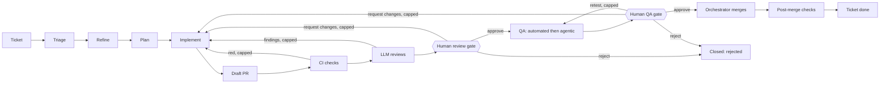
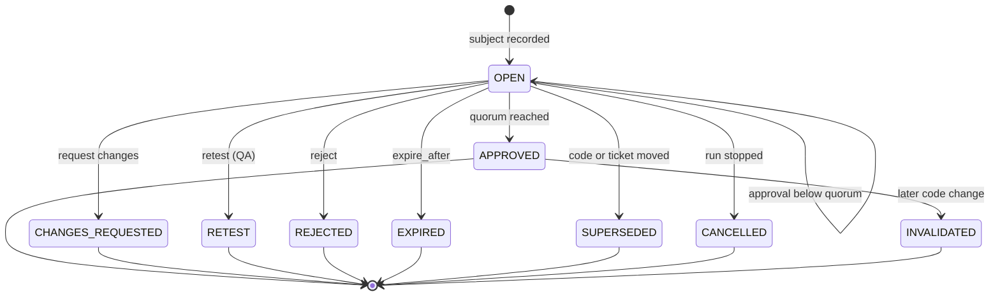
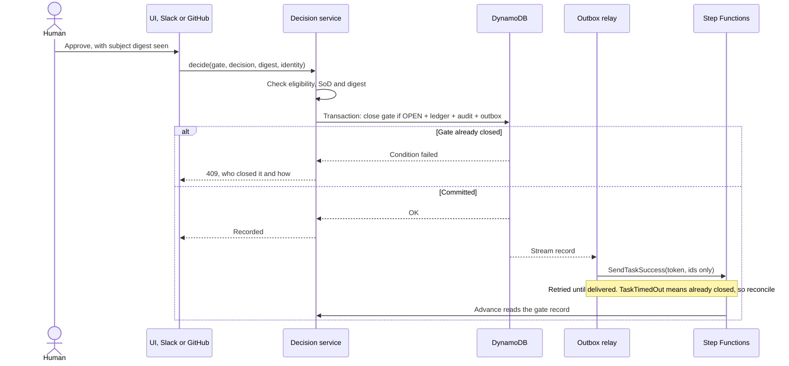
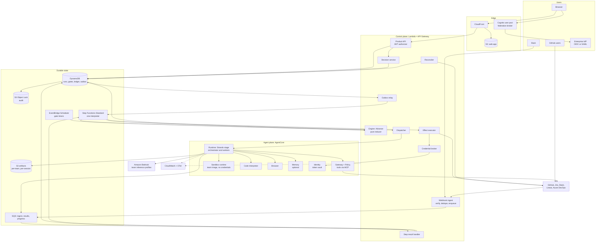
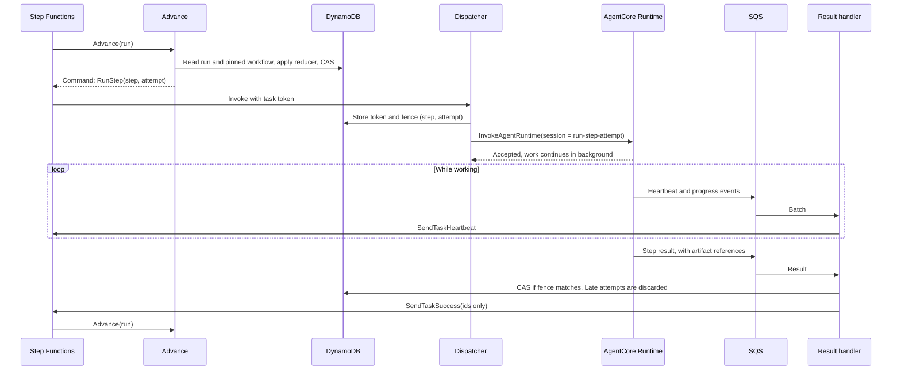
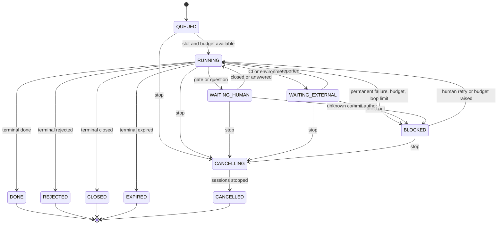
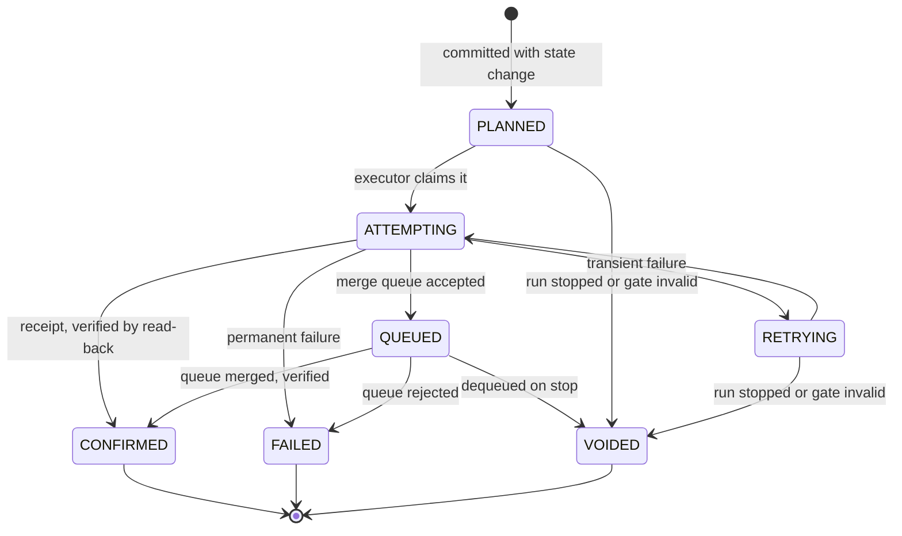
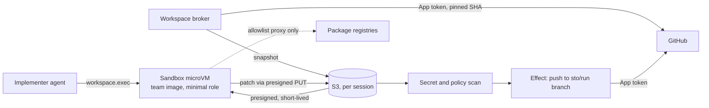

# SWE Ticket Orchestrator: plan

A reusable platform that takes a software ticket through a team's own delivery workflow, using Strands
agents on Amazon Bedrock AgentCore, with two mandatory human gates: one at review, after the LLM
reviews, and one at QA.

**Status:** plan only, with no product code. **Nothing has been deployed or run against Bedrock.**

Related documents:

- [STAGES.md](STAGES.md): delivery stages and issues
- [adr/](adr/README.md): one record per major decision
- [RESEARCH.md](RESEARCH.md): sources, verified facts and PoC lessons (`[S1]` and so on refer to it)

## 0. Open questions for Peter

Each has a default, and work proceeds on the default until you say otherwise. None of them blocks
D0 to D2.

| # | Question | Default we proceed on | What changes if you choose otherwise | Decide by |
|---|---|---|---|---|
| Q1 | **Who runs it?** One deployment per company, with many teams inside it, or a central multi-company SaaS? | One deployment per company, and any company can deploy its own from this public repo | SaaS needs a tenant boundary above teams, per-tenant KMS keys and IdPs, and billing. It adds about one delivery stage | D3 start |
| Q2 | **Can a team remove a human gate?** | No. Both gates are a platform floor. An org admin can add gates but not remove these two | If removal is allowed, the floor becomes an org setting, audited, and the validator proof applies only to remaining gates | D2-04 |
| Q3 | **Who is the first pilot team, and what is their stack?** | None assumed. The default sandbox image covers Python and Node | It sets the first sandbox image, the first real workflow config and the eval set | Before D14 |
| Q4 | **Which AWS Region and data-residency rule for the first deploy?** | Parameterised. Docs and examples use `us-east-1` with `us.` profiles | Sets model profile prefixes and IAM. Avoid In-Region profiles marked "limited model selection" [S30] | With credentials, D12 |

**Actions needed from you for D4, not questions:**

- Confirm the GitHub App manifest in a browser, once (D4-02).
- `bamseynet` is a **personal account, not an organization.** The throwaway repo can live there, but ruleset bypass
  lists need an organization-owned repo [S42]. If private repos on your plan lack draft PRs or branch protection,
  which D4-02 checks first, the live suite needs a paid plan or a free organization with a public throwaway repo.
- Live review tests need a **second GitHub user**, because the author cannot approve their own PR.

### Your decisions, now built in

| Topic | Decision | Where it lands |
|---|---|---|
| AWS | No account yet. Everything must be deployable with CDK and fully testable offline, with a staged first deploy blocked on credentials | [ADR-0019](adr/0019-offline-first-testing-and-live-milestone.md), D11, D12 |
| Integrations | GitHub, Jira and Slack are all first-class and fully built. GitHub is tested live on a throwaway repo. Jira and Slack are contract-tested against recorded and fake APIs until credentials arrive | [ADR-0009](adr/0009-integration-spi-webhooks-as-nudges.md), D4, D6, D7 |
| Auth | Enterprise SSO through OIDC and SAML federation, IdP-agnostic, with team and role mapping from IdP groups | [ADR-0008](adr/0008-sso-cognito-as-federation-broker.md), D3 |
| Autonomy | The orchestrator merges reviewed, green PRs itself | [ADR-0010](adr/0010-autonomous-merge-github-app.md), D4 |
| Budget | No ceiling. A full-featured product, with issues still one PR each | [STAGES.md](STAGES.md) |
| Build capacity | Up to 8 workers on one 7.4 GB laptop, so heavy verification is in GitHub Actions. Workers run targeted, hermetic tests | Section 15.1, D0-05, D0-08, D0-09 |

### Three interpretations you may want to check

1. **"Merges itself" does not replace the gates.** "Reviewed" means the human review gate approved
   that exact code. Under the default templates, the merge follows the QA gate with no further click.
   A team can move the merge to directly after the review gate and run QA on staging.
2. **"Nothing written before approval" is about visible, hard-to-undo writes.** A reviewer needs
   something to review, so a bot branch and a draft PR exist before the gate. Everything is classified:
   `scoped` effects may run before a gate if the workflow declares them, and `gated` effects may not
   (section 6.3).
3. **The orchestrator agent works inside a stage, not above the workflow.** A Strands orchestrator
   picks specialists and combines their work in each stage. Plain code decides stage transitions, so
   no prompt can talk its way past a gate ([ADR-0001](adr/0001-deterministic-engine-with-strands-stage-orchestrators.md)).

## 1. Goals and non-goals

### Goals

- **Goal 1, Reusable:** a new team onboards by writing configuration, never by forking code.
- **Goal 2, Fully functional:** a real ticket becomes a merged PR, through real GitHub, Jira and Slack
  integrations, with a full UI (section 17).
- **Goal 3, Trustworthy gates:** a human decision is bound to exact code, recorded atomically and audited.
  It cannot be bypassed, replayed or overridden by a model, a retry or a restart.
- **Goal 4, Bounded cost:** every run has budgets, can be cancelled, and can be stopped fleet-wide.
- **Goal 5, Durable:** a run survives waits of weeks, restarts and deployments, and a permanently failed
  run never re-spends by itself.
- **Goal 6, Observable:** every model call, tool call, decision and cost can be traced to its run.
- **Goal 7, Testable without AWS:** the whole product works and is tested offline.

### Non-goals

- Replacing the team's CI. It remains the authority on test results.
- Running production deployments directly. A `release` effect only triggers the team's own pipeline.
- Removing human judgement. A pass from an LLM reviewer means "ready for a person to read".
- Measuring agent quality before D12. Plumbing can be proved offline, but judgement needs real models.
- Hosting source code or a ticket system.
- Non-Bedrock model providers in the first release. The port permits them, but they are not built.

## 2. Personas

| Persona | Wants | Main surfaces | Can |
|---|---|---|---|
| **Developer** | Hand off a ticket and get a good PR | Ticket label or command, run timeline, PR | Start, retry, cancel their runs, answer clarifying questions |
| **Reviewer** | Judge a change fast, with evidence | Review gate page, Slack, GitHub | Approve, request changes, reject at review gates |
| **QA engineer** | Know what was tested and what was not | QA gate page, evidence viewer, Slack | Approve, request changes, retest, reject at QA gates, waive with reason if permitted |
| **Team admin** | Fit the workflow to the team | Workflow editor, dry-run, budgets, members, connections | Publish workflows, set team budgets, map groups to roles |
| **Org admin** (supporting) | Control floors, spend and risk | Org settings, kill switch | Set floors and org budgets, stop the fleet |
| **Auditor** (supporting) | Prove what happened | Audit explorer, exports | Read everything in scope, change nothing |

## 3. End-to-end flow



This is the default template. Teams change stages, order and tools through configuration
(section 7), within the floors in section 7.5.

## 4. The two gates

Both gates use one model: a **gate instance** is opened with a **subject**, collects **decisions**, and
closes exactly once.

**The subject** is what is being approved:

```text
subject = { head_sha, patch_id, evidence_digest, ticket_revision }
```

`patch_id` identifies the diff regardless of base. It is `git patch-id --verbatim` over a canonical diff against
the merge base, because the default mode ignores whitespace, so a re-indent that changes behaviour would keep the
same ID (checked locally on git). `evidence_digest` hashes the review or QA artifacts shown to the human.
An approval carries the subject digest the human saw, and the server refuses it if the subject has moved. A
negative decision is exempt from the digest match, so an edited ticket can never delay a veto.

### 4.1 Review gate

**Opens after:** CI is green and the required LLM reviewers have finished, or failed visibly.

**What the reviewer sees, top to bottom:**

1. **Banner:** ticket, requester, budget used, time waiting, round number ("round 2 of 3").
2. **Attention list:** problems first. Failed or skipped reviewers, `degraded` flags, findings at high
   severity or above, unverified acceptance criteria. If there are none, it says so.
3. **Acceptance criteria matrix:** each criterion with the code or tests said to satisfy it, and who
   claims so. LLM claims are labelled as claims.
4. **LLM findings:** merged by file and line, with severity, reviewer, disagreements between reviewers
   shown rather than resolved, and what the implementer did about each.
5. **Diff:** full diff, plus an **interdiff since the last round** on re-review.
6. **CI:** each check at this exact SHA, with links.
7. **Plan and rationale:** the approved plan, and where the implementation departed from it.
8. **Change since opened:** a warning if the ticket was edited (section 4.5).

Everything from the model or ticket is rendered as inert text, never as HTML.

**Decisions:**

| Decision | Needs | Effect | Re-entry |
|---|---|---|---|
| **Approve** | Optional comment | Gate closes `approved`, next stage runs | None |
| **Request changes** | **Required comment**, optional line comments | Gate closes `changes_requested`. Comment goes to the implementer as untrusted, framed text | Back to `implement` on the same branch, using one count of the `human_review` loop. Then CI, LLM reviews and a **new gate** with an interdiff |
| **Reject** | **Required reason** | Gate closes `rejected`. Run ends `REJECTED`. An unmerged draft PR is closed by a scoped `pr.close` effect, ticket commented if configured | None. A new attempt is a new run |

**Decision surfaces:** the UI always. Slack and GitHub PR review are configured per gate (section 10). All surfaces
call one decision function, so the rules cannot differ between them. Surfaces do differ in what they can show:

| Surface | Can do | Must send the person to the UI for |
|---|---|---|
| UI | Everything | Nothing |
| Slack | Approve, request changes, reject | Retest, waive, and any approval that needs an acknowledgement |
| GitHub review | Approve and request changes, on review-type gates only | The same. A GitHub review carries only a commit ID, so it binds `head_sha` but not evidence or ticket revision. A team opts in to this weaker binding, and org policy can forbid it (V10) |

**Quorum:** `approvals_required: N` means N distinct people, each eligible when the gate closes. Each person has one
vote per gate instance. A subject change drops earlier votes (section 4.5).

### 4.2 QA gate

**Opens after:** the automated QA suite has reported and the agentic QA stage has finished, or failed
visibly.

**What the QA engineer sees:**

1. **Banner** as above, plus environment name and URL, and the tested SHA.
2. **Attention list:** failed checks, QA agent failures, untested criteria, flaky retries, and anything
   the agent marked `inconclusive`.
3. **Test matrix:** each acceptance criterion against evidence. Each row is `verified by automation`,
   `observed by agent`, or **`not verified`**. An agent's observation is never shown as a pass from a
   test.
4. **Automated results:** suites, counts, failures, flakiness, comparison with the base branch.
5. **Agentic session:** step log, screenshots, browser recording where available, console and network
   errors, and exploratory notes.
6. **Review history:** who approved review, with the comment, and any changes since.

**Decisions:**

| Decision | Needs | Effect | Re-entry |
|---|---|---|---|
| **Approve** | Optional comment. Any `not verified` row must be acknowledged | Gate closes `approved`, next stage runs | None |
| **Request changes** | **Required defect list** | Gate closes `changes_requested` | Back to `implement`, using one count of `qa_fix`. Because the code changes, CI, LLM reviews, **the review gate** and QA all run again |
| **Retest** | Required reason | Gate closes `retest`. Same SHA | Back to the QA stages, using one count of `retest`, and a new gate |
| **Reject** | **Required reason** | Run ends `REJECTED`. If the code is already merged, as in the Kanban order, the workflow's edge opens a revert PR and alerts | None |
| **Waive** (optional) | `waive` permission, required reason per criterion | Approves with recorded waivers | None. Regulated template forbids it |

### 4.3 Integrity rules

These are the rules the PoC review bugs came from. Each has a named test in section 15.3.

1. **Gated effects need a live approval:** the effect executor requires a decision ID and re-reads
   gate, run and subject immediately before acting.
2. **Approve is exactly as strong as the code it saw:** a merge needs an approved gate instance whose `head_sha` is the
   SHA being merged. A new SHA therefore always passes through the gate stage again, where section 4.6 may close it
   without asking when the patch is unchanged.
3. **While a gate is open, any negative decision closes it, regardless of earlier approvals.** A quorum gate with one
   approval and then a reject closes as rejected. Order is decided by commit: if the deciding approval commits first,
   the gate is already closed, and rule 5 applies.
4. **A gate closes exactly once,** by a conditional write. A write conflict while the gate is still open is retried
   internally, and sub-quorum approvals all commit. Only a truly closed gate returns `409 gate_closed`, showing who
   closed it and how.
5. **After close, the way to stop is Stop.** "A later reject" on a closed gate is refused with a visible message and a
   Stop button, which anyone eligible for that gate can use. Stop beats any approved but unexecuted effect, because
   executors re-check run state. Merges wait `hold_after_approval` (default 10 minutes) so that this window is real.
6. **Decision, audit event and outbox entry commit in one transaction.** There is no window where a
   decision exists without its audit record, or the reverse.
7. **Decisions are never replayed from a framework.** The engine reads the gate record. Neither Strands
   nor Step Functions holds a decision as a saved value. A Step Functions callback is only a wake-up
   signal carrying IDs.
8. **Timeouts never approve.** The validator rejects any such configuration.
9. **Models cannot decide.** No agent, tool or Gateway target can reach the decision function or a
   task token.
10. **What the UI claims is what happened.** "Written", "Merged" and "Commented" appear only from a
    confirmed receipt (section 6.3).

### 4.4 Timeouts and escalation

Timers use business time from the team calendar and do nothing while the run is paused.

| Timer | Default | Action |
|---|---|---|
| `remind_after` | 1 business day | Notify eligible approvers |
| `escalate_after` | 2 business days | Notify `escalate_to` role. They can act if eligible, but are not auto-granted eligibility |
| `expire_after` | Unset, never expires | Gate closes `expired`, following the workflow's `expired` edge |

- Each timer is a one-shot schedule that re-reads the gate before acting, so a late timer is harmless.
- `expired` can only lead to a non-approving path. A run also has `max_run_age`, default 180 days,
  well inside the Step Functions 1 year cap.
- There is no reassign that bypasses eligibility: an admin may change who is eligible, audited, but
  cannot approve on behalf of someone.

### 4.5 Ticket and code changes during a run

These rules apply **at any stage**, not only while a gate is open. Reconciliation and webhooks feed them.

| Event | Behaviour |
|---|---|
| New commit on the branch not in the run's own push receipts | Any open gate `superseded`, active step stopped. Treated as a human commit of unknown author (section 9.4). The run returns to the workflow's `on_external_commit` stage, by default its CI stage, using the `external_commit` loop, default cap 3, then `BLOCKED` |
| Base branch moves | No change until merge. The merge guard handles it (section 6.4) |
| Ticket edited, gate open | Gate stays open, with a banner and a diff of the ticket. **Earlier votes are dropped**, because they saw another revision. Approving requires acknowledgement |
| Ticket edited, no gate open | The new revision is recorded, and the next gate shows the change |
| Ticket closed or deleted | Any open gate `superseded`, run `CANCELLED` with reason. If code is already merged, it ends `done_with_incident` |
| PR closed by a person | Any open gate `superseded`, run `CANCELLED` |
| PR merged, not by our App | Any open gate `superseded`, run `BLOCKED`, and an outside merge is flagged in audit. Our own merge is recognised from its receipt and merge author, so it never supersedes the Kanban QA gate |
| Workflow published | No effect. Runs stay on their pinned version (section 7.4) |
| Approver loses eligibility | A pending vote stops counting, because eligibility is re-checked when the gate closes. Decisions on already closed gates stand, and are audited |

**A gate's subject must be what was tested.** Review and QA evidence each record the SHA they ran on, and a gate cannot
open when they differ from `head_sha`. After a merge, later gated effects check against the subject frozen in the merge
receipt, so a ticket edit cannot strand a run after a successful merge.

### 4.6 Carry-over on unchanged code

When a gate stage is re-entered with `carry_over: patch_id`, it closes `approved` with no human action only if **all**
of these hold. Otherwise it opens normally.

1. An earlier instance of this gate closed `APPROVED`, with full quorum, and has not been invalidated. A partial set of
   votes on a superseded gate never carries.
2. Its `patch_id` equals the current one. A change of patch invalidates it permanently, so P1, P2 and back to P1 asks again.
3. Every approver it cites is still eligible, and separation of duties still holds against the current commits.
4. The ticket revision is unchanged.
5. The **attention digest** is unchanged: failed reviewers, findings at or above `block_on`, unverified criteria and red
   checks. Free-form LLM text is excluded, so re-running a reviewer does not by itself force a new decision, but a new
   problem does.

This handles a clean base update without a pointless re-approval. The new instance has the new SHA and cites the earlier
decision in audit. `carry_over: none` is the regulated default and forces a new decision. Carry-over never crosses a QA
retest.

For the same reason, stages avoid repeated work when the patch is unchanged: a `review_panel` and an `agent` QA stage reuse
results for the same `patch_id`, while `checks` stages always run at the new SHA.

### 4.7 State machine



### 4.8 Decision sequence



### 4.9 Audit

Every state change writes an append-only audit event, in the same transaction as the change:

- **Fields:** sequence, time, team, run, actor (verified identity and IdP subject, or a service
  identity), action, subject digest, surface (`ui`, `slack`, `github`), workflow version, previous hash
  and own hash.
- **Tamper evidence:** events are hash-chained per run. A stream copies them to S3 with Object Lock.
  DynamoDB deny policies block update and delete from application roles.
- **Export:** by team, run or period, with a verification tool that checks the chain.
- **Redaction:** tokens and secrets are removed before anything is stored. Comment text is kept.
- **Retention:** default 400 days, configurable upward. Object Lock mode is a deploy setting.

## 5. Architecture



### Layers, and the rule for each

| Layer | Holds | Rule |
|---|---|---|
| **Stage engine** | What happens next | Deterministic code. No LLM. Source of truth for transitions |
| **Gates and effects** | Human decisions and outside-world writes | Run only in the control plane, with credentials that agents cannot reach |
| **Stage orchestrators** | How one stage's work gets done | Strands agents, chosen workers, bounded by budgets and a tool allowlist. Disposable |
| **Sandboxes** | Running repo and model-written code | No cloud or SCM credentials. Network restricted |

### One step, end to end



The task token never enters the microVM. A dead session stops its heartbeats, Step Functions raises
`States.Timeout` and the engine applies its retry rule.

## 6. Engine, runs and effects

### 6.1 Reducer

```text
next(run_state, event, workflow) -> (new_state, commands)
```

The reducer is pure, with no I/O, clock or randomness. Commands and state commit together, so a crash
can always resume from the last committed state. This is what makes the engine testable with
property tests, and lets one engine run under two drivers:

- `LocalDriver`: asyncio, used for `make dev` and tests.
- `StepFunctionsDriver`: one interpreter state machine for all teams. Workflows are data, so publishing
  one never touches AWS, which avoids the 1 per second `CreateStateMachine` limit.

**Events:** `StepSucceeded`, `StepFailed`, `GateClosed`, `EffectConfirmed`, `TimerFired`,
`CancelRequested`, `ExternalChanged` and so on.

**Commands:** `RunStep`, `OpenGate`, `RunEffect`, `AwaitChecks`, `Notify`, `Finish`.

### 6.2 Run lifecycle



**Failure rules (lesson: permanently failed tickets re-ran on restart):**

| Class | Examples | Behaviour |
|---|---|---|
| `transient` | Throttling, 5xx, lost session | Retried with backoff, up to the stage's `max_attempts` (default 2) |
| `permanent` | 401, 403, validation, refusal, budget | `BLOCKED` immediately. **No restart or redrive retries it.** A person clicks Retry, which is audited |
| `degraded` | One required reviewer failed | The gate opens with a clear flag, or the run blocks if `fail_closed: true` |

There is exactly one retry layer per external call: inner clients are set to `total_max_attempts=1`.

**A run that merged code and ends without a QA approval of it ends `done_with_incident`,** with an alert, whichever terminal
it reaches. `done_with_incident` is `DONE` with an incident flag.

### 6.3 Effects and the outbox

Every write to the outside world is an **effect** with its own record.



| Class | Rule | Examples |
|---|---|---|
| `internal` | Free | Artifacts, events |
| `scoped` | Only if the workflow declares it, only to bot-owned objects | Push to `sto/*` branch, update its base, open or close a draft PR, open a revert PR, publish a check run, progress comment on a ticket, gate notifications |
| `gated` | The class comes from the effect catalog, not config. Requires a non-empty `requires_gates`, and a valid approval for each. The executor re-checks immediately before acting | Mark PR ready, merge, ticket to Done, trigger release, external announcement |

**A refused gated effect** does not retry blindly. The effect is `VOIDED` with `gate_invalid`, and the engine returns the run to
the stage of the first gate whose approval no longer holds, so the path is still through a gate, capped by `max_steps_per_run`.

**Idempotency** uses a key from `(run, stage, visit number, effect type, subject digest)`, so a deliberate retry after a
`stale` result gets a new record:

- GitHub comments carry a hidden marker, and a lookup finds existing ones **only among comments
  written by our own bot identity**. This fixes the PoC finding that a public issue could plant a
  marker to suppress the real comment.
- GitHub merges use `sha`, and an already merged PR at that SHA counts as success.
- Jira comments and transitions read current state first. Transitions are by target status, and
  "already there" is success.
- Slack messages store `ts` and update in place.

**Truthfulness:** a receipt holds the external ID and URL, plus a read-back result. The UI's word
"Merged" means `CONFIRMED`. Simulated writes in local dev are labelled `simulated` everywhere.

### 6.4 Merge guard

The orchestrator merges with these checks, all re-read immediately before the call:

1. Run is active. Team and fleet merge switches are on. No freeze window applies. `hold_after_approval` has passed.
2. Every gate in `requires_gates` has an approved instance **whose `head_sha` is the current head**. The carry-over rules
   in section 4.6 are the only way a new SHA gets such an instance without a person.
3. Team-required checks are green at this exact SHA. A check that is merely pending means wait, not failure.
4. Separation of duties still holds, including any commit added since the gate opened.
5. PR is open, not draft (marked ready by a prior gated effect), and targets the expected base.
6. **Head contains the current base tip** (`require_up_to_date`, default on), so the tree being merged is the tree that was
   tested. `sha` only guards the head. Teams may turn this off and use a merge queue instead.
7. The merge call passes that approved SHA as `sha`. A 409 means the head moved, and a 405 means it cannot merge, and the reason decides the next step.
8. Read back that the PR is merged, and record the merge SHA and frozen subject.

| Result | Next |
|---|---|
| Merged | The `done` edge |
| Base moved, or head not up to date | `stale` edge to a `pr.update_branch` effect, which commits the base update, and then CI. Reviews and QA agents reuse results if the patch is unchanged, and carry-over decides whether a person is needed |
| Update or merge conflict | `conflict` edge to `implement`, using the `merge_conflict` loop, so gates apply again |
| Required check pending | Wait, with no loop used. A timeout takes the `stale` edge |
| Merge queue configured | Enqueue, wait for the queue outcome, read back. Requires `merge_group` on team CI [S43]. Stop dequeues it, checking the expected head. Enqueue through the API is unverified, and D4-12 settles it |
| Guard 2 or 4 fails | `gate_invalid`, per section 6.3 |
| Branch protection blocks the App | `BLOCKED`, with a message saying exactly which rule, and how to fix it |

**GitHub enforcement:** the App publishes `sto/review-gate` and `sto/qa-gate` check runs on `sto/*` heads, and a neutral result
on all other PRs, so human PRs, dependency PRs and revert PRs are not blocked. A team requires them, pinned to our App ID
[S41], so an out-of-band merge is blocked by GitHub itself. Each template documents which to require: a Kanban merge happens
before QA, so it requires only the review check. If a repo also requires a human GitHub review, use `decision_surfaces:
[github]`, so the reviewer's own GitHub review is the decision ([ADR-0010](adr/0010-autonomous-merge-github-app.md)).

## 7. Workflow configuration

### 7.1 Principles

- **Declarative YAML,** validated by a JSON Schema generated from typed models, then by semantic rules.
- **Layered:** platform floors, then org defaults, then a template, then team overlay. A lower layer
  cannot weaken a floor.
- **Versioned and immutable once published.** Every run pins one version, and a run in flight never
  changes.
- **Dry-runnable:** a team can simulate any workflow with the fake LLM before publishing.
- **Stored in the platform,** or synced from a repo path with GitOps, where a PR changes the workflow.

### 7.2 Schema

```yaml
apiVersion: sto/v1
kind: Workflow
metadata: { name: string, team: string, extends: optional template@version }

intake:                     # which tickets start a run
  source: github | jira | linear | azure_devops
  filter: string            # label or JQL or equivalent, adapter-specific
  sprint: { mode: any | active_only }          # optional
  wip_limit: integer        # optional, per-team running runs

repos: [ { url: string, base: string, sandbox_image: string } ]

calendar: { timezone: string, workdays: [mon..sun], hours: "09:00-17:30", holidays: ref }
sprint:   { cadence: 1w | 2w | 3w | 4w, anchor: date, merge_freeze_before_end: duration }

budgets:
  run_usd: number
  team_monthly_usd: number
  stage_usd: { <stage id>: number }

limits:
  loops: { <loop name>: integer }   # every cycle in the graph must name one
  max_steps_per_run: integer        # platform maximum 500
  max_run_age: duration             # platform maximum 300d

on_external_commit: <stage id>      # optional, defaults to the workflow's CI stage

definition_of_done:                 # machine-evaluated, stage exit conditions
  - { stage: <id>, check: ac_present | checks_green | coverage_at_least | no_findings_above | ... }

start: <stage id>
stages:
  - id: string
    kind: agent | review_panel | checks | gate | effect | wait | terminal
    # kind: agent
    agent: <agent profile>         # see section 8
    model_tier: fast | standard | deep    # optional override
    max_attempts: integer
    # kind: review_panel
    reviewers: [ <agent profile> ]
    required: [ <agent profile> ]
    fail_closed: boolean
    block_on: low | medium | high | critical
    # kind: checks
    source: ci | qa_suite | post_merge
    required: [ string ] | team_default
    timeout: duration
    # kind: gate
    gate:
      type: review | qa | custom
      eligible_roles: [ role ]
      approvals_required: integer
      decisions: [ approve, request_changes, reject, retest, waive ]
      decision_surfaces: [ ui, slack, github ]
      separation_of_duties: { not: [ author, requester, committer, approver_of: gate id ] }
      carry_over: patch_id | none
      timeouts: { remind_after: duration, escalate_after: duration,
                  escalate_to: role, expire_after: duration }
    # kind: effect
    effect: pr.open_draft | pr.close | pr.update_branch | pr.mark_ready | pr.merge | ticket.comment
            | ticket.transition | release.trigger | pr.open_revert | notify
    with: { ... }                   # effect parameters
    requires_gates: [ gate stage id ]
    # kind: wait
    wait_for: human_answer | environment_ready
    timeout: duration
    # kind: terminal
    result: done | rejected | closed | expired | done_with_incident
    # every kind but terminal
    next:
      <outcome>: <stage id>                   # or
      <outcome>: { to: <stage id>, loop: <loop name> }
```

The edge key is `next`, not `on`, because YAML 1.1 parsers such as PyYAML read a bare `on` as boolean true. The loader
also refuses duplicate keys, and YAML's other implicit booleans in keys.

**Outcomes by kind.** The validator requires an edge for each.

| Kind | Outcomes |
|---|---|
| `agent` | Declared by its profile, for example `triage`: `ready`, `needs_info`, `not_actionable` |
| `review_panel` | `clean`, `findings`, `degraded` |
| `checks` | `green`, `red` |
| `gate` | `approved`, `changes_requested`, `rejected`, plus `retest` if listed, plus `expired` if `expire_after` is set |
| `effect` | `done`. `pr.merge` adds `conflict` and `stale`, and `pr.update_branch` adds `conflict` |
| `wait` | `resumed`, `timeout` |

Engine-level failures (section 6.2) do not need edges, because they go to `BLOCKED`.

### 7.3 Validator rules

Each rule has a test, and every bundled template passes all of them in CI.

| Rule | Why |
|---|---|
| V1 All references resolve, all stages reachable, a terminal is reachable from every stage | No stuck runs |
| V2 Every outcome has an edge | No undefined behaviour |
| V3 **Every cycle contains an edge with a named `loop`,** and the limit is at most the platform cap | Review loops need caps, proved statically |
| V4 **Gate dominance:** every `gated` effect has a non-empty `requires_gates`. For each gate listed, remove its `approved` edge, and the effect must be unreachable from `start` | Nothing gated runs without approval, on every path |
| V5 **Freshness:** same removal, from every code-changing stage, the effect is unreachable. Code-changing is derived: a profile with `workspace.write`, `pr.update_branch`, and `on_external_commit`'s target | An approval cannot be reused past a code change on any path |
| V6 **Floors:** `pr.merge` requires a `review` gate. `release.trigger` and a `ticket.transition` to done require a `qa` gate. Terminal `done` is unreachable without a QA approval. After a merge's `done` edge, with QA gates removed and `wait` timeouts ignored, no `done` or `closed` terminal is reachable | The two mandatory gates, in either order |
| V7 Every gate has a human-only path: `eligible_roles` non-empty, `approvals_required` at least 1, no `auto_approve` key exists in the schema | Timeouts never approve |
| V8 `expired` and `rejected` edges cannot lead to a `gated` effect | Non-approval stays non-approval |
| V9 Budgets and limits within org ceilings. Models in the catalog. Tools in each profile's allowlist | Floors hold |
| V10 Decision surfaces permitted: regulated orgs may set `slack` off, `github` only on review-type gates, and org policy can forbid `waive` | Compliance |
| V11 **Review order:** with `review_panel` stages removed, no review-type gate is reachable from a code-changing stage | LLM reviews come before the human review, as Peter asked |

V4, V5 and V6 are the runtime-independent generalisation of the PoC's topology test. The checks on the examples below were run by a
scratch script for this PR, and become real code in D2-03 and D2-04.

### 7.4 Pinning and change

- Publishing creates version N+1. A run stores `workflow_version` and the exact config digest.
- Runs in flight stay on their version. Admins can migrate a run only if the target is valid at its
  current stage, and the migration is audited.
- Dry-run replays recent runs against a draft to show routing differences.

### 7.5 Platform floors

Teams cannot weaken these:

- A review gate and a QA gate exist on every path to `done` (Q2). LLM reviews precede the review gate.
- Merge requires a valid review approval for that code.
- Separation of duties has a minimum: an identity that authored commits in the PR cannot approve its
  review gate.
- Timeouts never approve. Every cycle is capped. Every run has a budget.
- Secret scanning cannot be turned off. Agents never hold SCM credentials.

### 7.6 Example: Scrum team, 2-week sprints

```yaml
apiVersion: sto/v1
kind: Workflow
metadata: { name: payments-scrum, team: payments }
intake:
  source: jira
  filter: 'project = PAY AND labels = agent-ready'
  sprint: { mode: active_only }
repos:
  - { url: https://github.com/example/payments, base: main, sandbox_image: sto/java21:1 }
calendar: { timezone: Europe/London, workdays: [mon, tue, wed, thu, fri], hours: "09:00-17:30" }
sprint: { cadence: 2w, anchor: 2026-11-02, merge_freeze_before_end: 1d }
budgets:
  run_usd: 40            # placeholder until D12 measures real costs
  team_monthly_usd: 3000
  stage_usd: { implement: 20, qa_agentic: 6 }
limits:
  loops: { info: 2, ci_fix: 3, llm_fix: 2, human_review: 3, qa_fix: 2, retest: 2, merge_conflict: 2, merge_stale: 3 }
  max_steps_per_run: 120
  max_run_age: 45d
definition_of_done:
  - { stage: refine, check: ac_present }
  - { stage: review_gate, check: checks_green }
  - { stage: review_gate, check: coverage_at_least, value: 80 }
start: triage
stages:
  - id: triage
    kind: agent
    agent: triage
    next: { ready: refine, needs_info: await_info, not_actionable: closed }
  - id: await_info
    kind: wait
    wait_for: human_answer
    timeout: 10d
    next: { resumed: { to: triage, loop: info }, timeout: closed }
  - id: refine
    kind: agent
    agent: refiner
    next: { ready: plan, needs_info: await_info }
  - id: plan
    kind: agent
    agent: planner
    model_tier: deep
    next: { ready: implement, needs_info: await_info }
  - id: implement
    kind: agent
    agent: implementer
    next: { ready: open_pr, blocked: await_info }
  - id: open_pr
    kind: effect
    effect: pr.open_draft
    next: { done: ci }
  - id: ci
    kind: checks
    source: ci
    required: team_default
    timeout: 2h
    next: { green: llm_review, red: { to: implement, loop: ci_fix } }
  - id: llm_review
    kind: review_panel
    reviewers: [correctness_reviewer, security_reviewer, test_reviewer]
    required: [correctness_reviewer, security_reviewer]
    block_on: high
    next: { clean: review_gate, findings: { to: implement, loop: llm_fix }, degraded: review_gate }
  - id: review_gate
    kind: gate
    gate:
      type: review
      eligible_roles: [reviewer]
      approvals_required: 1
      decisions: [approve, request_changes, reject]
      decision_surfaces: [ui, slack]
      separation_of_duties: { not: [committer] }
      carry_over: patch_id
      timeouts: { remind_after: 1d, escalate_after: 2d, escalate_to: team_admin }
    next:
      approved: qa_auto
      changes_requested: { to: implement, loop: human_review }
      rejected: closed_rejected
  - id: qa_auto
    kind: checks
    source: qa_suite
    required: [integration, e2e]
    timeout: 3h
    next: { green: qa_agentic, red: { to: implement, loop: qa_fix } }
  - id: qa_agentic
    kind: agent
    agent: qa_agent
    next: { pass: qa_gate, fail: qa_gate, inconclusive: qa_gate }
  - id: qa_gate
    kind: gate
    gate:
      type: qa
      eligible_roles: [qa]
      approvals_required: 1
      decisions: [approve, request_changes, retest, reject]
      decision_surfaces: [ui, slack]
      separation_of_duties: { not: [committer] }
      carry_over: patch_id
      timeouts: { remind_after: 1d, escalate_after: 2d, escalate_to: team_admin }
    next:
      approved: mark_ready
      changes_requested: { to: implement, loop: qa_fix }
      retest: { to: qa_auto, loop: retest }
      rejected: closed_rejected
  - id: mark_ready
    kind: effect
    effect: pr.mark_ready
    requires_gates: [review_gate, qa_gate]
    next: { done: merge }
  - id: merge
    kind: effect
    effect: pr.merge
    with: { method: squash }
    requires_gates: [review_gate, qa_gate]
    next: { done: post_merge, conflict: { to: implement, loop: merge_conflict }, stale: { to: update_branch, loop: merge_stale } }
  - id: update_branch
    kind: effect
    effect: pr.update_branch
    next: { done: ci, conflict: { to: implement, loop: merge_conflict } }
  - id: post_merge
    kind: checks
    source: post_merge
    required: team_default
    timeout: 1h
    next: { green: ticket_done, red: revert_pr }
  - id: ticket_done
    kind: effect
    effect: ticket.transition
    with: { to_status_category: done }
    requires_gates: [review_gate, qa_gate]
    next: { done: done }
  - id: revert_pr
    kind: effect
    effect: pr.open_revert
    next: { done: incident }
  - { id: done, kind: terminal, result: done }
  - { id: incident, kind: terminal, result: done_with_incident }
  - { id: closed, kind: terminal, result: closed }
  - { id: closed_rejected, kind: terminal, result: rejected }
```

Sprint behaviour: only tickets in the active sprint start. Merge pauses before sprint end, holding the
run in `WAITING_EXTERNAL`. Sprint reports appear on the Insights page.

Merging after QA means any other merge to `main` moves the base. So both gates use `carry_over: patch_id`: on a clean update, CI and
the QA suite run again at the new SHA, reviews and QA agents reuse their results, and no person is asked unless something changed.

### 7.7 Example: Kanban team, trunk-based, QA on staging after merge

```yaml
apiVersion: sto/v1
kind: Workflow
metadata: { name: platform-kanban, team: platform }
intake:
  source: github
  filter: 'label:agent-ready'
  wip_limit: 5
repos:
  - { url: https://github.com/example/platform, base: main, sandbox_image: sto/go1:1 }
calendar: { timezone: America/New_York, workdays: [mon, tue, wed, thu, fri], hours: "08:00-18:00" }
budgets: { run_usd: 25, team_monthly_usd: 2000, stage_usd: { implement: 15 } }
limits:
  loops: { ci_fix: 3, llm_fix: 2, human_review: 3, qa_fix: 2, retest: 2, merge_conflict: 2, merge_stale: 3, info: 2 }
  max_steps_per_run: 100
  max_run_age: 30d
start: triage
stages:
  - id: triage
    kind: agent
    agent: triage
    model_tier: fast
    next: { ready: implement, needs_info: await_info, not_actionable: closed }
  - id: await_info
    kind: wait
    wait_for: human_answer
    timeout: 7d
    next: { resumed: { to: triage, loop: info }, timeout: closed }
  - id: implement
    kind: agent
    agent: implementer
    next: { ready: open_pr, blocked: await_implementer }
  - id: await_implementer
    kind: wait
    wait_for: human_answer
    timeout: 7d
    next: { resumed: { to: implement, loop: info }, timeout: closed }
  - id: open_pr
    kind: effect
    effect: pr.open_draft
    next: { done: ci }
  - id: ci
    kind: checks
    source: ci
    required: team_default
    timeout: 45m
    next: { green: llm_review, red: { to: implement, loop: ci_fix } }
  - id: llm_review
    kind: review_panel
    reviewers: [correctness_reviewer, security_reviewer]
    required: [correctness_reviewer]
    block_on: high
    next: { clean: review_gate, findings: { to: implement, loop: llm_fix }, degraded: review_gate }
  - id: review_gate
    kind: gate
    gate:
      type: review
      eligible_roles: [reviewer]
      approvals_required: 1
      decisions: [approve, request_changes, reject]
      decision_surfaces: [ui, slack, github]
      separation_of_duties: { not: [committer] }
      carry_over: patch_id
      timeouts: { remind_after: 4h, escalate_after: 1d, escalate_to: team_admin }
    next:
      approved: mark_ready
      changes_requested: { to: implement, loop: human_review }
      rejected: closed_rejected
  - id: mark_ready
    kind: effect
    effect: pr.mark_ready
    requires_gates: [review_gate]
    next: { done: merge }
  - id: merge
    kind: effect
    effect: pr.merge
    with: { method: squash }
    requires_gates: [review_gate]
    next: { done: qa_auto, conflict: { to: implement, loop: merge_conflict }, stale: { to: update_branch, loop: merge_stale } }
  - id: update_branch
    kind: effect
    effect: pr.update_branch
    next: { done: ci, conflict: { to: implement, loop: merge_conflict } }
  - id: qa_auto
    kind: checks
    source: qa_suite
    required: [staging-smoke]
    timeout: 1h
    next: { green: qa_agentic, red: { to: implement, loop: qa_fix } }
  - id: qa_agentic
    kind: agent
    agent: qa_agent
    next: { pass: qa_gate, fail: qa_gate, inconclusive: qa_gate }
  - id: qa_gate
    kind: gate
    gate:
      type: qa
      eligible_roles: [qa, reviewer]
      approvals_required: 1
      decisions: [approve, request_changes, retest, reject]
      decision_surfaces: [ui, slack]
      separation_of_duties: { not: [committer] }
      carry_over: none
      timeouts: { remind_after: 4h, escalate_after: 1d, escalate_to: team_admin }
    next:
      approved: release
      changes_requested: { to: implement, loop: qa_fix }
      retest: { to: qa_auto, loop: retest }
      rejected: revert_pr
  - id: revert_pr
    kind: effect
    effect: pr.open_revert
    next: { done: incident }
  - id: release
    kind: effect
    effect: release.trigger
    with: { workflow: deploy-prod.yml, sha_input: release_sha }
    requires_gates: [qa_gate]
    next: { done: ticket_done }
  - id: ticket_done
    kind: effect
    effect: ticket.transition
    with: { to_status_category: done }
    requires_gates: [qa_gate]
    next: { done: done }
  - { id: done, kind: terminal, result: done }
  - { id: incident, kind: terminal, result: done_with_incident }
  - { id: closed, kind: terminal, result: closed }
  - { id: closed_rejected, kind: terminal, result: rejected }
```

Notes on merging before QA:

- Request changes after a merge means fixing forward. `implement` works on a new branch, `sto/<run>/<n>`, cut from the new `main`,
  and opens a follow-up PR. A QA rejection opens a revert PR and alerts, because the code is already on `main`. Teams that
  cannot accept that use the Scrum order.
- QA tests a staging environment that contains the merge SHA, even if later merges have landed since.
- Release passes the approved merge SHA as a workflow input, so production gets what QA saw, not whatever `main` holds by then.
  The team's deploy workflow must accept that input, and the effect reads back the triggered run.
- Branch protection requires only `sto/review-gate`, since the QA check cannot pass before this merge.

### 7.8 Example: regulated team with extra gates

```yaml
apiVersion: sto/v1
kind: Workflow
metadata: { name: ledger-regulated, team: ledger }
intake:
  source: jira
  filter: 'project = LED AND labels = agent-ready AND "Risk" is not EMPTY'
repos:
  - { url: https://github.com/example/ledger, base: main, sandbox_image: sto/java21:1 }
calendar: { timezone: Europe/London, workdays: [mon, tue, wed, thu, fri], hours: "09:00-17:00" }
sprint: { cadence: 3w, anchor: 2026-11-02, merge_freeze_before_end: 2d }
budgets: { run_usd: 80, team_monthly_usd: 5000, stage_usd: { implement: 30, llm_review: 15 } }
limits:
  loops: { info: 2, ci_fix: 2, llm_fix: 2, human_review: 2, security_fix: 2, qa_fix: 2, retest: 1, change_fix: 1, merge_conflict: 1, merge_stale: 2 }
  max_steps_per_run: 150
  max_run_age: 90d
definition_of_done:
  - { stage: refine, check: ac_present }
  - { stage: review_gate, check: checks_green }
  - { stage: review_gate, check: no_findings_above, value: low }
start: triage
stages:
  - id: triage
    kind: agent
    agent: triage
    next: { ready: refine, needs_info: await_info, not_actionable: closed }
  - id: await_info
    kind: wait
    wait_for: human_answer
    timeout: 15d
    next: { resumed: { to: triage, loop: info }, timeout: closed }
  - id: refine
    kind: agent
    agent: refiner
    next: { ready: plan, needs_info: await_info }
  - id: plan
    kind: agent
    agent: planner
    model_tier: deep
    next: { ready: implement, needs_info: await_info }
  - id: implement
    kind: agent
    agent: implementer
    next: { ready: open_pr, blocked: await_info }
  - id: open_pr
    kind: effect
    effect: pr.open_draft
    next: { done: ci }
  - id: ci
    kind: checks
    source: ci
    required: team_default
    timeout: 3h
    next: { green: llm_review, red: { to: implement, loop: ci_fix } }
  - id: llm_review
    kind: review_panel
    reviewers: [correctness_reviewer, security_reviewer, test_reviewer, compliance_reviewer]
    required: [correctness_reviewer, security_reviewer, test_reviewer, compliance_reviewer]
    fail_closed: true
    block_on: medium
    next: { clean: review_gate, findings: { to: implement, loop: llm_fix }, degraded: review_gate }
  - id: review_gate
    kind: gate
    gate:
      type: review
      eligible_roles: [reviewer]
      approvals_required: 2
      decisions: [approve, request_changes, reject]
      decision_surfaces: [ui]
      separation_of_duties: { not: [author, requester, committer] }
      carry_over: none
      timeouts: { remind_after: 1d, escalate_after: 3d, escalate_to: team_admin, expire_after: 20d }
    next:
      approved: security_gate
      changes_requested: { to: implement, loop: human_review }
      rejected: closed_rejected
      expired: closed_expired
  - id: security_gate
    kind: gate
    gate:
      type: custom
      eligible_roles: [security_officer]
      approvals_required: 1
      decisions: [approve, request_changes, reject]
      decision_surfaces: [ui]
      separation_of_duties: { not: [author, requester, committer, { approver_of: review_gate }] }
      carry_over: none
      timeouts: { remind_after: 2d, escalate_after: 4d, escalate_to: org_admin, expire_after: 20d }
    next:
      approved: qa_auto
      changes_requested: { to: implement, loop: security_fix }
      rejected: closed_rejected
      expired: closed_expired
  - id: qa_auto
    kind: checks
    source: qa_suite
    required: [integration, e2e, performance]
    timeout: 6h
    next: { green: qa_agentic, red: { to: implement, loop: qa_fix } }
  - id: qa_agentic
    kind: agent
    agent: qa_agent
    next: { pass: qa_gate, fail: qa_gate, inconclusive: qa_gate }
  - id: qa_gate
    kind: gate
    gate:
      type: qa
      eligible_roles: [qa]
      approvals_required: 1
      decisions: [approve, request_changes, retest, reject]
      decision_surfaces: [ui]
      separation_of_duties: { not: [author, requester, committer, { approver_of: review_gate }, { approver_of: security_gate }] }
      carry_over: none
      timeouts: { remind_after: 1d, escalate_after: 3d, escalate_to: team_admin, expire_after: 20d }
    next:
      approved: change_gate
      changes_requested: { to: implement, loop: qa_fix }
      retest: { to: qa_auto, loop: retest }
      rejected: closed_rejected
      expired: closed_expired
  - id: change_gate
    kind: gate
    gate:
      type: custom
      eligible_roles: [change_manager]
      approvals_required: 1
      decisions: [approve, request_changes, reject]
      decision_surfaces: [ui]
      separation_of_duties: { not: [author, requester, committer] }
      carry_over: none
      timeouts: { remind_after: 1d, escalate_after: 2d, escalate_to: org_admin, expire_after: 15d }
    next:
      approved: mark_ready
      changes_requested: { to: implement, loop: change_fix }
      rejected: closed_rejected
      expired: closed_expired
  - id: mark_ready
    kind: effect
    effect: pr.mark_ready
    requires_gates: [review_gate, security_gate, qa_gate, change_gate]
    next: { done: merge }
  - id: merge
    kind: effect
    effect: pr.merge
    with: { method: merge }
    requires_gates: [review_gate, security_gate, qa_gate, change_gate]
    next: { done: post_merge, conflict: { to: implement, loop: merge_conflict }, stale: { to: update_branch, loop: merge_stale } }
  - id: update_branch
    kind: effect
    effect: pr.update_branch
    next: { done: ci, conflict: { to: implement, loop: merge_conflict } }
  - id: post_merge
    kind: checks
    source: post_merge
    required: team_default
    timeout: 2h
    next: { green: evidence, red: revert_pr }
  - id: evidence
    kind: effect
    effect: ticket.comment
    with: { template: evidence_pack_link }
    next: { done: ticket_done }
  - id: ticket_done
    kind: effect
    effect: ticket.transition
    with: { to_status_category: done }
    requires_gates: [review_gate, security_gate, qa_gate, change_gate]
    next: { done: done }
  - id: revert_pr
    kind: effect
    effect: pr.open_revert
    next: { done: incident }
  - { id: done, kind: terminal, result: done }
  - { id: incident, kind: terminal, result: done_with_incident }
  - { id: closed, kind: terminal, result: closed }
  - { id: closed_rejected, kind: terminal, result: rejected }
  - { id: closed_expired, kind: terminal, result: expired }
```

Notes: `merge_stale` updates the branch and returns to CI and, with `carry_over: none`, every human gate is asked again.
Org policy for this team also forbids `waive` and Slack decisions, and enables the evidence pack
(section 13.4).

## 8. Agents and tool permissions

### 8.1 How a stage runs

Each `agent` stage runs one **stage orchestrator**: a Strands `Agent` whose tools are its workers
(`Agent.as_tool`), using `ConcurrentToolExecutor`. It decides at run time which workers to call and
returns a **structured result** with one outcome from the profile's declared list. Code validates that
outcome. Anything else fails the step.

Rules carried from the PoCs:

- Opus 5.5 and Sonnet 5.5 cannot be forced to call a tool (`tool_choice` is `auto` or `none` only [S26],
  [S27]), so outcomes use native structured output, with one retry.
- Plans and other things that must arrive are tool calls, because text between tool calls can be hidden
  in thinking blocks on Opus.
- A worker's finish is read from its own stream, and refusals are checked by stop reason.
- `max_tokens` as a stop reason is a **failure**, never a usable result (lesson: a truncated draft went
  undetected).
- Code computes `degraded` from the run record: a worker failed, a required worker was never called, a
  synthesis credits a worker that never ran. The LLM does not mark its own homework.
- Reviewers run in **fresh sessions**, seeing the diff, plan and acceptance criteria but not the
  implementer's reasoning.
- No-progress detection: if a loop round produces the same `patch_id` or the same findings, the run
  blocks rather than spending another round.

### 8.2 Model tiers

Model IDs live in a catalog, not code. Defaults use US profiles, and a deployment swaps the prefix.

| Tier | Default profile | Used for |
|---|---|---|
| `fast` | `us.anthropic.claude-haiku-5-5` | Triage, summaries, notification drafts |
| `standard` | `us.anthropic.claude-sonnet-5-5` | Implementer workers, QA agent, test reviewer |
| `deep` | `us.anthropic.claude-opus-5-5` | Stage orchestrators, planner, correctness and security reviewers |

IDs are checked against the model cards in [RESEARCH.md](RESEARCH.md) section 3, and proved live in
D12. At deploy, each team gets an application inference profile per tier, tagged for cost allocation.

### 8.3 Roster and permissions

All tools come through the tool broker: Gateway in AWS, an in-process registry locally. Every stage's
allowlist is enforced **twice**: when the agent is built, and by Cedar policy at the Gateway. No agent
has a write tool to GitHub, Jira or Slack. Writes are engine effects.

| Stage | Orchestrator | Workers | Tools | Sandbox |
|---|---|---|---|---|
| `triage` | Triage (fast) | None | `ticket.read`, `ticket.search_similar`, `repo.tree`, `memory.read` | None |
| `refine` | Refiner (standard) | `ac_writer`, `ambiguity_finder` | Above, plus `repo.read_file`, `repo.search`, `ask_human` | None |
| `plan` | Planner (deep) | `code_explorer`, `risk_assessor` | Refine tools, plus `repo.log`, `repo.blame`, `record_plan` | Read-only |
| `implement` | Implementer (deep) | `coder` (standard), `test_writer` (standard), `fixer` (standard) | Plan tools, plus `workspace.read`, `workspace.write`, `workspace.exec`, `workspace.diff`, `ask_human` | **Read-write**, restricted egress |
| `llm_review` | Panel of independent reviewers | `correctness_reviewer` (deep), `security_reviewer` (deep), `test_reviewer` (standard), `compliance_reviewer` (deep) | `repo.read_file` at the PR SHA, `repo.search`, `pr.diff`, `checks.read`, `record_finding` | Read-only, optional |
| `qa_agentic` | QA agent (standard) | `test_planner`, `explorer`, `verifier` | `browser.*` (allowlisted hosts), `code_interpreter.run`, `env.info`, `record_evidence`, `pr.diff` | Code Interpreter and Browser |
| Summaries | Notifier (fast) | None | None. Input only | None |

**Never available to any agent:** gate decisions, task tokens, merge, ticket transitions, credentials,
config writes, other runs' data.

**Teams extend** with their own MCP tools registered as Gateway targets, per-team and read-only by
default. A team tool with write access requires an org admin and an in-stage approval (section 8.5).

### 8.4 Workspaces and private repos

Lesson: the PoCs only had a shallow, unauthenticated, drifting clone.



- Private repos work because a **broker** in the control plane mints a narrowly scoped GitHub App
  token, one repo and one hour at most [S37], and fetches a snapshot at a pinned SHA.
- **The sandbox never holds an SCM or cloud credential.** The model cannot exfiltrate a token that is
  not there.
- The agent returns a patch. The control plane scans it, checks path policy and size, and commits to a
  `sto/<run>` branch, or `sto/<run>/<n>` for a follow-up. Force-push and other branches are impossible, because the executor
  does not offer them. A patch touching `.github/workflows` is refused by default path policy.
- Agents read history through `repo.log` and `repo.blame`, so a full clone is unnecessary.
- Workspace state lives on the branch and in S3, so losing a session loses nothing. Session storage
  (preview) is not required.

Provider port, with three implementations ([ADR-0012](adr/0012-sandboxed-workspaces-and-repo-access.md)):

| Provider | Where | Used for |
|---|---|---|
| `local_docker` | Local machine, container with no network | Dev and tests |
| `agentcore_sandbox` | Second AgentCore Runtime, team image up to 2 GB, `InvokeAgentRuntimeCommand` | Default in AWS |
| `code_interpreter` | AgentCore Code Interpreter | QA scripts. Python, JS and TS only, so not a general build environment |

### 8.5 In-stage interrupts

Strands interrupts handle pauses **inside** a stage, not the two gates:

- `ask_human`: the agent has a question. A `BeforeToolCallEvent` hook raises an interrupt, the harness
  saves the session to S3 under the run's own prefix, using `SnapshotSessionManager` if it fits, as the docs recommend for new
  single-agent sessions, or else `S3SessionManager` (D5-14 decides), and the step ends `needs_info`. The engine's
  `wait` stage handles the human wait. On answer, a new session resumes with an `interruptResponse`.
- High-risk team tools: a hook interrupts before the call, and a team member approves that one call.

The docs warn that session state is trusted input [S5], so sessions load only from our own bucket
prefix, never from a repo, and only the orchestrator agent has a session manager, because managers are
not thread-safe and take no lock [S6].

### 8.6 Memory

AgentCore Memory is **optional** and holds team knowledge such as repo conventions and review
preferences, in a team namespace. It is never a source of truth. To resist poisoning, it is written only
from content a human approved at a gate, and read as untrusted framed text.

## 9. Multi-tenancy and access control

### 9.1 Tenancy

- **Unit:** one deployment holds one org with many teams (Q1). All tables and prefixes are keyed by
  team. All data access goes through repository functions taking a verified `TeamScope`, and a test
  fails if a query lacks one.
- **Agent isolation:** one microVM per session [S15], session credentials restricted to that session's
  S3 prefix through session context keys [S8], [S15], and one inference profile per team and tier.
- **Noisy neighbours:** team concurrency and budget caps, plus Gateway rate limits per team [S8].
- **Connections** to GitHub, Jira and Slack are per team, and one team can never use another's.

### 9.2 Identity

SSO through OIDC or SAML, brokered by a Cognito user pool
([ADR-0008](adr/0008-sso-cognito-as-federation-broker.md)):

- The API trusts **an issuer plus a JWKS,** not Cognito specifically, so another broker can replace it.
- **Group mapping** is data held by the platform: `(idp, group) -> (team, role)`. Authorization happens
  server-side on every request against current mappings.
- **Freshness:** access tokens last 15 minutes and refresh tokens 8 hours by default. A token refresh may not re-query a
  federated IdP (unverified until D12-10), so assume a removed person keeps their group claim for up to the session life. Gate
  decisions therefore also require a recent `auth_time`, and an admin can disable a user with immediate effect, which the API
  checks on every request.
- **Linking:** Slack and GitHub accounts are linked to an SSO identity by the user, through a signed
  flow while signed in. An unlinked account can never decide a gate. Matching on email alone is not
  accepted.
- **Service identities** are distinct and can never be eligible for a gate.

### 9.3 Roles

| Permission | developer | reviewer | qa | team_admin | org_admin | auditor |
|---|---|---|---|---|---|---|
| View team runs | Yes | Yes | Yes | Yes | Yes | Yes |
| Start, answer, cancel own run | Yes | Yes | Yes | Yes | Yes | No |
| Cancel any team run | No | No | No | Yes | Yes | No |
| Stop a run while eligible for its open or just-approved gate | No | Yes | Yes | Yes | Yes | No |
| Decide a gate | The role must be in that gate's `eligible_roles`, which is the only authority. Templates default to `reviewer` for review gates and `qa` for QA gates | | | | | |
| Publish workflow, map team groups, set team budget | No | No | No | Yes | Yes | No |
| Retry a blocked run, raise run budget | Own | Own | Own | Yes | Yes | No |
| Set floors, org budgets, kill switch | No | No | No | No | Yes | No |
| Read audit, export | No | No | No | Team | Org | Scope |

- Admins do not approve by default. Being admin is not eligibility, so admin rights alone cannot pass
  a gate. An admin who also holds `reviewer` can, subject to separation of duties.
- `security_officer`, `change_manager` and other custom gate roles are declared per team, and mapped
  from groups.

### 9.4 Who can approve, and separation of duties

A decision is accepted only if **all** hold, checked server-side at decision time:

1. A linked, currently authenticated human, with a role in `eligible_roles` for this team.
2. The surface is listed in `decision_surfaces`.
3. For an approval, the subject digest matches.
4. Not excluded by `separation_of_duties`:

| Term | Means |
|---|---|
| `committer` | Any linked human who authored or pushed any commit in the PR. **Always applied: this is the floor** |
| `author` | The person the ticket says owns the change (assignee), or who wrote its plan by hand |
| `requester` | The person who started the run |
| `approver_of: <gate>` | Anyone who approved that gate in this run |

**Commit metadata can be forged,** because git author fields are free text, so identity rests on the run's own records:

- A commit in the run's **push receipts** was made by the platform, and has no human author.
- **Any other commit is human and unattributed.** The gate blocks until a team admin attributes it, which is audited. GitHub's
  linked account for the commit is offered as a suggestion, and email alone is never accepted. Trailers such as
  `Co-authored-by` only add exclusions, and an admin can clear a false one, so naming a reviewer as co-author cannot silently
  exclude them for good.
- Pusher data from a webhook adds exclusions when it arrives, but nothing depends on it, because webhooks can be missed.
- Setup docs require a ruleset restricting `sto/*` pushes to the App, and the connection test reports if that is absent.

The default keeps requesters eligible at review, because in a small team the requester usually wrote only the ticket and the agent
wrote the code. The regulated template excludes them.

A team where no eligible approver remains gets an immediate, explicit warning, rather than a silent
wait.

## 10. Integrations

### 10.1 SPI

Adapters implement narrow ports, and a capability declaration says what each supports. The engine
never imports a vendor.

```python
class TicketSource(Protocol):
    capabilities: TicketCapabilities
    def get(self, ref: TicketRef) -> Ticket: ...
    def search(self, query: IntakeQuery, cursor: str | None) -> Page[TicketSummary]: ...
    def parse_event(self, raw: RawWebhook) -> list[ExternalChange]: ...  # verified before this call
    def comment(self, ref: TicketRef, body: str, key: IdempotencyKey) -> Receipt: ...
    def transition(self, ref: TicketRef, to: StatusIntent, key: IdempotencyKey) -> Receipt: ...
    def current_sprint(self, board: BoardRef) -> Sprint | None: ...

class ScmProvider(Protocol):
    capabilities: ScmCapabilities
    def snapshot(self, repo: RepoRef, sha: str) -> SnapshotLocation: ...
    def push_patch(self, repo: RepoRef, branch: str, patch: PatchRef, key: IdempotencyKey) -> Receipt: ...
    def open_draft_pr(self, spec: PrSpec, key: IdempotencyKey) -> Receipt: ...
    def mark_ready(self, pr: PrRef, key: IdempotencyKey) -> Receipt: ...
    def close_pr(self, pr: PrRef, key: IdempotencyKey) -> Receipt: ...
    def update_branch(self, pr: PrRef, key: IdempotencyKey) -> UpdateResult: ...
    def trigger_release(self, repo: RepoRef, spec: ReleaseSpec, key: IdempotencyKey) -> Receipt: ...
    def checks(self, repo: RepoRef, sha: str) -> list[CheckResult]: ...
    def publish_check(self, spec: CheckSpec, key: IdempotencyKey) -> Receipt: ...
    def merge(self, pr: PrRef, expected_sha: str, method: MergeMethod, key: IdempotencyKey) -> MergeResult: ...
    def parse_event(self, raw: RawWebhook) -> list[ExternalChange]: ...

class Notifier(Protocol):
    capabilities: NotifierCapabilities
    def send(self, message: GateMessage, key: IdempotencyKey) -> Receipt: ...
    def update(self, receipt: Receipt, message: GateMessage) -> Receipt: ...
    def parse_action(self, raw: RawWebhook) -> DecisionRequest | None: ...

class WebhookVerifier(Protocol):
    def verify(self, headers: Mapping[str, str], raw_body: bytes) -> VerifiedDelivery: ...
```

**Webhooks are nudges, not facts.** A verified delivery says that something changed. The adapter then
re-reads current state. This handles Jira's lack of ordering guarantees [S45], missed GitHub deliveries
[S40] and tampered bodies in one design. A **reconciler** also sweeps open runs on a schedule, so a
missed webhook only adds delay.

### 10.2 Conformance

A new adapter passes a shared **contract test suite** against a recorded or fake API
([ADR-0009](adr/0009-integration-spi-webhooks-as-nudges.md)):

- Fake server implements each vendor's documented behaviour, including signatures, pagination, rate
  limits and errors. When real credentials exist, the same tests run against the real API, and any
  difference is a bug in the fake.
- Each adapter proves: signature rejection, duplicate delivery, out-of-order delivery, idempotent
  writes after a crash at each step, rate-limit backoff, auth failure as `permanent`.

### 10.3 GitHub

- **GitHub App,** because only Apps can write check runs [S36]. A KMS-held key signs the App JWT, and
  the broker mints tokens per repo, per need, for up to one hour [S37].
- **Permissions:** contents, pull requests, checks, issues and metadata for writing. Also actions and deployments for QA and
  release, statuses read for CI that reports commit statuses, and administration read to explain protection failures. Not
  `workflows`. D4-02 records the reason for each, and these come from our knowledge of GitHub Apps, so D4-15 proves them live.
  Webhooks for issues, comments, PRs, reviews, pushes, check suites and runs, merge groups, installations.
- **Intake:** issues by label, command comments such as `/sto run`. Commands are accepted only from
  users with a linked identity and role.
- **Gate surface:** PR review events map to decisions when `github` is permitted. A review on an old
  commit is refused as stale.
- **Limits:** webhook response within 10 seconds, so ingest only verifies, dedupes on
  `X-GitHub-Delivery` and enqueues. Rate limits use conditional requests and backoff.
- **Live test:** the throwaway repo runs a tagged suite with the real App.

### 10.4 Jira Cloud

- **Auth:** OAuth 2.0 (3LO) app through AgentCore Identity in AWS, through a fake in tests. API token
  for a service account as an alternative for admins who forbid 3LO.
- **Webhooks:** REST-registered, refreshed by a scheduled job well inside the 30-day expiry [S45],
  dedupe by `X-Atlassian-Webhook-Identifier`. Because the limit is 5 per OAuth 2.0 app, per user, per tenant, teams on one Jira site
  share one registration, routed by project. Admin webhooks with `X-Hub-Signature` are the alternative.
- **Transitions:** resolve per issue through Get Transitions, targeting a status category, since IDs
  differ across workflows [S46]. Required fields on a transition screen are reported as a clear
  `BLOCKED` reason.
- **Sprints:** Jira Software board API drives `sprint.mode: active_only`. Rich text (ADF) converts to
  and from framed plain text, and nothing from ADF renders as active content.

### 10.5 Slack

- **App** with signed requests, verified on the raw body with a 5 minute window [S47].
- **Gate messages:** Block Kit, with a summary, attention list, deep link, and Approve, Request changes
  and Reject buttons, updated in place when a gate closes, whatever surface closed it.
- **The 3 second limit** [S48]: buttons that need a comment must open a modal within the `trigger_id`
  window, so this handler opens it synchronously in a small function with provisioned concurrency, separate from the main API.
  Approve confirms in a modal, and shows the subject summary and SHA. Retest, waive and approvals needing acknowledgement
  deep-link to the UI.
- **Identity:** the Slack user must be linked. Otherwise the reply is a private link to sign in.
- **Security:** a message's buttons carry only IDs. Decisions go through the same function, with the
  same checks. A channel member without eligibility is refused in an ephemeral reply.
- **Other notifications:** run blocked, budget at 80%, reminders, escalations, run finished. Grouped
  digest per channel to avoid fatigue.

### 10.6 Optional adapters

Linear (`Linear-Signature`, `webhookTimestamp` within a minute [S49]) and Azure DevOps (TicketSource
and ScmProvider, service hooks over HTTPS with a secret header [S50]). Both are built on the SPI in D13
and prove reusability. Azure DevOps has no check runs, so its capability declaration uses PR statuses.

## 11. Data model

DynamoDB, one table per environment plus an audit table. S3 for anything large. Step Functions carries
IDs only, never payloads, so the 256 KiB limit does not apply.

| Item | PK | SK | Key fields |
|---|---|---|---|
| Team | `TEAM#t` | `META` | Name, floors overlay, status, switches |
| Group mapping | `ORG` | `GROUPMAP#idp#group` | Team, role |
| Member link | `USER#u` | `LINK#surface#id` | Verified identity, linked at |
| Connection | `TEAM#t` | `CONN#kind#id` | Provider reference, never the secret |
| Workflow version | `TEAM#t` | `WF#name#v` | YAML, digest, published by. Immutable |
| Run | `TEAM#t#RUN#r` | `META` | Status, stage, workflow version, version counter, budget state |
| Step | `TEAM#t#RUN#r` | `STEP#n#a` | Stage, attempt, fence, session ID, status, usage, artifact refs |
| Gate instance | `TEAM#t#RUN#r` | `GATE#g#round` | Type, subject, status, eligible snapshot, closed by, timer IDs |
| Decision | `TEAM#t#RUN#r` | `DEC#g#round#ulid` | Actor, surface, decision, digest, comment. Append only |
| Effect | `TEAM#t#RUN#r` | `FX#key` | Class, status, attempts, receipt, frozen subject after a merge |
| Outbox | `TEAM#t#RUN#r` | `OUT#ulid` | Signal to deliver |
| Event | `TEAM#t#RUN#r` | `EVT#seq` | Typed run event for the timeline |
| Task token | `TEAM#t#RUN#r` | `TOK#step` | Token. Readable only by result and relay roles. TTL |
| Delivery | `HOOK#surface#id` | `SEEN` | Webhook dedupe, TTL |
| Budget ledger | `TEAM#t` or `ORG` | `BUD#period` | Reserved, spent. Atomic, conditional |
| Concurrency | `TEAM#t` | `SLOT#ulid` | Lease with TTL |
| Audit | `TEAM#t#RUN#r` (audit table) | `seq` | Hash chain |

**Indexes:**

- `GSI1` queues: `TEAM#t#GATE#OPEN#role`, for "my approvals".
- `GSI2` run lists by team, status and update time, so listing never reads every run.
- `GSI3` ticket lookup: `TICKET#source#ref`, to prevent duplicate active runs.
- `GSI4` PR lookup: `PR#repo#n`, for webhook routing.

**S3:** `artifacts/<team>/<run>/<session>/...` (session credentials restricted to their own prefix),
`sessions/<team>/<run>/...` (Strands), `snapshots/...` (expiring) and `audit/...` (Object Lock). All
KMS-encrypted, with lifecycle rules by class.

Atomicity uses `TransactWriteItems` with conditions on the version counter or gate status. Dedupe uses
conditional puts. The same contract suite runs on the in-memory and SQLite stores and moto locally, and on DynamoDB Local in
CI. A DynamoDB transaction conflict is retried rather than reported as a business failure, and an integration test proves that
retry contract, since the fast stores may not model it.

## 12. Security and threat model

**Assumptions:** ticket text, code, PR comments, CI logs, web pages under test and tool output are all
**untrusted**, and can contain instructions. The model may be fooled, so controls must hold when it is.

| # | Threat | Control | Proof |
|---|---|---|---|
| T1 | Prompt injection tries to approve, merge or skip a gate | Agents have no such tools. Transitions validate outcomes from a declared list. Gates are outside the agent plane | G14, red-team fixtures with hostile tickets |
| T2 | Text corrupts or escapes prompts | One-pass rendering in our code, with no framework substitution. Untrusted text framed, with closing tags neutralised | `test_untrusted_text_cannot_close_tags`, `test_placeholder_in_ticket_stays_literal` |
| T3 | Injection drives data exfiltration | Sandbox has no credentials and a default-deny egress allowlist. Agents have no general web tool. Browser allowlisted to test hosts | Sandbox egress tests, Policy tests |
| T4 | Secrets in source reach the model or PR | Scan all tool output before the model sees it, with redaction. Scan patches before push. Path deny list as a second layer. Findings block the step | Canary secrets in fixtures at unusual names and inside source files |
| T5 | Error text leaks URLs, paths or tokens to reviewers or logs | Redact at one boundary, with stored raw errors restricted to operators | Redaction tests |
| T6 | Forged webhook or action | Verify signature on raw body, constant time, replay windows, dedupe. Then re-read state | Contract suite |
| T7 | Stolen or replayed decision | SSO, CSRF-safe API, short tokens, digest binding, decisions refused when stale. Slack buttons hold only IDs and need a linked identity | G4, G5, G7 |
| T8 | Approver ineligible or colluding bot | SoD at decision time, service identities excluded, commit authorship checked | G7 |
| T9 | Cross-team access | `TeamScope` required on every query, session-scoped credentials, per-team connections and profiles | Tenancy test suite, IAM template tests |
| T10 | Compromised dependency or team image | Pinned, hashed dependencies, image digests, SBOM, scan in CI, minimal sandbox role | CI checks |
| T11 | Cost attack from public issues | Commands and intake need linked roles or filters. Budgets and concurrency caps | Intake tests |
| T12 | Poisoned memory or session | Memory written only from approved content and read as untrusted. Sessions only from own prefix | Memory and session tests |
| T13 | Malicious rendering in UI | Everything rendered as text. Strict CSP. Diff viewer escapes. Links allowlisted | XSS fixtures |
| T14 | Tampered audit | Hash chain, Object Lock, IAM denies mutation | Chain verifier test |
| T15 | Over-privileged App or role | Least privilege, tested on the synthesized template, tokens narrowed per call. cdk-nag with no unjustified suppressions | Template tests |
| T16 | Reviewer rubber-stamps | Attention list, required comments on negative decisions, acknowledgement of unverified rows, metrics on time to decide and approval rate | Metrics (section 14) |
| T17 | Model invocation logs hold source code | Invocation logging off by default, or to a KMS bucket restricted like source | Infra test |

Bedrock Guardrails can add a prompt-attack filter on `bedrock-runtime` [S26], as an extra layer, never
the control.

**Secrets:** App key in KMS, tokens in the Identity vault or Secrets Manager, none in env vars,
templates or prompts. This repo is **public**, so no account IDs, internal URLs or real tenant data
are ever committed. Fixtures are synthetic or scrubbed.

**Prompt rule for maintainers:** never give an agent a tool that acts on the outside world. Add an
effect instead.

## 13. Product surface

### 13.1 UI

React, TypeScript and Vite, served from S3 through CloudFront.

| Page | For | Contains |
|---|---|---|
| My work | All | Open gates I can decide, my runs, blocked items |
| Board | Team | Runs by stage, WIP limits, sprint filter |
| Run detail | All | Timeline, stage graph, step details, artifacts, costs, Cancel and Retry, trace link |
| **Review gate** | Reviewer | Section 4.1 |
| **QA gate** | QA | Section 4.2, evidence viewer |
| Workflows | Team admin | YAML editor with live validation, stage graph, dry-run, version diff, publish |
| Team settings | Team admin | Members, group mappings, connections, budgets, notification routes, linking |
| Spend | Admins | Team and run costs, estimate vs billed, budget burn |
| Insights | Team | Cycle time per stage, gate wait, approve/change/reject rates, loop counts, LLM finding agreement |
| Audit | Auditor | Filter, hash-chain check, export, evidence pack |
| Org | Org admin | Floors, kill switch, model catalog, fleet health |

**Accessibility:** WCAG 2.2 AA, keyboard-driven gate decisions, tested with an automated audit.

### 13.2 Live updates

Lesson: SSE through CloudFront caused trouble, and a dropped connection could not resume.

The timeline reads `GET /runs/{id}/events?after=<seq>`, a resumable cursor over stored events. AppSync
Events sends a "something changed" signal over WebSocket [S58], so the client re-reads at once. If the
socket fails, polling continues, with only a delay. There is no SSE and no dependence on the agent's
own stream ([ADR-0016](adr/0016-web-hosting-and-event-delivery.md)).

### 13.3 API

`POST /runs`, `GET /runs`, `GET /runs/{id}`, `GET /runs/{id}/events`, `POST /runs/{id}/cancel`,
`POST /runs/{id}/retry`, `POST /runs/{id}/answer`, `GET /gates/mine`, `GET /gates/{id}`,
`POST /gates/{id}/decisions`, `GET|POST /teams/{t}/workflows`, `POST /teams/{t}/workflows:dry-run`,
`POST /teams/{t}/workflows/{name}:publish`, `GET|PUT /teams/{t}/budgets`, `GET|PUT /teams/{t}/mappings`,
`GET /audit`, `POST /audit:export`, `POST /org/kill-switch`, `GET /health`. OpenAPI is generated, with
a generated TypeScript client, and a test fails on drift. `POST` routes accept an `Idempotency-Key`.

A CLI (`sto`) covers validate, dry-run, run, decide and export for scripted teams.

### 13.4 Evidence pack

A signed archive per run: ticket snapshot, plan, diffs, reviews, checks, QA evidence, decisions, audit
chain and config version, for regulated teams and audits.

## 14. Cost controls and observability

### 14.1 Budgets

Levels: step, stage, run, team per month, org per month. Peter's "no ceiling" applies to this project's
scope. The product still needs cost controls, because customers will.

- **Reservation before each model call:** a Strands hook reserves `estimated input + max_tokens`, and
  settles to actual usage after. Count tokens is unavailable on `bedrock-runtime` for these models
  [S26], so the estimate is deliberately conservative, and calibrated in D12.
- **Atomic ledger:** conditional DynamoDB updates. **If the ledger cannot be reached, calls stop**
  (fails closed).
- **At 80%:** notify. **At 100%:** the step ends cleanly and the run goes to `BLOCKED(budget)`, keeping
  its work. A team admin can raise it, and the run resumes.
- **Prices** are data in the model catalog, with source and effective date, never constants. UI labels
  them "estimated". Haiku's long-context pricing above 100,000 tokens is modelled [S28].
- **Reconciliation:** a monthly job compares estimates with Cost and Usage Reports, by application
  inference profile tags, and flags drift.
- **Efficiency:** prompt caching on system prompts and tool definitions, narrow tool sets, per-stage
  tiers. Gates cost nothing: no session is alive during a human wait.

### 14.2 Concurrency

A DynamoDB lease semaphore per team and org. **Lambda reserved concurrency is never used as a spending
brake** (lesson: it counted every request and throttled unrelated endpoints).

### 14.3 Cancellation

Cancel is a first-class state with these steps, in order:

1. Commit `CANCELLING`, and void `PLANNED` effects.
2. The budget hook refuses any new model call, because it reads the run state.
3. `StopRuntimeSession` for active sessions, stop sandboxes and Browser and Code Interpreter sessions, and dequeue a queued merge
   with its expected head.
4. `AbortableBedrockModel` closes a live stream at the next chunk. Its cancel signal stays set (the
   PoC's finding).
5. `StopExecution`, close gates, delete timers.
6. Confirm and report `CANCELLED`, including what was already written, since writes cannot be undone.

**Target:** no new model call after step 1, and all sessions stopped within 60 seconds. Closing a
browser never cancels anything, because runs do not live on a connection.

### 14.4 Kill switch

| Level | Mechanism | Effect |
|---|---|---|
| Pause | Flag read before dispatch and each model call | No new work, in-flight steps finish. Per team, per org, or per model |
| Stop | Own path, sharing session stopping with 14.3. It does not close gates, void effects or stop executions | All sessions stopped, planned effects held, runs `BLOCKED(kill_switch)`. On release, interrupted steps retry and held effects re-run their guards |
| Merge off | Team or org flag | Runs continue up to merge, then wait |
| Break glass | Runbook attaches explicit-deny IAM to agent roles | Bedrock calls fail even if app code is broken |

### 14.5 Observability

- **Traces:** OpenTelemetry through ADOT to CloudWatch, one trace per run stage, linked by run ID.
  Strands spans for agents, models and tools, plus engine, gate and effect spans. Transaction Search is
  enabled once per account (D12).
- **Attributes:** `team`, `run`, `stage`, `step`, `attempt`, `workflow_version`, `model`. Never ticket
  text or code by default.
- **Metrics:** cycle time, gate wait, loop counts, tokens, estimated cost, cache hit rate, step failures
  by class, effect retries, webhook lag, reconcile drift, cancel latency.
- **Alarms:** stuck runs, outbox age, DLQ depth, ledger errors, budget burn, signature failures, merges
  outside the platform.
- **Evals:** AgentCore Evaluations and a local harness, on labelled tickets. Meaningful only after D12.
- **Logs** are structured and redacted, with no secrets.

## 15. Testing strategy

### 15.1 Where tests run

The build runs up to 8 agent workers in parallel on one 7.4 GB laptop, so **heavy verification lives in
GitHub Actions**. Workers run only targeted tests for the code they touched. Full suites, e2e and synth run
in CI, and must be green before merge.

| Tier | Runs locally | Runs in CI | Docker | Rule |
|---|---|---|---|---|
| **Unit** | Targeted | Full | No | Hermetic, fake LLM, in-process |
| **Contract** | Targeted | Full | No | Adapters against in-process fake vendor APIs |
| **Gate integrity** | Targeted | Full, never path-filtered on backend changes | No | Section 15.3, on the memory store. G3, G5 and G6 also run on DynamoDB Local, in the integration tier |
| **Integration** | No | Full | Yes | DynamoDB Local, the agent container, `local_docker` sandbox |
| **UI** | Vitest for changed files only | Full, plus Playwright journeys and a11y | No | Browsers run in CI only |
| **Infra** | No | Synth, template tests, cdk-nag | No | `cdk synth` is memory-heavy, so CI only |
| **E2E** | No | Full | Yes | Whole local stack |
| **Live** | No | Tagged, on demand | No | GitHub from D4, AWS from D12 |

**Rules for keeping local runs fast and hermetic:**

- **Unit, contract and gate tests need no Docker, network, AWS credentials or browser.** Fakes run in process
  (ASGI transport for vendor APIs, the in-memory store, the scripted model, and botocore's `before-send` hook for
  Bedrock and AgentCore wire tests). Sockets stay blocked.
- **Target budget for a worker's local run:** under 60 seconds and about 500 MB, because 8 workers share 7.4 GB.
  There is no parallel pytest by default, and the UI's `tsc` and full lint stay in CI.
- `make test-changed` maps changed files to their direct tests, and is what workers run. It has a selection budget: a change
  in a widely used package such as `domain/` runs the direct tests, and leaves the rest to CI. `make test T=<path>` runs a
  chosen target. `make check` is the full local equivalent of CI, for occasional use, not for workers.
- **Markers enforce tiers:** a test needing Docker without the `integration` marker fails the suite.
- `make dev` runs with no Docker, on a local SQLite file store, so a waiting gate survives a restart, with fake LLM and fake
  integrations.

**CI** ([ADR-0019](adr/0019-offline-first-testing-and-live-milestone.md)) has parallel jobs: lint, typecheck,
unit, contract, gate-integrity, UI, UI browser, cdk synth, integration, e2e and coverage.

- **Path filters** skip jobs that cannot be affected, using a filter job inside one workflow rather than
  workflow-level filters, because a skipped workflow can leave a required check pending forever [S59].
- **One always-running `ci-required` job** aggregates the others, and is the only required status check. It fails
  if any selected job failed.
- **A change to shared code, CI config or lockfiles selects every job.** Pushes to `main` always run everything,
  so a wrong filter is caught quickly.
- Coverage has a floor per package, and the engine, gates, effects and budget packages have the highest.

### 15.2 Layers

Everything except the `@aws_live` set runs with no credentials, and tests block sockets by default, as in the
LangGraph PoC.

| Layer | What | How | Tier |
|---|---|---|---|
| Unit | Reducer, validator, SoD, budget maths, redaction | pytest, Hypothesis property tests | Unit |
| Engine | Every template through every outcome, with crash injection at each commit | Reducer plus in-memory store, fault injection | Unit |
| Agents | Real Strands event loop, behind a scripted model | `ScriptedModel`, `FakeLLM` for the demo. PoC approach: mock nothing in the framework | Unit |
| Bedrock wire | Real `BedrockModel` and botocore against a local stub | Assert URLs, signing Region, body shape, profile ID, structured output retry, abort | Contract |
| AgentCore contract | Our container serves `/invocations` and `/ping`, tracks async tasks | ASGI test locally, arm64 container in CI, Stubber for `bedrock-agentcore` | Contract, Integration |
| Store | Same contract suite on memory, SQLite, moto and DynamoDB Local | Conditions and transactions | Contract, Integration |
| ASL | Interpreter state machine | Lint, Step Functions Local or moto where it holds (spike D11-03), plus `TestState` in D12 | Integration |
| Adapter contract | Each adapter against a fake server | Shared conformance suite, recorded fixtures | Contract |
| GitHub live | Real App on a throwaway repo | Tagged, needs App secrets, not on fork PRs | Live |
| Infra | CDK assertions, IAM least privilege, cdk-nag, synth | Vitest, no account needed | Infra |
| UI | Components, reducers, gate flows, a11y | Vitest, Playwright against the local stack | UI |
| E2E offline | Whole product: fake LLM, fake Jira and Slack, local Git server | `make e2e` | E2E |
| Security | Hostile fixtures, canaries | Injection corpus through scripted models and real tool layer | Unit |
| Evals | Agent quality | **Real models, D12 onward** | Live |

Fake LLM rule: it must show feedback really travels, as in the CrewAI PoC, where the fake only raises a
score if the draft contains the requested section.

### 15.3 Gate integrity suite

A required, named suite in CI. Every template runs it. These names go into the code unchanged. Green CI missed
the PoC's critical bugs, so these exist to catch that class.

| ID | Invariant | Test sketch |
|---|---|---|
| G1 | **Writer not called before approval** | Spy executor: assert zero `gated` calls before the decision, on every branch of every template |
| G2 | **Static dominance** | Validator V4 and V5 on all templates, and mutation: deleting a gate fails validation |
| G3 | **Reject beats approve while open** | Quorum of 2: approve then reject is rejected. Any reject committed before quorum closes the gate negative. A reject after the deciding approval commits gets `409` and a Stop option, and Stop then voids the effect. Tested by commit order, and concurrently |
| G4 | **Approval bound to subject** | Approve with an old digest: refused, nothing changes. A reject with an old digest is accepted |
| G5 | **Exactly one close** | 50 concurrent decisions on a quorum gate. Sub-quorum approvals all commit, one transition closes, one audit close, and only a truly closed gate returns `409` |
| G6 | **Crash safety, no replay** | Inject a crash after each write in `decide` and in the relay. On recovery, decision applied once. An earlier approval never resurrects after a later rejection, and audit failure rolls back the decision |
| G7 | **Separation of duties** | Matrix of committer, co-author, requester, prior approver, bot, unlinked, revoked mapping |
| G8 | **Truthful status** | Adapter returns success but read-back disagrees: UI and API must not say written |
| G9 | **Idempotent write** | Crash after the external write, before confirm. Re-run produces one comment and one merge. A planted marker from another user does not suppress the real comment |
| G10 | **Stop beats approval** | Cancel after approval, before the effect. Effect is `VOIDED`, the writer not called |
| G11 | **Moving ticket or PR** | Closed ticket supersedes. Edited ticket demands acknowledgement. New commit invalidates |
| G12 | **Timeout never approves** | Fire every timer in any order, late and repeated. Never approved. Validator rejects config attempts |
| G13 | **Approval does not outlive code** | New SHA with a different patch: merge refused. A whitespace-only change is a different patch. Same patch with `carry_over: patch_id` re-enters the gate and closes with a citation. With `none`: new decision required. P1, P2, P1 asks again. Partial votes, ineligible approvers, an edited ticket or a new attention item never carry |
| G14 | **Model cannot decide** | Hostile ticket instructing approval, across all stages. Assert tool lists lack such tools, Cedar forbids them, and gate stays open |
| G15 | **Merge guard** | Each guard failing alone blocks the merge. 409 and 405 handled. Reads back merged state |
| G16 | **Surface parity** | Same matrix through UI, Slack, GitHub and CLI gives the same result, or the documented refusal and deep link |
| G17 | **Late results are discarded** | Stale attempt reports success after a newer attempt started: ignored |
| G18 | **Reviewer failure is visible** | Required reviewer crashes: gate shows it, or blocks if `fail_closed` |

### 15.4 Other named suites

| ID | Invariant |
|---|---|
| C1 | After cancel commits, the scripted model receives no further call |
| C2 | A live Bedrock stream closes at the next chunk after cancel, using the abort wrapper |
| C3 | Cancel during each state ends in `CANCELLED`, sessions stopped, no leaks |
| C4 | Closing a browser or Slack changes nothing |
| C5 | Kill switch at each level stops the right things |
| R1 | A permanent failure is not retried by restart, redrive or reconciliation, and its token spend stays flat |
| R2 | One retry layer per call, counted at the stub |
| R3 | Restart during every run state resumes correctly |
| R4 | Late or duplicate webhooks change nothing |
| B1 | Budget reservation races cannot overspend beyond one call's reservation |
| B2 | Ledger outage stops model calls |
| A1 | Agents only get allowlisted tools |
| A2 | Refusal stop reason fails the step |
| A3 | `max_tokens` stop reason fails the step |
| A4 | A round with an unchanged patch or findings blocks the run |
| A5 | Code computes `degraded` correctly, for every structural failure |
| A6 | Structured outcomes outside the declared list fail the step |
| H1 | CloudFront template forwards `Authorization`. An integration test confirms a stripped header gives a clear 401 on GET rather than empty data |
| H2 | No user-visible progress path depends on `InvokeAgentRuntime` streaming |
| H3 | No Lambda reserved concurrency is used as a spending brake (template test) |
| H4 | No client code needs `crypto.subtle`, and no function URL with OAC in the template |
| O1 | Spans exist, with team, run and stage, for every model and tool call |

### 15.5 What offline tests cannot prove

Listed plainly, because PoC READMEs were honest about this and it mattered. D12 closes each:
real model judgement and prompt quality, IAM on real calls, arm64 images on AgentCore, Gateway and
Cedar behaviour, Identity flows, session context key conditions, CloudFront behaviour, Cognito with a
real IdP, Jira and Slack real APIs, real costs.

## 16. Deployment

### 16.1 CDK

TypeScript CDK, using stable `aws-cdk-lib` AgentCore L2 constructs (from v2.255.0) and L1 for Policy,
whose L2 is alpha [S8]. Template tests, with cdk-nag, run offline.

| Stack | Contains |
|---|---|
| `Foundation` | KMS keys, S3 buckets, DynamoDB, log groups, VPC for egress proxy |
| `Identity` | Cognito user pool, IdP config from parameters, pre token trigger |
| `ControlPlane` | API, Lambdas, SQS, DLQs, Scheduler role, Step Functions interpreter |
| `AgentPlane` | Runtime, sandbox runtime, Gateway, Policy, Code Interpreter and Browser configs, Identity providers, inference profiles |
| `Web` | CloudFront, S3 site, AppSync Events, WAF |
| `Observability` | Dashboards, alarms, budgets, Transaction Search helper |

All names, Regions and profiles are parameters. Config comes from a typed `deployment.yaml`, validated
before synth. No account IDs are in the repo.

### 16.2 Environments

| Env | Where | Purpose |
|---|---|---|
| `local` | Laptop, no Docker needed | Fake LLM, fake integrations, or real Bedrock if credentials exist. `make dev` |
| `e2e-offline` | GitHub Actions | Whole stack with fakes |
| `dev` | First AWS account | D12 onward. Fake or real models |
| `staging` | Same or separate account | Real integrations in sandboxes, evals |
| `prod` | Separate account recommended | Teams |

Promotion is by digest, and agent images pin digests. Rollback: redeploy the previous digest. In-flight
runs are safe because of pinned workflows, and because the reducer stays backward compatible with
stored state, enforced by a replay test over stored fixtures.

### 16.3 Local development

Lessons: Node and uv prerequisites, port collisions, LAN access.

- `make doctor` checks Python 3.12+, uv, Node 24 (`.nvmrc`) and free ports, with fix advice. Docker is reported
  as optional, because only the integration and e2e tiers need it, and those run in CI.
- Dedicated ports: API `8710`, web `5710`, fake services `8711-8719`, all overridable, none shared with
  the PoCs' 8000 and 5173. Each `make dev` reports what it bound.
- `make dev-lan` binds to the LAN, with a clear warning. Local auth is a dev token, so plain HTTP works
  and nothing depends on `crypto.subtle`. Real PKCE sign-in is HTTPS only.
- No AWS credentials needed. Tests hide host AWS config.

### 16.4 First deployment

D12 is the first real deploy, blocked only on credentials. See [STAGES.md](STAGES.md). Until it is done,
the README states plainly that this has never been deployed, as the PoCs did.

## 17. What "fully functional" means

The product is fully functional when all of these are true. **[O]** means proved offline. **[GH]** means
proved live on a throwaway GitHub repo. **[A]** means proved in a real AWS account, so it stays open until
D12.

### Core flow

- FF-01 **[O][GH][A]** A labelled ticket becomes a merged PR, through triage, refine, plan, implement, LLM reviews, review gate,
  QA, QA gate and merge, with no human action other than the gate decisions. [GH] uses scripted agents on the throwaway repo, and
  [A] uses real agents on a private repo.
- FF-02 **[O][A]** Both gates hold for 14 days through restarts and deployments, then resume correctly.
- FF-03 **[O][GH]** Request changes and reject work at both gates, with correct re-entry, an interdiff
  and caps.
- FF-04 **[O][GH]** The orchestrator merges only with every guard satisfied, and reads back the result.
- FF-05 **[O][GH]** Nothing `gated` occurs before approval, proved by G1, G2 and by checking the live repo's events during a run.

### Reuse

- FF-06 **[O]** The three example teams run on one deployment with no code differences.
- FF-07 **[O]** A new team is onboarded in under an hour, using only docs, UI and config, tried by
  someone who did not build it (a written trial, not a CI job), and a new workflow can be dry-run before publishing.
- FF-08 **[O]** Team A cannot see or affect team B in any test of the tenancy suite.

### Integrations

- FF-09 **[O][GH]** GitHub: intake, App tokens, branches, draft PRs, checks, reviews, merge and
  reconcile, all exercised live on the throwaway repo.
- FF-10 **[O][A]** Jira: intake, comments, transitions, sprints, webhooks, passing the contract suite, then
  the same suite against a real site once credentials exist.
- FF-11 **[O][A]** Slack: notifications and decisions, passing the contract suite, then against a real
  workspace once credentials exist.
- FF-12 **[O]** Linear and Azure DevOps pass the same conformance suite.

### Control

- FF-13 **[O][A]** SSO through a real OIDC and a real SAML IdP, with groups mapped to team roles. Offline uses
  a fake issuer.
- FF-14 **[O]** All of section 15.3 passes on every template.
- FF-15 **[O][A]** Cancel stops all spend within the target, verified by tokens at the stub and by real
  Bedrock metrics.
- FF-16 **[O][A]** Budgets stop a run and the kill switch stops the fleet, including break-glass.
- FF-17 **[O]** Every decision and effect is in the audit log, and the chain verifier passes.
- FF-18 **[O]** The threat model's controls pass, with the hostile corpus.

### Operations

- FF-19 **[O]** One-command local run with a working UI and no credentials.
- FF-20 **[O]** `cdk synth` and template tests pass, with least privilege proved.
- FF-21 **[A]** `cdk deploy` from clean succeeds, following docs. `cdk destroy` works, keeping audit data.
- FF-22 **[A]** Model IDs, IAM, AgentCore, Gateway, Policy, Identity and observability verified live.
- FF-23 **[A]** A trace and cost figure exist for every model call, and estimates are within an agreed margin
  of billed costs.
- FF-24 **[A]** Evals pass agreed thresholds on a labelled ticket set.

**Offline-complete** (everything marked [O] or [GH]) is the target before credentials arrive. The product is
**fully functional** only when [A] items are done too.

## 18. Risks

| Risk | Likelihood | Impact | Response |
|---|---|---|---|
| First deploy finds things stubs could not | **Certain** | Medium | D12 is scheduled, with a hypothesis list. Offline-first design contains the blast radius |
| Agent quality is unproven until D12, and may need prompt and workflow rework | High | High | Prompts are versioned data, evals ready at D12. The gates hold regardless |
| Fakes drift from real Jira and Slack | Medium | Medium | Fakes are built from docs, contract suite re-run live at D12 |
| Sandbox toolchain limits per team | Medium | Medium | Team images, CI remains the test authority |
| AgentCore and Strands change quickly (release notes show monthly change) | High | Low | Pinned versions, ports around each service, weekly dependency PRs, and this doc's sources dated |
| Reviewers rubber-stamp, so the gate becomes theatre | Medium | High | Attention-first UI, insights metrics, per-team review |
| A large merge volume overloads reviewers | Medium | Medium | WIP limits and intake filters |
| Autonomous merge misfires | Low | High | Guards, read-back, GitHub-enforced check runs, merge switch, revert PR path |
| Cognito limits at enterprise scale (group list size, step-up) | Medium | Medium | Issuer-based API lets a different broker replace it, and spike in D3 |
