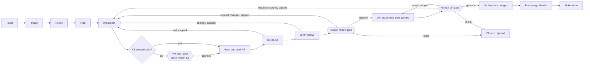
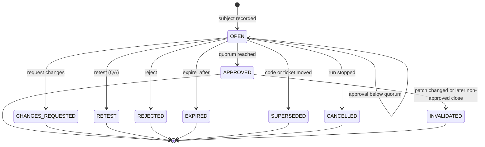
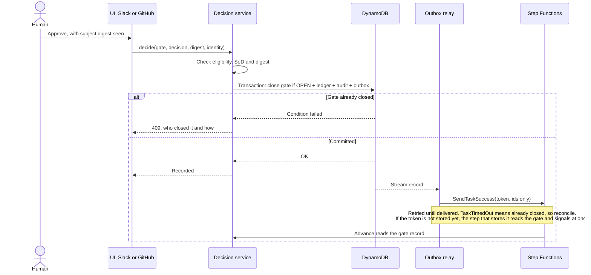
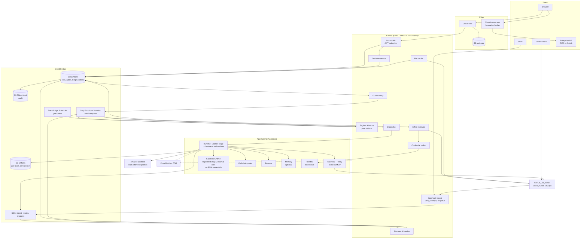
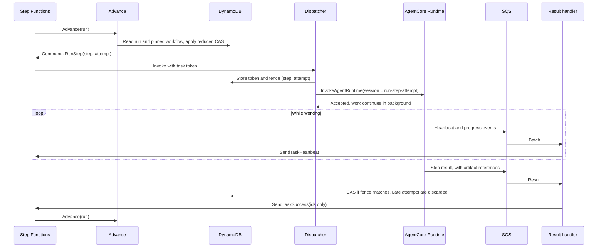
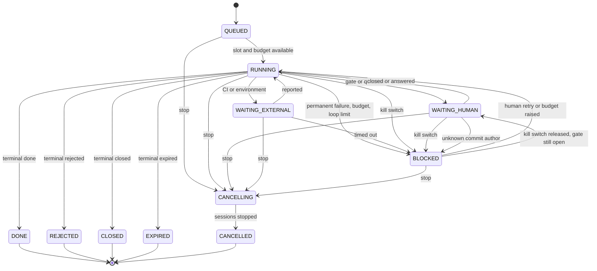
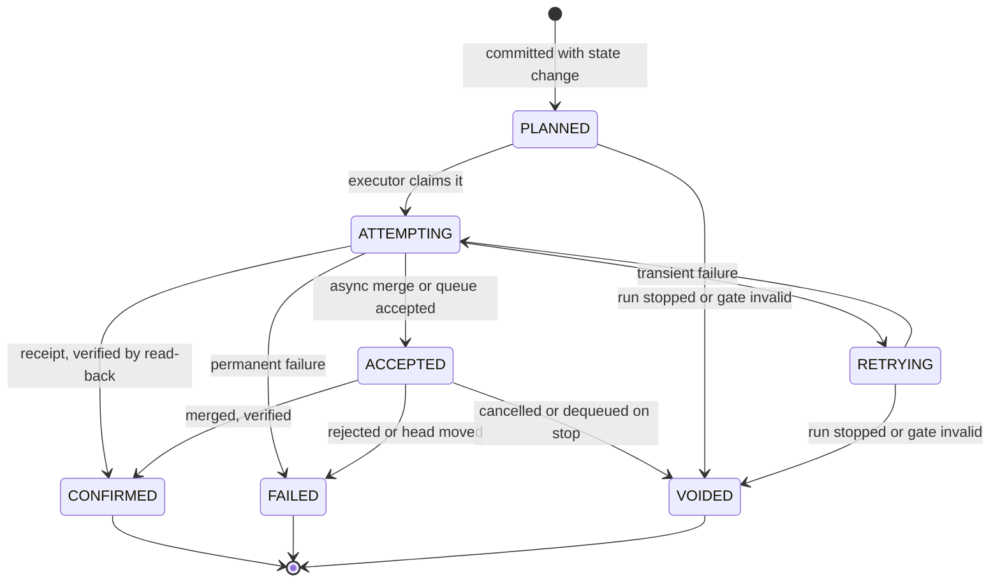
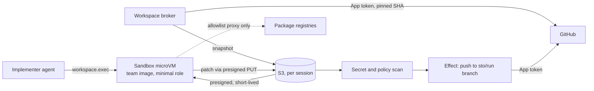

# SWE Ticket Orchestrator: plan

A reusable platform that takes a software ticket through a team's own delivery workflow, using Strands
agents on Amazon Bedrock AgentCore, with two mandatory human gates: one at review, after the LLM
reviews, and one at QA.

**Status:** plan only, with no product code. **Nothing has been deployed or run against Bedrock.**

Related documents:

- [STAGES.md](STAGES.md): delivery stages and issues
- [adr/](adr/README.md): one record per major decision
- [RESEARCH.md](RESEARCH.md): sources, verified facts and PoC lessons (`[S1]` and so on refer to it)

## 0. Open questions for Peter

Each has a default, and work proceeds on the default until you say otherwise. None of them blocks
D0 to D2.

| # | Question | Default we proceed on | What changes if you choose otherwise | Decide by |
|---|---|---|---|---|
| Q1 | **Who runs it?** One deployment per company, with many teams inside it, or a central multi-company SaaS? | One deployment per company, and any company can deploy its own from this public repo | SaaS needs a tenant boundary above teams, per-tenant KMS keys and IdPs, and billing. It adds about one delivery stage | D3 start |
| Q2 | **Can a team remove a human gate?** | No. Both gates are a platform floor. An org admin can add gates but not remove these two | If removal is allowed, the floor becomes an org setting, audited, and the validator proof applies only to remaining gates | D2-04 |
| Q3 | **Who is the first pilot team, and what is their stack?** | None assumed. The default sandbox image covers Python and Node | It sets the first sandbox image, the first real workflow config and the eval set | Before D14 |
| Q4 | **Which AWS Region and data-residency rule for the first deploy?** | Parameterised. Docs and examples use `us-east-1` with `us.` profiles | Sets model profile prefixes and IAM. Avoid In-Region profiles marked "limited model selection" [S30] | With credentials, D12 |
| Q5 | **Must two different people pass the gates?** You asked for two human gates, and small teams, including you alone on a throwaway repo, may have one person | Yes: the requester cannot approve review, and one person cannot approve both review and QA. An org admin can waive this in `OrgPolicy`, which is audited and shown on every affected gate | If one person may do it all by default, the floor is weaker and an injected ticket needs only one careless approver | D3-05 |
| Q6 | **How should CI run on code no human has seen?** CI starts as soon as code is pushed, and CI usually holds secrets (section 12, T18) | **Fail closed:** unless a repo proves its CI safe, a patch waits in S3, and a person approves it **before anything is pushed**, on every round. `no_secrets` is the attested faster path, and forks stay unsupported until D4-23 passes | Without this gate, CI secrets are exposed to model-written code. With it, repos that have not attested get one more click per round, and no branch or PR exists until then | D4-26 |

**Actions needed from you for D4, not questions:**

- Confirm the GitHub App manifest in a browser, once (D4-02).
- `bamseynet` is a **personal account, not an organization.** The throwaway repo can live there, but ruleset bypass
  lists need an organization-owned repo [S42]. If private repos on your plan lack draft PRs or branch protection,
  which D4-02 checks first, the live suite needs a paid plan or a free organization with a public throwaway repo.
- Live review tests need a **second GitHub user**, because the author cannot approve their own PR.
- These live on a separate issue (D4-24), so no offline work waits for them.

**One more action, before workers start (D0-05):** give workers a separate bot account or GitHub App, with no admin rights, no ruleset bypass, and not on any Environment's reviewer list. Every comment and commit on this PR comes from one identity, so until this exists the reviewer's label and the Environment's required reviewer cannot tell a worker from you.

### Your decisions, now built in

| Topic | Decision | Where it lands |
|---|---|---|
| AWS | No account yet. Everything must be deployable with CDK and fully testable offline, with a staged first deploy blocked on credentials | [ADR-0019](adr/0019-offline-first-testing-and-live-milestone.md), D11, D12 |
| Integrations | GitHub, Jira and Slack are all first-class and fully built. GitHub is tested live on a throwaway repo. Jira and Slack are contract-tested against recorded and fake APIs until credentials arrive | [ADR-0009](adr/0009-integration-spi-webhooks-as-nudges.md), D4, D6, D7 |
| Auth | Enterprise SSO through OIDC and SAML federation, IdP-agnostic, with team and role mapping from IdP groups | [ADR-0008](adr/0008-sso-cognito-as-federation-broker.md), D3 |
| Autonomy | The orchestrator merges reviewed, green PRs itself | [ADR-0010](adr/0010-autonomous-merge-github-app.md), D4 |
| Budget | No ceiling. A full-featured product, with issues still one PR each | [STAGES.md](STAGES.md) |
| Build capacity | Up to 8 workers on one 7.4 GB laptop, so heavy verification is in GitHub Actions. Workers run targeted, hermetic tests | Section 15.1, D0-05, D0-08, D0-09 |

A trial of FF-07 by someone who did not build this needs a person, and you are the only one so far. It moves to the pilot (D14-03).

### Three interpretations you may want to check

1. **"Merges itself" does not replace the gates.** "Reviewed" means the human review gate approved
   that exact code. Under the default template, the merge follows the QA gate and a short hold, with no further click.
   A team can move the merge to directly after the review gate and run QA on staging.
2. **"Nothing written before approval" is about visible, hard-to-undo writes.** A reviewer needs
   something to review, so a bot branch and a draft PR exist before the review gate. Pushing them starts team CI, so a repo must attest safe CI, or a person approves the patch before the push (T18). Everything is classified:
   `scoped` effects may run before a gate if the workflow declares them, and `gated` effects may not
   (section 6.3).
3. **The orchestrator agent works inside a stage, not above the workflow.** A Strands orchestrator
   picks specialists and combines their work in each stage. Plain code decides stage transitions, so
   no prompt can talk its way past a gate ([ADR-0001](adr/0001-deterministic-engine-with-strands-stage-orchestrators.md)).

## 1. Goals and non-goals

### Goals

- **Goal 1, Reusable:** a new team onboards by writing a short overlay on a template, never by forking code, and can add its own reviewer without a platform PR.
- **Goal 2, Fully functional:** a real ticket becomes a merged PR, through real GitHub, Jira and Slack
  integrations, with a full UI (section 17).
- **Goal 3, Trustworthy gates:** a human decision is bound to exact code, recorded atomically and audited.
  It cannot be bypassed, replayed or overridden by a model, a retry or a restart.
- **Goal 4, Bounded cost:** every run has budgets, can be cancelled, and can be stopped fleet-wide.
- **Goal 5, Durable:** a run survives waits of weeks, restarts and deployments, and a permanently failed
  run never re-spends by itself.
- **Goal 6, Observable:** every model call, tool call, decision and cost can be traced to its run.
- **Goal 7, Testable without AWS:** the whole product works and is tested offline.

### Non-goals

- Replacing the team's CI. It remains the authority on test results.
- Running production deployments directly. A `release` effect only triggers the team's own pipeline.
- Removing human judgement. A pass from an LLM reviewer means "ready for a person to read".
- Measuring agent quality before D12. Plumbing can be proved offline, but judgement needs real models.
- Hosting source code or a ticket system.
- Non-Bedrock model providers in the first release. The port permits them, but they are not built.

## 2. Personas

| Persona | Wants | Main surfaces | Can |
|---|---|---|---|
| **Developer** | Hand off a ticket and get a good PR | Ticket label or command, run timeline, PR | Start, retry, cancel their runs, answer clarifying questions |
| **Reviewer** | Judge a change fast, with evidence | Review gate page, Slack, GitHub | Approve, request changes, reject at review gates |
| **QA engineer** | Know what was tested and what was not | QA gate page, evidence viewer, Slack | Approve, request changes, retest, reject at QA gates, waive with reason if permitted |
| **Team admin** | Fit the workflow to the team | Workflow editor, dry-run, budgets, members, connections | Publish workflows, set team budgets, map groups to roles |
| **Org admin** (supporting) | Control floors, spend and risk | Org settings, kill switch | Set floors and org budgets, stop the fleet |
| **Auditor** (supporting) | Prove what happened | Audit explorer, exports | Read everything in scope, change nothing |

## 3. End-to-end flow



This is the default template. Teams change stages, order and tools through configuration
(section 7), within the floors in section 7.5. The pre-push gate is why nothing reaches CI secrets unseen (T18, Q6). It is a real stage, so the static proofs cover it.

## 4. The two gates

Both gates use one model: a **gate instance** is opened with a **subject**, collects **decisions**, and
closes exactly once.

**The subject** is what is being approved:

```text
subject = { head_sha, patch_id, evidence_digest, attention_digest, ticket_revision }
```

`patch_id` identifies the diff regardless of base. It is `git patch-id --verbatim` over a canonical diff against
the merge base, because the default mode ignores whitespace, so a re-indent that changes behaviour would keep the
same ID (checked locally on git). `evidence_digest` hashes the review or QA artifacts shown to the human.
`ticket_revision` hashes the normalised summary, description, acceptance criteria and route input fields only, so our own comments and
transitions never change it. After a merge, the subject also records `merge_sha`. A `pre_push` gate closes before any commit exists, so its subject is `{ base_sha, patch_id, ticket_revision }`, with no `head_sha`.
An approval carries the subject digest the human saw, and the server refuses it if the subject has moved. A
negative decision is exempt from the digest match, so an edited ticket can never delay a veto.

### 4.1 Review gate

**Opens after:** CI is green and the required LLM reviewers have finished, or failed visibly.

**What the reviewer sees, top to bottom:**

1. **Banner:** ticket, requester, budget used, time waiting, round number ("round 2 of 3").
2. **Attention list:** problems first. Failed or skipped reviewers, `degraded` flags, findings at high
   severity or above, unverified acceptance criteria. If there are none, it says so.
3. **Acceptance criteria matrix:** each criterion with the code or tests said to satisfy it, and who
   claims so. LLM claims are labelled as claims.
4. **LLM findings:** merged by file and line, with severity, reviewer, disagreements between reviewers
   shown rather than resolved, and what the implementer did about each.
5. **Diff:** full diff, plus an **interdiff since the last round** on re-review.
6. **CI:** each check at this exact SHA, with links.
7. **Plan and rationale:** the approved plan, and where the implementation departed from it.
8. **Change since opened:** a warning if the ticket was edited (section 4.5).

Everything from the model or ticket is rendered as inert text, never as HTML.

**Decisions:**

| Decision | Needs | Effect | Re-entry |
|---|---|---|---|
| **Approve** | Optional comment | Gate closes `approved`, next stage runs | None |
| **Request changes** | **Required comment**, optional line comments | Gate closes `changes_requested`. Comment goes to the implementer as untrusted, framed text | Back to `implement` on the same branch, using one count of the `human_review` loop. Then CI, LLM reviews and a **new gate** with an interdiff |
| **Reject** | **Required reason** | Gate closes `rejected`. Run ends `REJECTED`. An unmerged draft PR is closed by a scoped `pr.close` effect, ticket commented if configured | None. A new attempt is a new run |

**Decision surfaces:** the UI always. Slack and GitHub PR review are configured per gate (section 10). All surfaces
call one decision function, so the rules cannot differ between them. Surfaces do differ in what they can show:

| Surface | Can do | Must send the person to the UI for |
|---|---|---|
| UI | Everything | Nothing |
| Slack | Approve, request changes, reject | Retest, waive, and any approval that needs an acknowledgement |
| GitHub review | Approve and request changes, on review-type gates only | The same. A GitHub review carries only a commit ID, so it binds `head_sha` but not evidence or ticket revision. A team opts in to this weaker binding, and org policy can forbid it (V10) |

**Quorum:** `approvals_required: N` means N distinct people, each eligible when the gate closes. Each person has one
vote per gate instance. A subject change drops earlier votes (section 4.5).

### 4.2 QA gate

**Opens after:** the automated QA suite has reported and the agentic QA stage has finished, or failed
visibly.

**What the QA engineer sees:**

1. **Banner** as above, plus environment name and URL, and the tested SHA.
2. **Attention list:** failed checks, QA agent failures, untested criteria, flaky retries, and anything
   the agent marked `inconclusive`.
3. **Test matrix:** each acceptance criterion against evidence. Each row is `verified by automation`,
   `observed by agent`, or **`not verified`**. An agent's observation is never shown as a pass from a
   test.
4. **Automated results:** suites, counts, failures, flakiness, comparison with the base branch.
5. **Agentic session:** step log, screenshots, browser recording where available, console and network
   errors, and exploratory notes.
6. **Review history:** who approved review, with the comment, and any changes since.

**Decisions:**

| Decision | Needs | Effect | Re-entry |
|---|---|---|---|
| **Approve** | Optional comment. Any `not verified` row must be acknowledged | Gate closes `approved`, next stage runs | None |
| **Request changes** | **Required defect list** | Gate closes `changes_requested` | Back to `implement`, using one count of `qa_fix`. Because the code changes, CI, LLM reviews, **the review gate** and QA all run again |
| **Retest** | Required reason | Gate closes `retest`. Same SHA | Back to the QA stages, using one count of `retest`, and a new gate |
| **Reject** | **Required reason** | Run ends `REJECTED`. If the code is already merged, as in the Kanban order, the workflow's edge opens a revert PR and alerts | None |
| **Waive** (optional) | `waive` permission, required reason per criterion | Approves with recorded waivers | None. Regulated template forbids it |

### 4.3 Integrity rules

These are the rules the PoC review bugs came from. Each has a named test in section 15.3.

1. **Gated effects need a live approval, checked atomically:** the executor claims an effect in a transaction with
   `ConditionCheck`s on run status, gate instance status and version, and the switches. Stop and a claim therefore cannot
   both win. If Stop finds the effect already `ATTEMPTING`, it reports "the merge may have landed" and reconciles.
2. **Approve is exactly as strong as the code it saw:** a merge needs the **latest instance** of each required gate to be
   approved, at the SHA being merged. A new SHA therefore always passes through the gate stage again, where section 4.6 may
   close it without asking when the patch is unchanged. Once a gate reached by a **ticket-field route** has been visited in a run, it is required for the rest of that run, so a later change cannot route around it.
3. **While a gate is open, any negative decision closes it, regardless of earlier approvals.** A quorum gate with one
   approval and then a reject closes as rejected. Order is decided by commit: if the deciding approval commits first,
   the gate is already closed, and rule 5 applies. **Any non-approved close of a gate invalidates all earlier approvals of
   that gate in the run,** so a person's request for changes can never be overridden by an older approval of the same patch.
4. **A gate closes exactly once,** by a conditional write. A write conflict while the gate is still open is retried
   internally, and sub-quorum approvals all commit. Only a truly closed gate returns `409 gate_closed`, showing who
   closed it and how.
5. **After close, the way to stop is Stop.** "A later reject" on a closed gate is refused with a visible message and a
   Stop button, which anyone eligible for that gate can use. Stop beats any approved but unexecuted effect, because
   executors check run state when claiming. `pr.merge`, `release.trigger` and a `done` transition wait
   `hold_after_approval` (default 10 minutes, with an org minimum) so that this window is real.
6. **Decision, audit event and outbox entry commit in one transaction.** There is no window where a
   decision exists without its audit record, or the reverse.
7. **Decisions are never replayed from a framework.** The engine reads the gate record. Neither Strands
   nor Step Functions holds a decision as a saved value. A Step Functions callback is only a wake-up
   signal carrying IDs.
8. **Timeouts never approve.** The validator rejects any such configuration.
9. **Models cannot decide.** No agent, tool or Gateway target can reach the decision function or a
   task token.
10. **What the UI claims is what happened.** "Written", "Merged" and "Commented" appear only from a
    confirmed receipt (section 6.3).
11. **Org floors apply now.** Floors are read at decision and effect time from current `OrgPolicy`, not from a run's
    pinned workflow, so tightening a rule after an incident reaches runs in flight.

### 4.4 Timeouts and escalation

Timers use business time from the team calendar and do nothing while the run is paused.

| Timer | Default | Action |
|---|---|---|
| `remind_after` | 1 business day | Notify eligible approvers |
| `escalate_after` | 2 business days | Notify `escalate_to` role. They can act if eligible, but are not auto-granted eligibility |
| `expire_after` | Unset, never expires | Gate closes `expired`, following the workflow's `expired` edge |

- Each timer is a one-shot schedule that re-reads the gate before acting, so a late timer is harmless.
- `expired` can only lead to a non-approving path. A run also has `max_run_age`, default 180 days, counted in **wall-clock**
  time, because the Step Functions 1 year limit is wall-clock and does not pause [S33].
- There is no reassign that bypasses eligibility, and nobody can approve on behalf of someone. If every eligible person has left or is away, an org admin can extend eligibility on that open gate (section 9.3).

### 4.5 Ticket and code changes during a run

These rules apply **at any stage**, not only while a gate is open. Reconciliation and webhooks feed them.

| Event | Behaviour |
|---|---|
| New commit on the branch that is not ours (section 9.4) | Any open gate `superseded`, active step stopped. Treated as a human commit of unknown author. The run returns to the workflow's `on_external_commit` stage, by default its CI stage, using the `external_commit` loop, default cap 3, then `BLOCKED`. Classification waits while one of our push or update effects is `ATTEMPTING`, so we never mistake our own commit |
| Base branch moves | No change until merge. The merge guard handles it (section 6.4) |
| Ticket edited, gate open | Gate stays open, with a banner and a diff of the ticket. **Earlier votes are dropped**, because they saw another revision. Approving requires acknowledgement |
| Ticket edited, no gate open, before the final approval | The new revision is recorded, and the next gate shows the change |
| Ticket edited after the final approval, before the merge | The subject moved, so the effect is refused with `gate_invalid`, and the run returns to the gate (section 6.3) |
| Ticket edited by someone who is not a team member, or by an unknown editor | Treated as untrusted: the run pauses for a member to confirm it. The reconciler often sees only a hash change, so an unknown editor counts as a non-member |
| Route input changed | Frozen values apply, and only a raise takes effect (section 7.2) |
| Ticket closed or deleted | Any open gate `superseded`, run `CANCELLED` with reason. If code is already merged, it ends `done_with_incident` |
| PR closed by a person | Any open gate `superseded`, run `CANCELLED` |
| PR merged, not by our App | Any open gate `superseded`, run `BLOCKED`, and an outside merge is flagged in audit. Our own merge is recognised from its receipt and merge author, so it never supersedes the Kanban QA gate |
| Workflow published | No effect. Runs stay on their pinned version (section 7.4) |
| Approver loses eligibility | A pending vote stops counting, because eligibility is re-checked when the gate closes. Decisions on already closed gates stand, and are audited |

**Agents read a confirmed snapshot, not the live ticket.** `ticket.read` serves the stored snapshot at the last confirmed revision, plus comments by team members. Other comments appear as withheld, so a comment on a public issue, or an edit between its webhook and the next sweep, never reaches an agent (T11, G11). `ticket.search_similar` serves the same filtered view.

**A gate's evidence must cover what is being approved.** Every evidence record stores `tested_sha`, `patch_id` and a declared
validity. A gate cannot open unless all its evidence is valid for the subject:

| Validity | Used by | Holds when |
|---|---|---|
| `exact_sha` | `checks` stages | `tested_sha` equals `head_sha`. CI and QA suites always re-run on a new SHA |
| `same_patch` | LLM reviews, QA agents | `patch_id` equals the current one. The gate page shows "evidence from an older base" |
| `contains_sha` | Staging QA after a merge | The tested deployment contains the `merge_sha`. The gate page lists anything else it contains |

After a merge, later gated effects check against the subject frozen in the merge receipt, so a ticket edit cannot strand a run
after a successful merge.

### 4.6 Carry-over on unchanged code

When a gate stage is re-entered with `carry_over: patch_id`, it closes `approved` with no human action only if **all**
of these hold, evaluated by the same code as a human decision. Otherwise it opens normally.

1. The **most recent closed instance** of this gate closed `APPROVED`, with full quorum, and has not been invalidated. A
   partial set of votes on a superseded gate never carries, and neither does an approval followed by any other close.
2. Its `patch_id` equals the current one. A change of patch invalidates it permanently, so P1, P2 and back to P1 asks again.
3. Every approver it cites is still eligible, and separation of duties still holds against the current commits.
4. The ticket revision is unchanged.
5. The **attention digest** is unchanged: failed reviewers, findings at or above `block_on`, unverified criteria and red
   checks. Free-form LLM text is excluded, so re-running a reviewer does not by itself force a new decision, but a new
   problem does.
6. **The base range changed no file in the patch.** `patch_id` ignores position, so the same added line in two places gives
   the same ID (tested on git). This condition stops a base change from moving what an approved patch means.

This handles a clean base update without a pointless re-approval. The new instance has the new SHA and cites the earlier
decision in audit. `carry_over: none` is the regulated default and forces a new decision. Carry-over never crosses a QA
retest.

For the same reason, stages avoid repeated work when the patch is unchanged: a `review_panel` and an `agent` QA stage reuse
results for the same `patch_id` with `same_patch` validity, while `checks` stages always run at the new SHA.

### 4.7 State machine



### 4.8 Decision sequence



### 4.9 Audit

Every state change writes an append-only audit event, in the same transaction as the change:

- **Fields:** sequence, time, team, run, actor (verified identity and IdP subject, or a service
  identity), action, subject digest, surface (`ui`, `slack`, `github`), workflow version, previous hash
  and own hash.
- **Tamper evidence, and its limits:** events are hash-chained per run through a chain head item. Every vote serialises on that
  head, which is acceptable at human decision rates, and a conflict is retried. A chain alone is not enough, because it is unkeyed
  and anyone with write access could recompute it or remove a tail. So:
  - A stream copies events to S3 with Object Lock. **Compliance mode is the default for regulated deployments**, because governance
    mode can be bypassed with a permission. Streams keep data for 24 hours, so iterator age alarms well under that.
  - **Periodic KMS-signed checkpoints** per team, over chain heads and counts, go in the locked bucket. The verifier checks
    against them, so removing a tail or a whole run is detected.
  - App roles are denied update and delete. They still need `PutItem`, which can replace an item, and a condition expression is the
    caller's choice, so **DynamoDB alone is not tamper-proof.** Protection starts when an event reaches the locked bucket.
- **Refused attempts** cannot be written in a transaction that failed, so they go through a separate, best-effort write and metric.
- **Export:** by team, run or period, with a verification tool that checks the chain.
- **Redaction:** tokens and secrets are removed before anything is stored. Comment text is kept.
- **Retention:** default 400 days, configurable upward. Object Lock mode is a deploy setting.

## 5. Architecture



### Layers, and the rule for each

| Layer | Holds | Rule |
|---|---|---|
| **Stage engine** | What happens next | Deterministic code. No LLM. Source of truth for transitions |
| **Gates and effects** | Human decisions and outside-world writes | Run only in the control plane, with credentials that agents cannot reach |
| **Stage orchestrators** | How one stage's work gets done | Strands agents, chosen workers, bounded by budgets and a tool allowlist. Disposable |
| **Sandboxes** | Running repo and model-written code | No SCM credentials, a minimal execution role with no data access, and restricted network. A Runtime always has a role, and commands can read it [S61], so the role is what limits harm |

### One step, end to end



The task token never enters the microVM. A dead session stops its heartbeats, Step Functions raises
`States.Timeout` and the engine applies its retry rule.

## 6. Engine, runs and effects

### 6.1 Reducer

```text
next(run_state, event, workflow) -> (new_state, commands)
```

The reducer is pure, with no I/O, clock or randomness. Commands and state commit together, so a crash
can always resume from the last committed state. This is what makes the engine testable with
property tests, and lets one engine run under two drivers:

- `LocalDriver`: asyncio, used for `make dev` and tests.
- `StepFunctionsDriver`: one interpreter state machine for all teams. Workflows are data, so publishing
  one never touches AWS, which avoids the 1 per second `CreateStateMachine` limit.

**Events:** `StepSucceeded`, `StepFailed`, `GateClosed`, `EffectConfirmed`, `TimerFired`,
`CancelRequested`, `ExternalChanged` and so on.

**Commands:** `RunStep`, `OpenGate`, `RunEffect`, `AwaitChecks`, `Notify`, `Finish`.

### 6.2 Run lifecycle



**Failure rules (lesson: permanently failed tickets re-ran on restart):**

| Class | Examples | Behaviour |
|---|---|---|
| `transient` | Throttling, 5xx, lost session | Retried with backoff, up to the stage's `max_attempts` (default 2) |
| `permanent` | 401, 403, validation, refusal, budget | `BLOCKED` immediately. **No restart or redrive retries it.** A person clicks Retry, which is audited |
| `degraded` | One required reviewer failed | The gate opens with a clear flag, or the run blocks if `fail_closed: true` |

There is exactly one retry layer per external call: inner clients are set to `total_max_attempts=1`.

**A run that merged code and ends without a QA approval of it ends `done_with_incident`,** whichever terminal it reaches, **including Stop**, so a cancelled run's code cannot sit unqualified in a later release range. The
engine alerts, and opens a revert PR for each such merge as an implicit scoped effect. `done_with_incident` is an incident flag on
the run's terminal status: usually `DONE`, but a stopped run stays `CANCELLED` with the flag.

**Retry and spent loops:** Retry resumes the blocked step at a new attempt, after stopping any earlier attempt, and does not reset
loop counters. A loop at its cap goes to `BLOCKED(loop_exhausted)`, and a team admin can grant extra rounds, which is audited.
Retry only re-runs a step, so it can never change an outcome or step past `block_on`.

**Route-to-gate** handles a persistent false positive from a `review_panel`, under the org setting `route_to_gate_allowed`. A team admin sends the run to **the next gate in the proved graph**, with the item on the attention list, audited, and they become ineligible for that round. **A patch blocked by path policy or a secret scan is never routed past `branch.push`.** It needs a corrected patch, or a separate org waiver naming that patch.

**`CANCELLING` has a timeout,** default 5 minutes. If a stop call keeps failing, an alarm fires and the run reports what is unconfirmed.

### 6.3 Effects and the outbox

Every write to the outside world is an **effect** with its own record.



| Class | Rule | Examples |
|---|---|---|
| `internal` | Free | Artifacts, events |
| `scoped` | Declared in the workflow, or engine-implicit, and only to bot-owned objects | **Declared:** `pr.ensure_draft`, `pr.update_branch`, `pr.open_revert`, progress comments. **Engine-implicit, needing no stage:** check runs, gate notifications, `pr.close` on reject, a revert PR for an unqualified merge |
| `gated` | The class comes from the effect catalog, not config. Requires a non-empty `requires_gates`, and a valid approval for each, checked in the claim transaction | `branch.promote`, `env.deploy_preview`, mark PR ready, merge, ticket to Done, trigger release, external announcement |
| `exposing` | `branch.push` only. It starts team CI, so its claim needs a human approval at this `patch_id`, or a current `no_secrets` attestation, and V16 proves the graph allows nothing else | `branch.push` |

Each effect's `with` is typed in the catalog, and unknown keys are refused, so a transition target or a zero hold cannot slip past the
validator.

**A refused gated effect** does not retry blindly. The effect is `VOIDED` with `gate_invalid`, and the engine returns the run to
the stage of the first gate whose approval no longer holds, so the path is still through a gate, capped by `max_steps_per_run`.

**Idempotency** uses a key from `(run, stage, visit number, effect type, subject digest)`, so a deliberate retry after a
`stale` result gets a new record. An effect that must stay single across rounds declares a narrower scope in the catalog:
`pr.ensure_draft` is keyed by `(run, branch)`, and finds or creates, so a second round cannot open a second PR. `pr.open_revert` is keyed by `(run, merge_sha)`, so a declared revert and the engine's implicit one open one PR.

- GitHub comments carry a hidden marker, and a lookup finds existing ones **only among comments
  written by our own bot identity**. This fixes the PoC finding that a public issue could plant a
  marker to suppress the real comment.
- GitHub merges pass the approved `sha`, and a PR already merged at that SHA counts as success.
- **Commits are recorded before the ref moves.** With the Git Data API we create the commit object, which returns its SHA, write that
  SHA as intent, then update the ref without force. A crash leaves a known SHA, and a concurrent push makes the update fail.
- **Base updates use `POST /repos/{o}/{r}/merges`,** which returns the commit SHA [S62], rather than `update-branch`, which returns 202
  with no SHA. It takes only `base`, `head` and `commit_message`, so it cannot carry an expected head. We check the head before, and read back that the first parent equals it. If a crash loses the response, a commit is recognised as ours only if its parents are the expected head and base tip
  **and** `patch_id` is unchanged, so a hand-made merge that alters code cannot pass as ours.
- **A release dispatch has no idempotency key,** and a crash can lose the run ID [S63]. So the effect key is a required workflow input
  shown in `run-name`. Retry looks it up first, and if the state is ambiguous the run goes to `BLOCKED`. A production deploy is never
  re-triggered on a guess.
- Jira comments and transitions read current state first. Transitions are by target status, and
  "already there" is success.
- Slack messages store `ts` and update in place.

**Truthfulness:** a receipt holds the external ID and URL, plus a read-back result. The UI's word
"Merged" means `CONFIRMED`. Simulated writes in local dev are labelled `simulated` everywhere.

### 6.4 Merge guard

The orchestrator merges with these checks. The switches and gate conditions are part of the claim transaction (section 4.3, rule 1), and
the rest are re-read immediately before it:

1. Run is active. Team and fleet merge switches are on. No freeze or change window applies. `hold_after_approval` has passed.
2. The **latest instance** of every gate in `requires_gates`, and any gate reached by a **ticket-field route** at any point in this run, is approved, with
   `head_sha` equal to the current head. `pre_push` approvals are checked only by the `branch.push` claim, and are not part of this guard. The carry-over rules in section 4.6 are the only way a new SHA gets that without a person.
3. Team-required checks are green at this exact SHA. A check that is merely pending means wait, not failure.
4. Separation of duties still holds, including any commit added since the gate opened.
5. PR is open, not draft (marked ready by a prior gated effect), and targets the expected base.
6. **Head contains the current base tip** (`require_up_to_date`, default on, with an org floor), so the tree being merged is the tree
   that was tested. `sha` only guards the head. A merge queue's group result counts as the tested tree.
7. The merge request goes through GitHub's **async merge API** (`PUT .../merge-async`, then poll), which GitHub now recommends and which is
   the only one that adds to a merge queue [S60], passing the approved SHA. The sync endpoint "does not support ... merging with a merge
   queue". A moved head cancels the merge, and the exact error semantics are settled live in D4-23.
8. Read back that the PR is merged, and record the merge SHA and frozen subject. An `enqueued` result is final for that request and does not
   mean merged [S60], so the effect stays `ACCEPTED` until read-back.

| Result | Next |
|---|---|
| Merged | The `done` edge |
| Base moved, or head not up to date | `stale` edge to a `pr.update_branch` effect, which commits the base update, and then CI. Reviews and QA agents reuse results if the patch is unchanged, and carry-over decides whether a person is needed |
| Update or merge conflict | `conflict` edge to `implement`, using the `merge_conflict` loop, so gates apply again |
| Required check pending | Wait, with no loop used. A timeout takes the `stale` edge |
| Merge queue configured | Enqueue, wait for the outcome, read back. Requires `merge_group` on team CI [S43]. Stop dequeues it. Queues need an organization-owned repo, and private repos need Enterprise Cloud [S43] |
| Guard 2 or 4 fails | `gate_invalid`, per section 6.3 |
| Branch protection blocks the App | `BLOCKED`, with a message saying exactly which rule, and how to fix it |

**Busy repos:** a trunk that merges often will keep moving the base, and each move re-runs CI. A run that exhausts `merge_stale` goes to
`BLOCKED(loop_exhausted)`. Use a merge queue where available, which is the default recommendation for regulated and busy repos. Where it is
not, `OrgPolicy` can list a repo in `require_up_to_date_waived_for`, relying on post-merge checks. D13-07 models this.

**GitHub enforcement raises the bar, and does not close it.** The App publishes `sto/review-gate` and `sto/qa-gate` check runs, which
teams can require, pinned to our App ID [S41]. Each template documents which to require: a Kanban merge happens before QA, so it requires only
the review check.

- **A check attaches to a commit, not a PR,** and neutral counts as passing [S59]. So neutral is posted only for a SHA no run has ever produced, and never replaces a pending gate check. A tombstone keeps that true after a run ends, so a rejected run's SHA can never go neutral on another branch.
- **This stops** merging a run's exact SHA before approval, from any branch.
- **This does not stop** someone with write access pushing different code to another branch and merging it, because that is an ordinary human PR.
  The reconciler detects a run's content landing outside the platform, and flags it.
- Revert PRs use a `sto-revert/*` namespace, outside the gate check, so a revert is not stuck in an incident.
- If a repo also requires a human GitHub review, use `decision_surfaces: [github]`, so the reviewer's own GitHub review is the decision
  ([ADR-0010](adr/0010-autonomous-merge-github-app.md)).

## 7. Workflow configuration

### 7.1 Principles

- **Four documents, with different owners and lifetimes:**

| Document | Owner | Lifetime | Holds |
|---|---|---|---|
| `OrgPolicy` | Org admin | **Live,** read at decision and effect time | Floors: who can be eligible, surfaces, waivers, minimum holds, identity age |
| `TeamConfig` | Team admin | **Live,** except custom profiles, which are pinned per run | Calendar, sprint, budgets, WIP limit, change windows, QA test domains, custom profiles |
| Resource bindings | Org admin | **Live** | Which team owns which repo, Jira project and Slack channel |
| `Workflow` | Team admin | **Versioned, immutable, pinned per run** | Intake, stages, edges, loop limits |

- **Templates and overlays:** a team writes a short overlay on a template, not a copy of it. Overlays use JSON Merge Patch (RFC 7386) on a stage
  map keyed by ID: maps merge, lists replace, and `null` removes. The order of stages has no meaning, because edges define the flow, so no
  `insert_after` is needed.
- **Publishing flattens.** A workflow pins `extends: template@version`, and publishing resolves it into a full, stored document with a digest. A
  changed template affects nobody until the team moves to the new version.
- **Validated statically,** by a JSON Schema generated from typed models, then by semantic rules. Dry-run works with the fake LLM before publishing.
- **Stored in the platform,** or synced from a repo path with GitOps, where a PR changes the workflow.
- **One repo per workflow,** for this release, which avoids any selection rule. A team with several repos publishes one workflow per repo. Cross-repo changes are linked tickets.

### 7.2 Schema

```yaml
apiVersion: sto/v1
kind: Workflow                # or WorkflowOverlay, with `extends: template@version`
metadata: { name: string, team: string }

intake:                       # closed selectors, so overlaps can be proved
  source: github | jira | linear | azure_devops
  project: string             # Jira project, or owner/repo. Must be bound to this team
  label: string
  issue_types: [ string ]     # optional
  extra_filter: string        # optional, adapter-specific, applied after re-reading the ticket
  sprint: { mode: any | active_only }

repo: { name: owner/name, base: string, sandbox_image: registered image name }

limits:
  loops: { <loop name>: integer }   # every cycle in the graph must name one
  max_steps_per_run: integer        # platform maximum 500
  max_run_age: duration             # wall clock, platform maximum 300d

on_external_commit: <stage id>      # optional, defaults to the workflow's CI stage

definition_of_done:                 # evaluated before a gate opens, or before a stage exits
  - { stage: <id>, check: ac_present | checks_green | coverage_at_least | no_findings_above }

start: <stage id>
stages:
  <stage id>:
    kind: agent | review_panel | checks | gate | effect | wait | route | terminal
    # kind: agent
    agent: <profile>               # built-in, or custom from TeamConfig
    model_tier: fast | standard | deep
    max_attempts: integer
    # kind: review_panel
    reviewers: [ <profile> ]
    required: [ <profile> ]        # at least one
    fail_closed: boolean           # a failed required reviewer blocks, and the degraded edge is then unused
    block_on: low | medium | high | critical
    # kind: checks
    source: ci | qa_suite | post_merge
    required: [ string ] | team_default    # must resolve to at least one check
    timeout: duration
    # kind: gate
    gate:
      type: review | qa | custom | pre_push
      eligible_roles: [ role ]     # the only authority on who may decide
      quorum: [ { role: role, count: integer } ]    # default one approval from any eligible role
      path_owners: none | codeowners               # also require owners of changed paths
      decisions: [ approve, request_changes, reject, retest, waive ]
      decision_surfaces: [ ui, slack, github ]
      separation_of_duties: { not: [ author, requester, committer, { approver_of: <gate id> } ] }
      carry_over: patch_id | none
      timeouts: { remind_after: duration, escalate_after: duration, escalate_to: role, expire_after: duration }
    # kind: effect
    effect: branch.push | branch.promote | pr.ensure_draft | pr.update_branch | pr.mark_ready | pr.merge
            | pr.open_revert | ticket.comment | ticket.transition | env.deploy_preview | release.trigger | notify
    with: { ... }                  # typed per effect in the catalog, unknown keys refused
    requires_gates: [ gate id ]    # required and non-empty on every gated effect
    # kind: wait
    wait_for: human_answer | environment_ready
    timeout: duration
    # kind: route, a closed vocabulary, with no expressions
    field: risk | issue_type | priority | component | label | repo_ci_trust
    order: [ value ]               # lowest to highest, for the ratchet on ticket fields
    # kind: terminal
    result: done | rejected | closed | expired | done_with_incident
    # every kind but terminal
    next:
      <outcome>: <stage id>                   # or
      <outcome>: { to: <stage id>, loop: <loop name> }
```

```yaml
apiVersion: sto/v1
kind: TeamConfig
metadata: { team: string }
calendar: { timezone: string, workdays: [mon..sun], hours: "09:00-17:30", holidays: ref }
sprint: { cadence: 1w | 2w | 3w | 4w, anchor: date, merge_freeze_before_end: duration }
wip_limit: integer
qa: { test_domains: ["*.pr.team.example.com", "staging.team.example.com"] }   # one custom browser per team, see T3
change_windows: { deny: [ { from: datetime, to: datetime, reason: string } ], allow_only: cron }
budgets:
  run_usd: number
  team_monthly_usd: number
  stage_usd: { <stage id>: number }
  session_seconds_per_run: integer
custom_profiles:             # a team's own reviewer, with no platform PR. New runs only: a run pins them in its manifest
  <name>: { base: <built-in profile>, prompt_addendum: string, tools: [ subset of base ] }
```

```yaml
apiVersion: sto/v1
kind: OrgPolicy
floors:
  single_human_allowed: false        # true lets one person pass both mandatory gates (Q5)
  requester_excluded_from: [review, pre_push]
  mandatory_gate_roles: { pre_push: [reviewer], review: [reviewer], qa: [qa, reviewer] }    # never developer
  decision_surfaces: { review: [ui, slack, github], qa: [ui, slack] }
  waive_allowed: true
  hold_after_approval_min: 10m
  require_up_to_date: true
  require_up_to_date_waived_for: []  # repos
  identity_max_age: 8h
  public_repo_intake: false          # public repos need explicit opt-in
  ci_without_secrets_waived_for: []  # repos exempt from the floor in T18
  route_to_gate_allowed: false
teams:                               # per team or tag, enforced at publish, on migrate and live
  ledger:
    required_gates:
      - { id: security_gate, role: security_officer }
      - { id: change_gate, role: change_manager, when: { field: risk, value: high } }
    min_quorum: { review: 2 }
    allowed_carry_over: [none]
```

The edge key is `next`, not `on`, because YAML 1.1 parsers such as PyYAML read a bare `on` as boolean true. The loader
also refuses duplicate keys, and YAML's other implicit booleans in keys.

**Outcomes by kind.** The validator requires an edge for each.

| Kind | Outcomes |
|---|---|
| `agent` | Declared by its profile, for example `triage`: `ready`, `needs_info`, `not_actionable` |
| `review_panel` | `clean`, `findings`, `degraded` |
| `checks` | `green`, `red` |
| `gate` | `approved`, `changes_requested`, `rejected`, plus `retest` if listed, plus `expired` if `expire_after` is set |
| `effect` | `done`. `pr.merge` adds `conflict` and `stale`, `pr.update_branch` adds `conflict`, and `release.trigger` adds `stale` |
| `wait` | `resumed`, `timeout` |
| `route` | Each field value used, plus `default` |

**Route fields are frozen, because a route must not be editable into skipping a gate.** Ticket-field routes are read once at intake and stored on the run. Later changes follow a **ratchet:** a change that raises the level by `order` applies at once, and lowering needs a named role, with the audited actor ineligible for that run's gates. Route inputs are part of `ticket_revision`, and once a routed gate has been visited it stays required for the rest of the run. **On a route with `order`, a value outside it goes to `BLOCKED` with a reason, and never takes `default`,** so a `Critical` or a differently cased `High` cannot skip a gate. **Limit:** a value set before intake is taken as given, so a team relying on one should restrict who can edit that field in Jira, and the gate page shows who set it. `repo_ci_trust` is different: it is evaluated fresh on each pass, because its safe direction is the gate.

Engine-level failures (section 6.2) do not need edges, because they go to `BLOCKED`.

### 7.3 Validator rules

Each rule has a test, and every bundled template passes all of them in CI. **Validation runs at publish. Org floors are also enforced at decision and
effect time, because a floor can tighten after publishing.**

| Rule | Why |
|---|---|
| V1 All references resolve, all stages reachable, a terminal is reachable from every stage | No stuck runs |
| V2 Every outcome has an edge | No undefined behaviour |
| V3 **Every cycle contains an edge with a named `loop`,** and the limit is at most the platform cap | Review loops need caps, proved statically |
| V4 **Gate dominance:** every `gated` effect has a non-empty `requires_gates`. For each gate listed, remove its `approved` edge, and the effect must be unreachable from `start` | Nothing gated runs without approval, on every path |
| V5 **Freshness:** same removal, from every code-changing stage, the effect is unreachable. Code-changing is derived: a profile with `workspace.write`, `pr.update_branch`, and `on_external_commit`'s target | An approval cannot be reused past a code change on any path |
| V6 **Floors:** `pr.merge` requires a `review` gate. `release.trigger` and a `ticket.transition` to done require a `qa` gate. Terminal `done` is unreachable without a QA approval. **If a merge is reachable from `start` with QA approvals removed** (merge before QA), then from its `done` edge, with QA gates removed and `wait` timeouts ignored, no `done` or `closed` terminal is reachable | The two mandatory gates, in either order |
| V7 Every gate has a human-only path: `eligible_roles` non-empty, quorum at least 1, no `auto_approve` key exists in the schema | Timeouts never approve |
| V8 `expired` and `rejected` edges cannot lead to a `gated` effect | Non-approval stays non-approval |
| V9 Budgets and limits within org ceilings. Models in the catalog. Tools in each profile's allowlist. Tier available in this deployment's geography | Floors hold |
| V10 Decision surfaces permitted by `OrgPolicy`, with `github` only on review-type gates. `waive` only if allowed | Compliance |
| V11 **Review order:** with `review_panel` stages removed, no review-type gate is reachable from a code-changing stage | LLM reviews come before the human review, as Peter asked |
| V12 **Resource ownership:** every repo, project and channel named is bound to this team. Intake project and label pairs do not overlap with another published workflow | One team cannot name another's repo (T19) |
| V13 **No empty floors:** a `review_panel` has at least one required reviewer. A `checks` stage has at least one required check, and `team_default` is re-checked at run time and blocks if empty | A floor cannot be met by an empty stage |
| V14 **QA evidence dominates:** with QA evidence stages removed (`qa_suite` checks, a QA agent), no `qa` gate is reachable from a code-changing stage | A QA gate must have something to judge |
| V15 Mandatory gates only list roles in `mandatory_gate_roles`. Sandbox images are registered. `with` is typed | Floors hold |
| V16 **Nothing reaches CI unseen:** from a stage with `workspace.write`, with `pre_push` gate approvals and `repo_ci_trust`'s `attested` edge removed, `branch.push` is unreachable | T18 holds on every round, by proof |
| V17 **Org-required gates:** each `required_gates` entry exists with its role, `min_quorum` and `allowed_carry_over` hold, and an entry with `when` is reached on that route value. Checked at publish, on migrate, and live | A regulated team's admin cannot remove the controls |

V4, V5 and V6 are the runtime-independent generalisation of the PoC's topology test. The checks on the examples below were run by a
scratch script for this PR, and become real code in D2-03 and D2-04.

**Overlapping intake:** arbitrary JQL cannot be proved disjoint, so intake uses closed selectors, and `extra_filter` can only narrow. If a ticket still
matches two workflows at run time, no run starts, and the team is told.

### 7.4 Pinning and change

- A run pins a **manifest digest** covering the flattened workflow, agent profiles, effect catalog and prompts. Old versions stay addressable by content
  hash, so a later change to a profile's outcomes cannot strand a run with no edge.
- **Budgets, calendars and org floors are live.** Only the shape of the workflow is pinned, so raising a budget or tightening a floor reaches runs in flight.
- `apiVersion` changes come with a migration rule.
- Admins can migrate a run through `POST /runs/{id}:migrate` and the Run page, only if the target is valid at its current stage, and it is audited.
- Dry-run replays recent runs against a draft to show routing differences.

### 7.5 Platform floors

Teams cannot weaken these. Org admins can change only those marked as `OrgPolicy` settings.

- A review gate and a QA gate exist on every path to `done` (Q2). LLM reviews precede the review gate.
- Merge requires a valid review approval for that code.
- **Separation of duties** (section 9.4): an identity that authored commits in the PR cannot approve its review gate. By default the requester cannot approve
  review, and no single person can approve both review and QA (`single_human_allowed`, Q5). Terms that cannot be resolved fail closed.
- **Code no human has approved at this `patch_id` runs without secrets, on every round** (T18).
- `hold_after_approval` and `require_up_to_date` have org minimums. `OrgPolicy.teams` can require gates, quorum and carry-over rules for a team.
- Timeouts never approve. Every cycle is capped. Every run has a budget.
- Secret scanning cannot be turned off. Agents never hold SCM credentials.

### 7.6 The `standard` template, and a Scrum team

The template is bundled and versioned. Teams do not edit it.

```yaml
apiVersion: sto/v1
kind: Workflow
metadata: { name: standard, team: _template }
limits:
  loops: { info: 2, pre_push_fix: 3, ci_fix: 3, llm_fix: 2, human_review: 3, qa_fix: 2, retest: 2, merge_conflict: 2, merge_stale: 3 }
  max_steps_per_run: 120
  max_run_age: 60d
definition_of_done:
  - { stage: refine, check: ac_present }
  - { stage: review_gate, check: checks_green }
start: triage
stages:
  triage: { kind: agent, agent: triage, next: { ready: refine, needs_info: await_info, not_actionable: closed } }
  await_info:
    kind: wait
    wait_for: human_answer
    timeout: 10d
    next: { resumed: { to: triage, loop: info }, timeout: closed }
  refine: { kind: agent, agent: refiner, next: { ready: plan, needs_info: await_info } }
  plan: { kind: agent, agent: planner, model_tier: deep, next: { ready: implement, needs_info: await_info } }
  implement: { kind: agent, agent: implementer, next: { ready: trust_route, blocked: await_info } }
  trust_route:                     # re-evaluated on every round, and anything but a current attestation means the gate
    kind: route
    field: repo_ci_trust
    next: { attested: push, default: pre_push_gate }
  pre_push_gate:                   # the patch is held in S3, and no branch or PR exists yet
    kind: gate
    gate:
      type: pre_push
      eligible_roles: [reviewer]
      decisions: [approve, request_changes, reject]
      decision_surfaces: [ui]
      carry_over: none
      timeouts: { remind_after: 1d, escalate_after: 2d, escalate_to: team_admin }
    next:
      approved: push
      changes_requested: { to: implement, loop: pre_push_fix }
      rejected: closed_rejected
  push: { kind: effect, effect: branch.push, next: { done: open_pr } }
  open_pr: { kind: effect, effect: pr.ensure_draft, next: { done: ci } }
  ci:
    kind: checks
    source: ci
    required: team_default
    timeout: 2h
    next: { green: llm_review, red: { to: implement, loop: ci_fix } }
  llm_review:
    kind: review_panel
    reviewers: [correctness_reviewer, security_reviewer, test_reviewer]
    required: [correctness_reviewer, security_reviewer]
    block_on: high
    next: { clean: review_gate, findings: { to: implement, loop: llm_fix }, degraded: review_gate }
  review_gate:
    kind: gate
    gate:
      type: review
      eligible_roles: [reviewer]
      decisions: [approve, request_changes, reject]
      decision_surfaces: [ui, slack]
      carry_over: patch_id
      timeouts: { remind_after: 1d, escalate_after: 2d, escalate_to: team_admin }
    next:
      approved: promote
      changes_requested: { to: implement, loop: human_review }
      rejected: closed_rejected
  promote:                         # moves the approved SHA to sto-approved/<run>, where QA secrets are allowed
    kind: effect
    effect: branch.promote
    requires_gates: [review_gate]
    next: { done: qa_env }
  qa_env:
    kind: effect
    effect: env.deploy_preview
    requires_gates: [review_gate]
    next: { done: qa_auto }
  qa_auto:
    kind: checks
    source: qa_suite
    required: [integration, e2e]
    timeout: 3h
    next: { green: qa_agentic, red: { to: implement, loop: qa_fix } }
  qa_agentic:
    kind: agent
    agent: qa_agent
    next: { pass: qa_gate, fail: qa_gate, inconclusive: qa_gate }
  qa_gate:
    kind: gate
    gate:
      type: qa
      eligible_roles: [qa]
      decisions: [approve, request_changes, retest, reject]
      decision_surfaces: [ui, slack]
      carry_over: patch_id
      timeouts: { remind_after: 1d, escalate_after: 2d, escalate_to: team_admin }
    next:
      approved: mark_ready
      changes_requested: { to: implement, loop: qa_fix }
      retest: { to: qa_auto, loop: retest }
      rejected: closed_rejected
  mark_ready:
    kind: effect
    effect: pr.mark_ready
    requires_gates: [review_gate, qa_gate]
    next: { done: merge }
  merge:
    kind: effect
    effect: pr.merge
    with: { method: squash }
    requires_gates: [review_gate, qa_gate]
    next: { done: post_merge, conflict: { to: implement, loop: merge_conflict }, stale: { to: update_branch, loop: merge_stale } }
  update_branch:
    kind: effect
    effect: pr.update_branch
    next: { done: ci, conflict: { to: implement, loop: merge_conflict } }
  post_merge:
    kind: checks
    source: post_merge
    required: team_default
    timeout: 1h
    next: { green: ticket_done, red: revert_pr }
  ticket_done:
    kind: effect
    effect: ticket.transition
    with: { to_status_category: done }
    requires_gates: [review_gate, qa_gate]
    next: { done: done }
  revert_pr: { kind: effect, effect: pr.open_revert, next: { done: incident } }
  done: { kind: terminal, result: done }
  incident: { kind: terminal, result: done_with_incident }
  closed: { kind: terminal, result: closed }
  closed_rejected: { kind: terminal, result: rejected }
```

A Scrum team on 2-week sprints needs only this. Its `TeamConfig` holds the sprint, calendar and budgets.

```yaml
apiVersion: sto/v1
kind: WorkflowOverlay
metadata: { name: payments-scrum, team: payments }
extends: standard@1
intake: { source: jira, project: PAY, label: agent-ready, sprint: { mode: active_only } }
repo: { name: example/payments, base: main, sandbox_image: java21 }
definition_of_done:
  - { stage: refine, check: ac_present }
  - { stage: review_gate, check: checks_green }
  - { stage: review_gate, check: coverage_at_least, value: 80 }
stages:
  llm_review: { reviewers: [correctness_reviewer, security_reviewer, test_reviewer, pci_reviewer] }
```

```yaml
apiVersion: sto/v1
kind: TeamConfig
metadata: { team: payments }
calendar: { timezone: Europe/London, workdays: [mon, tue, wed, thu, fri], hours: "09:00-17:30" }
sprint: { cadence: 2w, anchor: 2026-11-02, merge_freeze_before_end: 1d }
qa: { test_domains: ["*.pr.payments.example.com"] }
budgets:                     # placeholders until D12 measures real costs
  run_usd: 40
  team_monthly_usd: 3000
  stage_usd: { implement: 20, qa_agentic: 6 }
  session_seconds_per_run: 14400
custom_profiles:
  pci_reviewer: { base: security_reviewer, prompt_addendum: "Check card data handling against our PCI rules." }
```

Sprint behaviour: only tickets in the active sprint start. Merge pauses before sprint end, holding the run in `WAITING_EXTERNAL`. Sprint reports appear on the
Insights page.

Merging after QA means any other merge to `main` moves the base. So both gates use `carry_over: patch_id`: on a clean update, CI and the QA suite run again at
the new SHA, reviews and QA agents reuse their results, and no person is asked unless something changed.

### 7.7 Kanban team, trunk-based, QA on staging after merge

```yaml
apiVersion: sto/v1
kind: WorkflowOverlay
metadata: { name: platform-kanban, team: platform }
extends: standard@1
intake: { source: github, project: example/platform, label: agent-ready }
repo: { name: example/platform, base: main, sandbox_image: go1 }
limits:
  loops: { release_stale: 2 }
  max_steps_per_run: 100
  max_run_age: 30d
definition_of_done: null
stages:
  refine: null
  plan: null
  promote: null
  qa_env: null
  post_merge: null
  triage: { model_tier: fast, next: { ready: implement } }
  implement: { next: { blocked: await_implementer } }   # trust_route and pre_push_gate still apply
  await_implementer:
    kind: wait
    wait_for: human_answer
    timeout: 7d
    next: { resumed: { to: implement, loop: info }, timeout: closed }
  ci: { timeout: 45m }
  llm_review: { reviewers: [correctness_reviewer, security_reviewer], required: [correctness_reviewer] }
  review_gate:
    gate: { timeouts: { remind_after: 4h, escalate_after: 1d } }
    next: { approved: mark_ready }
  mark_ready: { requires_gates: [review_gate] }
  merge: { requires_gates: [review_gate], next: { done: qa_auto } }
  qa_auto: { required: [staging-smoke], timeout: 1h }
  qa_gate:
    gate: { eligible_roles: [qa, reviewer], carry_over: none, timeouts: { remind_after: 4h, escalate_after: 1d } }
    next: { approved: release, rejected: revert_pr }
  release:
    kind: effect
    effect: release.trigger
    with: { workflow: deploy-prod.yml, sha_input: release_sha }
    requires_gates: [qa_gate]
    next: { done: ticket_done, stale: { to: qa_auto, loop: release_stale } }
  ticket_done: { requires_gates: [qa_gate] }
```

**Rules for merging before QA:**

- **Which code QA tests:** the staging deployment that contains the merge SHA, with `contains_sha` validity. The gate page lists anything else staging contained.
- **Which code releases:** the **tested staging SHA**, because that is the tree QA saw, not the bare merge SHA. After a fix-forward, the latest tested SHA releases.
- **Nothing unqualified goes with it.** Staging also holds other runs' merges, so the QA gate page lists every commit between the last released SHA and the tested SHA, and release checks:
  - **A commit merged by a run needs a QA approval for that run.** A rejected, pending or cancelled-unqualified run **blocks the release, and acknowledgement cannot override a rejection.** Passing another run's review gate is not enough.
  - A rejected commit stops blocking only when its merged revert is also in the range, which means QA must have tested a later SHA.
  - **A commit a person merged outside the platform** needs an acknowledgement at the QA gate naming it.
  - **The last released SHA** comes from the deploy workflow's run history. If it is unknown, for example because the team also deploys outside the platform, release blocks with a message.
  - A pending run holds the release in `WAITING_EXTERNAL`, so WIP limits decide how often this happens, and an alarm fires on hold age.
  - **No rollback:** if the tested SHA is an ancestor of the last release, the effect does not dispatch, and finishes as "already released".
  - **No stranding:** a run blocked by a rejected commit takes the `stale` edge back to `qa_auto` under `release_stale`, so it can test a later SHA that contains the revert.
- **Fix-forward:** request changes after a merge means a new branch, `sto/<run>/<n>`, cut from the new `main`, and a follow-up PR.
- **Rejection:** a QA rejection opens a revert PR and alerts. So does a rejection of a follow-up at the review gate, through the engine rule in section 6.2, because the
  known-bad code is already on `main`.
- **Branch protection** requires only `sto/review-gate`, since the QA check cannot pass before this merge.
- Teams that cannot accept any of this use the standard order.

### 7.8 Regulated team with extra gates

```yaml
apiVersion: sto/v1
kind: WorkflowOverlay
metadata: { name: ledger-regulated, team: ledger }
extends: standard@1
intake: { source: jira, project: LED, label: agent-ready, extra_filter: '"Risk" is not EMPTY' }
repo: { name: example/ledger, base: main, sandbox_image: java21 }
limits:
  loops: { info: 2, ci_fix: 2, llm_fix: 2, human_review: 2, security_fix: 2, qa_fix: 2, retest: 1, change_fix: 1, merge_conflict: 1, merge_stale: 2 }
  max_steps_per_run: 150
  max_run_age: 90d
definition_of_done:
  - { stage: refine, check: ac_present }
  - { stage: review_gate, check: checks_green }
  - { stage: review_gate, check: no_findings_above, value: low }
stages:
  llm_review:
    reviewers: [correctness_reviewer, security_reviewer, test_reviewer, compliance_reviewer]
    required: [correctness_reviewer, security_reviewer, test_reviewer, compliance_reviewer]
    fail_closed: true
    block_on: medium
  review_gate:
    gate:
      quorum: [ { role: reviewer, count: 2 } ]
      decision_surfaces: [ui]
      separation_of_duties: { not: [author, requester, committer] }
      carry_over: none
      timeouts: { expire_after: 20d }
    next: { approved: security_gate, expired: closed_expired }
  security_gate:
    kind: gate
    gate:
      type: custom
      eligible_roles: [security_officer]
      decisions: [approve, request_changes, reject]
      decision_surfaces: [ui]
      separation_of_duties: { not: [author, requester, committer, { approver_of: review_gate }] }
      carry_over: none
      timeouts: { remind_after: 2d, escalate_after: 4d, escalate_to: org_admin, expire_after: 20d }
    next:
      approved: promote
      changes_requested: { to: implement, loop: security_fix }
      rejected: closed_rejected
      expired: closed_expired
  promote: { requires_gates: [review_gate, security_gate] }
  qa_env: { requires_gates: [review_gate, security_gate] }
  qa_auto: { required: [integration, e2e, performance], timeout: 6h }
  qa_gate:
    gate:
      decision_surfaces: [ui]
      separation_of_duties: { not: [author, requester, committer, { approver_of: review_gate }, { approver_of: security_gate }] }
      carry_over: none
      timeouts: { expire_after: 20d }
    next: { approved: change_route, expired: closed_expired }
  change_route:
    kind: route
    field: risk
    order: [low, medium, high]
    next: { high: change_gate, default: mark_ready }
  change_gate:
    kind: gate
    gate:
      type: custom
      eligible_roles: [change_manager]
      decisions: [approve, request_changes, reject]
      decision_surfaces: [ui]
      separation_of_duties: { not: [author, requester, committer] }
      carry_over: none
      timeouts: { remind_after: 1d, escalate_after: 2d, escalate_to: org_admin, expire_after: 15d }
    next:
      approved: mark_ready
      changes_requested: { to: implement, loop: change_fix }
      rejected: closed_rejected
      expired: closed_expired
  mark_ready: { requires_gates: [review_gate, security_gate, qa_gate] }
  merge: { with: { method: merge }, requires_gates: [review_gate, security_gate, qa_gate] }
  post_merge: { timeout: 2h, next: { green: evidence } }
  evidence:
    kind: effect
    effect: ticket.comment
    with: { template: evidence_pack_link }
    next: { done: ticket_done }
  ticket_done: { requires_gates: [review_gate, security_gate, qa_gate] }
  closed_expired: { kind: terminal, result: expired }
```

Notes:

- High-risk tickets go through `change_gate`. Risk is frozen at intake and can only be raised without a named role, so editing the field cannot skip it, and `OrgPolicy.teams.ledger` requires this gate on that route, so the team's own admin cannot remove it.
- With `carry_over: none`, every base move asks all the humans again, so this team should use a merge queue (section 6.4). Queues need an organization-owned repo.
- `OrgPolicy` for this org forbids `waive` and enables the evidence pack (section 13.4).

## 8. Agents and tool permissions

### 8.1 How a stage runs

Each `agent` stage runs one **stage orchestrator**: a Strands `Agent` whose tools are its workers
(`Agent.as_tool`), using `ConcurrentToolExecutor`. It decides at run time which workers to call and
returns a **structured result** with one outcome from the profile's declared list. Code validates that
outcome. Anything else fails the step.

Rules carried from the PoCs:

- Opus 5.5 and Sonnet 5.5 cannot be forced to call a tool (`tool_choice` is `auto` or `none` only [S26],
  [S27]), so outcomes use native structured output, with one retry.
- Plans and other things that must arrive are tool calls, because text between tool calls can be hidden
  in thinking blocks on Opus.
- A worker's finish is read from its own stream, and refusals are checked by stop reason.
- `max_tokens` as a stop reason is a **failure**, never a usable result (lesson: a truncated draft went
  undetected). Thinking counts toward the same limit, so `max_tokens` per tier is set by policy (section 14.1).
- Code computes `degraded` from the run record: a worker failed, a required worker was never called, a
  synthesis credits a worker that never ran. The LLM does not mark its own homework.
- Reviewers run in **fresh sessions**, seeing the diff, plan and acceptance criteria but not the
  implementer's reasoning.
- No-progress detection: if a loop round produces the same `patch_id` or the same findings, the run
  blocks rather than spending another round.

### 8.2 Model tiers

Model IDs live in a catalog, not code, resolved per tier and geography. Geographies differ: Sonnet 5.5 has no `jp.` or `ca.` profile,
and Opus 5.5 has no `ca.` [S26], [S27]. So a deployment chooses a geography, and validation fails if a tier has no profile there. Defaults
use US profiles.

| Tier | Default profile | Used for |
|---|---|---|
| `fast` | `us.anthropic.claude-haiku-5-5` | Triage, summaries, notification drafts |
| `standard` | `us.anthropic.claude-sonnet-5-5` | Refine orchestrator, implementer workers, QA agent, test reviewer |
| `deep` | `us.anthropic.claude-opus-5-5` | Plan and implement orchestrators, correctness and security reviewers |

IDs are checked against the model cards in [RESEARCH.md](RESEARCH.md) section 3, and proved live in
D12. At deploy, each team gets an application inference profile per tier, tagged for cost allocation.

### 8.3 Roster and permissions

All tools come through the tool broker: Gateway in AWS, an in-process registry locally. Every stage's
allowlist is enforced **twice**: when the agent is built, and by Cedar policy at the Gateway. No agent
has a write tool to GitHub, Jira or Slack. Writes are engine effects.

**Step identity:** Cedar needs a principal that says which stage is calling. The Runtime has one execution role, so IAM cannot say that
[S64]. So the dispatcher mints a **short-lived signed token per step** (`team`, `run`, `stage`, tools, repo, SHA), and the harness presents it to
the Gateway, whose OAuth principal exposes those claims to Cedar [S64]. Whether Gateway accepts a platform-minted token is unverified, so it is in the
first AWS spike (D12-18). Steps can run for hours, so the harness refreshes the token through the broker, using the per-attempt secret, and a refresh is refused for a step that is no longer live.

**Tool arguments never choose the target.** Repo and SHA come from that signed step context, never from model output, so a model cannot be talked into
reading another repo.

| Stage | Orchestrator | Workers | Tools | Sandbox |
|---|---|---|---|---|
| `triage` | Triage (fast) | None | `ticket.read`, `ticket.search_similar`, `repo.tree`, `memory.read` | None |
| `refine` | Refiner (standard) | `ac_writer`, `ambiguity_finder` | Above, plus `repo.read_file`, `repo.search`, `ask_human` | None |
| `plan` | Planner (deep) | `code_explorer`, `risk_assessor` | Refine tools, plus `repo.log`, `repo.blame`, `record_plan` | Read-only |
| `implement` | Implementer (deep) | `coder` (standard), `test_writer` (standard), `fixer` (standard) | Plan tools, plus `workspace.read`, `workspace.write`, `workspace.exec`, `workspace.diff`, `ask_human` | **Read-write**, restricted egress |
| `llm_review` | Panel of independent reviewers | `correctness_reviewer` (deep), `security_reviewer` (deep), `test_reviewer` (standard), `compliance_reviewer` (deep) | `repo.read_file` at the PR SHA, `repo.search`, `pr.diff`, `checks.read`, `record_finding` | Read-only, optional |
| `qa_agentic` | QA agent (standard) | `test_planner`, `explorer`, `verifier` | `browser.*` (allowlisted hosts), `code_interpreter.run`, `env.info`, `record_evidence`, `pr.diff` | Code Interpreter and Browser |
| Summaries | Notifier (fast) | None | None. Input only | None |

**Never available to any agent:** gate decisions, task tokens, merge, ticket transitions, credentials,
config writes, other runs' data.

**Teams extend** in two ways, with no platform PR:

- **Custom profiles** in `TeamConfig`: a built-in base, a prompt addendum, and a subset of its tools. Outcomes come from the base. This covers a team's own PCI
  or style reviewer.
- **Their own MCP tools** registered as Gateway targets, per-team and read-only by default. A team tool with write access requires an org admin and an
  in-stage approval (section 8.5).

### 8.4 Workspaces and private repos

Lesson: the PoCs only had a shallow, unauthenticated, drifting clone.



- Private repos work because a **broker** in the control plane mints a narrowly scoped GitHub App
  token, one repo and one hour at most [S37], and fetches a snapshot at a pinned SHA.
- **The sandbox never holds an SCM credential, and its execution role has no data access.** A Runtime always has a role, and commands can read
  it [S61], so that role is the limit of the harm.
- The agent returns a patch. The control plane scans it, checks path policy and size, and commits to a
  `sto/<run>` branch, or `sto/<run>/<n>` for a follow-up. Force-push and other branches are impossible, because the executor
  does not offer them. Default path policy refuses `.github/**`, CI config files, `CODEOWNERS` and the GitOps workflow path. **A deny list cannot close the CI hole**, because
  CI also runs `package.json` scripts, `Makefile`s and tests, which a change must be able to touch. Section 12's T18 is the real control.
- Agents read history through `repo.log` and `repo.blame`, so a full clone is unnecessary.
- Workspace state lives on the branch and in S3, so losing a session loses at most the work since its last checkpoint. The harness checkpoints a
  patch to S3 at each worker turn, and sets `idleRuntimeSessionTimeout` explicitly, because idle time counts while a long model turn runs. Session storage
  (preview) is not required.

Provider port, with three implementations ([ADR-0012](adr/0012-sandboxed-workspaces-and-repo-access.md)):

| Provider | Where | Used for |
|---|---|---|
| `local_docker` | Local machine, container with no network | Dev and tests |
| `agentcore_sandbox` | A Runtime **per registered image**, up to 2 GB, ARM64, with `InvokeAgentRuntimeCommand` | Default in AWS |
| `code_interpreter` | AgentCore Code Interpreter, in VPC mode with DNS filtering | QA scripts. Python, JS and TS only, so not a general build environment |

**Team images:** an image belongs to a Runtime, and creating one is an AWS call [S61], with a quota of 1,000 per account [S14]. So images are **registered**, by a separate, audited
operation that scans the image and provisions its Runtime. Publishing a workflow only names a registered image, and still touches no AWS API. Images must be ARM64 and meet the service
contract, including `/ping`, so we ship an entrypoint shim. A team building x86 in CI may see different test results, which is one more reason CI stays the authority.

**Egress:**

- Security groups do not filter traffic to Amazon DNS [S65], so VPC sandboxes also use **Route 53 Resolver DNS Firewall**, or DNS is an exfiltration channel for private source.
- A host allowlist is not a data control, because `npm publish` goes to an allowed host. The proxy allows **GET and HEAD only**, and an internal mirror is the preferred route.
- Dependency install scripts run hostile code. That is contained by the role and network limits above.
- Canary exfiltration tests run in D12-08 and D12-09.

### 8.5 In-stage interrupts

Strands interrupts handle pauses **inside** a stage, not the two gates:

- `ask_human`: the agent has a question. A `BeforeToolCallEvent` hook raises an interrupt, the harness
  saves the session to S3 under the run's own prefix, using `SnapshotSessionManager` if it fits, as the docs recommend for new
  single-agent sessions, or else `S3SessionManager` (D5-14 decides), and the step ends `needs_info`. The engine's
  `wait` stage handles the human wait. On answer, a new session resumes with an `interruptResponse`.
- High-risk team tools: a hook interrupts before the call, and a team member approves that one call.

The docs warn that session state is trusted input [S5], so sessions load only from our own bucket
prefix, never from a repo, and only the orchestrator agent has a session manager, because managers are
not thread-safe and take no lock [S6]. A worker made with `Agent.as_tool` stores its interrupted turn with the orchestrator only when
`preserve_context=False`, which is the default (Strands 1.63 source), and D5-14 pins that.

**Resume and session isolation:** session credentials are limited to their own prefix through `aws:AgentCoreRuntimeSourceSid` [S15], but a resume is a new session. So the dispatcher copies the saved
snapshot into the new session's prefix, rather than broadening the policy.

### 8.6 Memory

AgentCore Memory is **optional** and holds team knowledge such as repo conventions and review
preferences, in a team namespace. It is never a source of truth. To resist poisoning, it is written only
from content a human approved at a gate, and read as untrusted framed text.

## 9. Multi-tenancy and access control

### 9.1 Tenancy

- **Unit:** one deployment holds one org with many teams (Q1). All tables and prefixes are keyed by
  team. `TeamScope` is part of the store port from D1-01, so no query can be written without one.
- **Resource bindings are the tenancy boundary for outside systems.** A GitHub App installation normally covers a whole org, so "connections are per team" would not stop team A naming team B's repo. An
  org admin owns `(github-repo | jira-project | slack-channel) -> team`. It is enforced in three places: at publish (V12), in the credential broker, which refuses to mint a token otherwise, and in the tool
  layer, which reads targets from the signed step context.
- **Connections are org-level where the vendor forces it.** One Slack workspace has one bot token, and one Jira site has one shared webhook registration, both routed by binding.
- **Agent isolation:** one microVM per session [S15], session credentials restricted to that session's S3 prefix through session context keys [S8], [S15], and one inference profile per team and tier. Those keys "do
  not prove that a request was made from inside the corresponding microVM", and SDK clients created at module scope lack them [S15], so clients are built inside the handler, with a test.
- **Agent roles do not touch the store.** Ledger reads, flags and results go through narrow brokers keyed by the step token, so a compromised session cannot reach another team's ledger. Step results are signed with a
  per-attempt secret delivered at invoke, because `(step, attempt)` is guessable.
- **Noisy neighbours:** team concurrency and budget caps, plus Gateway rate limits per team [S8].

### 9.2 Identity

SSO through OIDC or SAML, brokered by a Cognito user pool
([ADR-0008](adr/0008-sso-cognito-as-federation-broker.md)):

- The API trusts **an issuer plus a JWKS,** not Cognito specifically, so another broker can replace it.
- **Group mapping** is data held by the platform: `(idp, group ID) -> (team, role)`. It uses **immutable group IDs,** because display names can be spoofed wherever users can create groups. Authorization happens
  server-side on every request.
- **Membership snapshot:** each identity stores the groups last proved by a sign-in, with `as_of`, **the time the IdP authenticated the person**. A refresh or a reused Cognito session cookie gives a fresh token with no federated sign-in, so neither moves `as_of`. **Every decision on every surface requires `as_of` within `identity_max_age`,** otherwise it deep-links to the UI for sign-in. A Slack or GitHub
  action carries no token, so this is what "currently authenticated" means there. A port allows an optional directory lookup or SCIM source to refresh it sooner.
- **Removal does not propagate by itself.** Cognito "doesn't remove attributes from users when the source attribute is no longer sent" [S66], so someone removed from their last group can keep the old value through a fresh sign-in. The **Inbound
  federation trigger** rewrites the groups attribute on every federated sign-in [S74], with Pre authentication as the fallback, since it also fires on later federated sign-ins [S67]. Two traps: returning `{}` is a no-op that keeps all original attributes, so a user with no groups needs a non-empty map with an explicit blank, and attributes left out of a non-empty map are dropped, so the function returns everything it keeps [S74]. A value over 2,048 characters makes sign-in fail [S66], so only
  app-relevant groups are sent.
- **No self-escalation:** the app client has no write access to the mapped attribute beyond what mapping needs, the `aws.cognito.signin.user.admin` scope is dropped, local users are disabled and it is admin-create-only. Whether a federated user could overwrite a mapped attribute is unverified, so template tests and D12-10 cover it.
- **Step-up:** UI decisions can use `prompt=login` and `max_age`, which Cognito forwards to IdPs on managed login [S68].
- **Lifetimes:** access tokens last 15 minutes and refresh tokens 8 hours by default. An admin can disable a user with immediate effect, which the API checks on every request.
- **Linking** must prove control of the account: the user completes that vendor's OAuth flow while signed in, for Slack, GitHub and **Jira**. Links expire. An unlinked account can never decide. Matching on email alone is not accepted.
- **Service identities** are distinct and can never be eligible for a gate.
- **First org admin:** the deployment names one bootstrap IdP group as a parameter, because mappings are data and something must write the first one.

### 9.3 Roles

| Permission | developer | reviewer | qa | team_admin | org_admin | auditor |
|---|---|---|---|---|---|---|
| View team runs | Yes | Yes | Yes | Yes | Yes | Yes |
| Start, answer, cancel own run | Yes | Yes | Yes | Yes | Yes | No |
| Cancel any team run | No | No | No | Yes | Yes | No |
| Stop a run while eligible for its open or just-approved gate | No | Yes | Yes | Yes | Yes | No |
| Decide a gate | The role must be in that gate's `eligible_roles`, which is the only authority. Templates default to `reviewer` for review gates and `qa` for QA gates | | | | | |
| Publish workflow, map team groups, set team budget | No | No | No | Yes | Yes | No |
| Retry a blocked run, raise run budget | Own | Own | Own | Yes | Yes | No |
| Attribute a commit, resolve a SoD term | No | No | No | Yes | Yes | No |
| Extend eligibility on an open gate | No | No | No | No | Yes | No |
| Set floors, org budgets, kill switch | No | No | No | No | Yes | No |
| Read audit, export | No | No | No | Team | Org | Scope |

- Admins do not approve by default. Being admin is not eligibility, so admin rights alone cannot pass
  a gate. An admin who also holds `reviewer` can, subject to separation of duties.
- **Admin self-service is closed off.** An admin who changes a mapping, publishes `eligible_roles`, attributes a commit or clears an exclusion is ineligible for the gate rounds that action affects. Mapping changes do not apply to gates already open: a gate
  snapshots eligibility when it opens, and a decision needs someone eligible **then and now**.
- **A stuck gate has a way out.** If the only approvers leave or are away, an org admin can extend eligibility on that open gate through `POST /gates/{id}:extend-eligibility`, audited. The extender cannot vote in that round, and the added person must pass separation of duties.
- `security_officer`, `change_manager` and other custom gate roles are declared per team, and mapped
  from groups.

### 9.4 Who can approve, and separation of duties

A decision is accepted only if **all** hold, checked server-side at decision time:

1. A linked, currently authenticated human, with a role in `eligible_roles` for this team.
2. The surface is listed in `decision_surfaces`.
3. For an approval, the subject digest matches.
4. Not excluded by `separation_of_duties`:

| Term | Means |
|---|---|
| `committer` | Any linked human who authored or pushed any commit in the PR. **Always applied: this is the floor** |
| `author` | The union of every assignee seen during the run, frozen as it grows, so reassigning just before approving does not help |
| `requester` | The actor who started the run: the person who issued a command, or the actor on the audited intake event (who added the label), re-read through the API |
| `approver_of: <gate>` | Anyone who approved that gate in this run |

**Floors beyond `committer`** (`OrgPolicy`, Q5): the requester cannot approve review, and nobody can approve both a review gate and a QA gate, so a run needs at least two distinct humans.

**Terms that cannot be resolved fail closed.** If a Jira reporter has no linked identity, or an intake actor cannot be determined, the gate shows that and refuses all approvals until a team admin resolves it through `POST /runs/{id}/sod-terms:resolve`, which makes them ineligible for that round. Negative decisions are still accepted.

**Commit metadata can be forged,** because git author fields are free text, so identity rests on the run's own records:

- A commit in the run's **push receipts** was made by the platform, and has no human author. Intent is written before the ref moves (section 6.3), so a crash leaves it recognisable.
- **Any other commit is human and unattributed.** The gate page shows the block, and it stays until a team admin attributes it through `POST /runs/{id}/commits/{sha}:attribute`, which is audited. GitHub's
  linked account for the commit is offered as a suggestion, and email alone is never accepted. Trailers such as
  `Co-authored-by` only add exclusions, and an admin other than the person concerned can clear a false one, so naming a reviewer as co-author cannot silently
  exclude them for good.
- Pusher data from a webhook adds exclusions when it arrives, but nothing depends on it, because webhooks can be missed.
- Setup docs require a ruleset restricting `sto/*`, `sto-approved/*` and `sto-revert/*` pushes to the App, and the connection test reports if that is absent.

A team where no eligible approver remains gets an immediate, explicit warning, rather than a silent
wait.

## 10. Integrations

### 10.1 SPI

Adapters implement narrow ports, and a capability declaration says what each supports. The engine
never imports a vendor.

```python
class TicketSource(Protocol):
    capabilities: TicketCapabilities
    def get(self, ref: TicketRef) -> Ticket: ...
    def search(self, query: IntakeQuery, cursor: str | None) -> Page[TicketSummary]: ...
    def parse_event(self, raw: RawWebhook) -> list[ExternalChange]: ...  # verified before this call
    def comment(self, ref: TicketRef, body: str, key: IdempotencyKey) -> Receipt: ...
    def transition(self, ref: TicketRef, to: StatusIntent, key: IdempotencyKey) -> Receipt: ...
    def current_sprint(self, board: BoardRef) -> Sprint | None: ...

class ScmProvider(Protocol):
    capabilities: ScmCapabilities
    def snapshot(self, repo: RepoRef, sha: str) -> SnapshotLocation: ...
    def create_commit(self, repo: RepoRef, patch: PatchRef, parent: str) -> CommitIntent: ...  # SHA known before the ref moves
    def move_ref(self, repo: RepoRef, branch: str, intent: CommitIntent, expected_head: str) -> Receipt: ...
    def promote(self, repo: RepoRef, sha: str, branch: str, key: IdempotencyKey) -> Receipt: ...  # fork to same-repo
    def ensure_draft_pr(self, spec: PrSpec, key: IdempotencyKey) -> Receipt: ...
    def mark_ready(self, pr: PrRef, key: IdempotencyKey) -> Receipt: ...
    def close_pr(self, pr: PrRef, key: IdempotencyKey) -> Receipt: ...
    def merge_base_into(self, pr: PrRef, expected_head: str, key: IdempotencyKey) -> UpdateResult: ...  # checked client-side
    def open_revert_pr(self, merge_sha: str, key: IdempotencyKey) -> Receipt: ...
    def request_merge(self, pr: PrRef, expected_sha: str, method: MergeMethod, key: IdempotencyKey) -> MergeHandle: ...
    def poll_merge(self, handle: MergeHandle) -> MergeResult: ...
    def dequeue(self, pr: PrRef, expected_head: str) -> Receipt: ...
    def trigger_workflow(self, repo: RepoRef, spec: DispatchSpec, key: IdempotencyKey) -> Receipt: ...
    def ci_trust(self, repo: RepoRef) -> CiTrustReport: ...  # for T18
    def checks(self, repo: RepoRef, sha: str) -> list[CheckResult]: ...
    def publish_check(self, spec: CheckSpec, key: IdempotencyKey) -> Receipt: ...
    def parse_event(self, raw: RawWebhook) -> list[ExternalChange]: ...

class Notifier(Protocol):
    capabilities: NotifierCapabilities
    def send(self, message: GateMessage, key: IdempotencyKey) -> Receipt: ...
    def update(self, receipt: Receipt, message: GateMessage) -> Receipt: ...
    def parse_action(self, raw: RawWebhook) -> DecisionRequest | None: ...

class WebhookVerifier(Protocol):
    def verify(self, headers: Mapping[str, str], raw_body: bytes) -> VerifiedDelivery: ...
```

**Webhooks are nudges, not facts.** A verified delivery says that something changed. The adapter then
re-reads current state. This handles Jira's lack of ordering guarantees [S45], missed GitHub deliveries
[S40] and tampered bodies in one design. A **reconciler** also sweeps open runs on a schedule, so a
missed webhook only adds delay.

### 10.2 Conformance

A new adapter passes a shared **contract test suite** against a recorded or fake API
([ADR-0009](adr/0009-integration-spi-webhooks-as-nudges.md)):

- Fake server implements each vendor's documented behaviour, including signatures, pagination, rate
  limits and errors. When real credentials exist, the same tests run against the real API, and any
  difference is a bug in the fake.
- Each adapter proves: signature rejection, duplicate delivery, out-of-order delivery, idempotent
  writes after a crash at each step, rate-limit backoff, auth failure as `permanent`.

### 10.3 GitHub

- **GitHub App,** because only Apps can write check runs [S36]. A KMS-held key signs the App JWT, and
  the broker mints tokens per repo, per need, for up to one hour [S37].
- **Permissions:** contents, pull requests, checks, issues and metadata for writing. Also actions and deployments for QA and
  release, statuses read for CI that reports commit statuses, secrets read and actions read for the T18 attestation, administration read to explain protection failures, and org `members` read when `path_owners` uses CODEOWNERS teams. Not
  `workflows`. A base update that brings in a workflow change may be refused without it, which is unverified, and D4-23 tests that case. D4-02 records the reason for each permission, and these come from our knowledge of GitHub Apps, so D4-15 proves them live.
  Webhooks for issues, comments, PRs, reviews, pushes, check suites and runs, merge groups, installations.
- **Intake:** issues by label, command comments such as `/sto run`. Commands are accepted only from
  users with a linked identity and role.
- **Gate surface:** PR review events map to decisions when `github` is permitted. A review on an old
  commit is refused as stale.
- **Limits:** webhook response within 10 seconds, so ingest only verifies, dedupes on
  `X-GitHub-Delivery` and enqueues. Rate limits use conditional requests and backoff.
- **Reviews as decisions** are accepted only with `submitted_at` after the gate opened, `commit_id` equal to `head_sha`, a review ID not yet consumed, and state re-read at decision time, so an old or dismissed review cannot decide. A linked account's PAT looks human and never touches SSO, which is why this surface is not in the default templates.
- **Live test:** the throwaway repo runs a tagged suite with the real App. Its secrets are in a GitHub Environment with Peter as required reviewer, because "not on fork PRs" does not stop a same-repo branch editing the workflow.

### 10.4 Jira Cloud

- **Auth:** a **service account with an API token is the default.** 3LO acts on the consenting person's behalf [S46], so our "bot identity" would be a person, their leaving breaks the integration, and refresh tokens lapse after 90 days of inactivity. OAuth 2.0 (3LO) through AgentCore Identity is the alternative.
- **Webhooks:** REST-registered, refreshed by a scheduled job well inside the 30-day expiry [S45],
  dedupe by `X-Atlassian-Webhook-Identifier`. Because the limit is 5 per OAuth 2.0 app, per user, per tenant, teams on one Jira site
  share one registration, routed by project binding. Webhook JQL supports only a few clauses [S45], so `labels` and custom fields cannot be server-side filters, and the adapter filters after its re-read. Admin webhooks with `X-Hub-Signature` are the alternative.
- **Transitions:** resolve per issue through Get Transitions, targeting a status category, since IDs
  differ across workflows [S46]. Required fields on a transition screen are reported as a clear
  `BLOCKED` reason.
- **Sprints:** Jira Software board API drives `sprint.mode: active_only`. Rich text (ADF) converts to
  and from framed plain text, and nothing from ADF renders as active content.

### 10.5 Slack

- **App** with signed requests, verified on the raw body with a 5 minute window [S47].
- **Gate messages:** Block Kit, with a summary, attention list, deep link, and Approve, Request changes
  and Reject buttons, updated in place when a gate closes, whatever surface closed it.
- **The 3 second limit** [S48]: buttons that need a comment must open a modal within the `trigger_id`
  window, so this handler opens it synchronously in a small function with provisioned concurrency, separate from the main API.
  Approve confirms in a modal, and shows the subject summary and SHA. Retest, waive and approvals needing acknowledgement
  deep-link to the UI.
- **Identity:** the Slack user must be linked, with a membership snapshot within `identity_max_age`. Otherwise the reply is a private link to sign in.
- **One workspace, one bot token,** installed at org level, with channels bound to teams.
- **Security:** a message's buttons carry only IDs. Decisions go through the same function, with the
  same checks. A channel member without eligibility is refused in an ephemeral reply.
- **Other notifications:** run blocked, budget at 80%, reminders, escalations, run finished. Grouped
  digest per channel to avoid fatigue.

### 10.6 Optional adapters

Linear (`Linear-Signature`, `webhookTimestamp` within a minute [S49]) and Azure DevOps (TicketSource
and ScmProvider, service hooks over HTTPS with a secret header [S50]). Both are built on the SPI in D13
and prove reusability. Azure DevOps has no check runs, so its capability declaration uses PR statuses.

## 11. Data model

DynamoDB, one table per environment plus an audit table. S3 for anything large. Step Functions carries
IDs only, never payloads, so the 256 KiB limit does not apply.

| Item | PK | SK | Key fields |
|---|---|---|---|
| Team | `TEAM#t` | `META` | Name, floors overlay, status, switches |
| Group mapping | `ORG` | `GROUPMAP#idp#group` | Team, role |
| Member link | `USER#u` | `LINK#surface#id` | Verified identity, linked at, expires at |
| Membership snapshot | `USER#u` | `MEMBERSHIP` | Group IDs, `as_of`, disabled flag |
| Resource binding | `ORG` | `RESOURCE#kind#id` | Owning team, set by org admin. Reverse index in `GSI5` |
| Connection | `ORG` or `TEAM#t` | `CONN#kind#id` | Provider reference, never the secret |
| Policy | `ORG` | `POLICY` | Current `OrgPolicy`, read live |
| Team config | `TEAM#t` | `CONFIG` | Current `TeamConfig`, read live |
| Manifest | `MANIFEST#digest` | `META` | Profiles, effects and prompts, addressable by hash |
| Sandbox image | `ORG` or `TEAM#t` | `IMAGE#name` | Digest, Runtime ARN, scan result |
| Chain head | `TEAM#t#RUN#r` | `CHAIN` | Latest audit hash and sequence |
| Workflow version | `TEAM#t` | `WF#name#v` | YAML, digest, published by. Immutable |
| Run | `TEAM#t#RUN#r` | `META` | Status, stage, workflow version, version counter, budget state |
| Step | `TEAM#t#RUN#r` | `STEP#n#a` | Stage, attempt, fence, session ID, status, usage, artifact refs |
| Gate instance | `TEAM#t#RUN#r` | `GATE#g#round` | Type, subject, status, eligible snapshot, extensions, closed by, timer IDs |
| Decision | `TEAM#t#RUN#r` | `DEC#g#round#ulid` | Actor, surface, decision, digest, comment. Append only |
| Run route inputs | `TEAM#t#RUN#r` | `ROUTE#field` | Value frozen at intake, who set it, changes and who approved them |
| SHA tombstone | `REPO#r` | `SHA#sha` | Every SHA a run produced, so it is never marked neutral |
| Ticket snapshot | `TEAM#t#RUN#r` | `TICKET#revision` | Confirmed text and member comments that agents may read |
| Effect | `TEAM#t#RUN#r` | `FX#key` | Class, status, attempts, intent, receipt, frozen subject after a merge |
| Evidence | `TEAM#t#RUN#r` | `EV#stage#ulid` | `tested_sha`, `patch_id`, validity, artifact refs |
| Outbox | `TEAM#t#RUN#r` | `OUT#ulid` | Signal to deliver |
| Event | `TEAM#t#RUN#r` | `EVT#seq` | Typed run event for the timeline |
| Task token | `TEAM#t#RUN#r` | `TOK#step` | Token. Readable only by result and relay roles. TTL |
| Delivery | `HOOK#surface#id` | `SEEN` | Webhook dedupe, TTL |
| Budget ledger | `TEAM#t` or `ORG` | `BUD#period` | Reserved, spent. Atomic, conditional |
| Concurrency | `TEAM#t` | `SLOT#ulid` | Lease with TTL |
| Audit | `TEAM#t#RUN#r` (audit table) | `seq` | Hash chain |

**Indexes:**

- `GSI1` queues: `TEAM#t#GATE#OPEN#role`, for "my approvals".
- `GSI2` run lists by team, status and update time, so listing never reads every run.
- `GSI3` ticket lookup: `TICKET#source#ref`, to prevent duplicate active runs.
- `GSI4` PR lookup: `PR#repo#n`, for webhook routing.
- `GSI5` resource lookup by owning team.

**S3:** `artifacts/<team>/<run>/<session>/...` (session credentials restricted to their own prefix),
`sessions/<team>/<run>/<session>/...` (Strands, copied forward by the dispatcher on resume), `snapshots/...` (expiring) and `audit/...` (Object Lock). All
KMS-encrypted, with lifecycle rules by class.

Atomicity uses `TransactWriteItems` with conditions on the version counter or gate status. Dedupe uses
conditional puts. The same contract suite runs on the in-memory and SQLite stores and moto locally, and on DynamoDB Local in
CI. A DynamoDB transaction conflict is retried rather than reported as a business failure, and an integration test proves that
retry contract, since the fast stores may not model it.

## 12. Security and threat model

**Assumptions:** ticket text, code, PR comments, CI logs, web pages under test and tool output are all
**untrusted**, and can contain instructions. The model may be fooled, so controls must hold when it is.

| # | Threat | Control | Proof |
|---|---|---|---|
| T1 | Prompt injection tries to approve, merge or skip a gate | Agents have no such tools. Transitions validate outcomes from a declared list. Gates are outside the agent plane | G14, red-team fixtures with hostile tickets |
| T2 | Text corrupts or escapes prompts | One-pass rendering in our code, with no framework substitution. Untrusted text framed, with closing tags neutralised | `test_untrusted_text_cannot_close_tags`, `test_placeholder_in_ticket_stays_literal` |
| T3 | Injection drives data exfiltration | Sandbox has no SCM credentials and a minimal role, default-deny egress, DNS Firewall and a GET-only proxy. Agents have no general web tool. Browser uses managed policies with `URLBlocklist: ["*"]` plus `URLAllowlist` [S70], because a tool-level check does not stop redirects. Managed policies are fixed at `CreateBrowser` [S70], so each team has **one custom browser allowing that team's `test_domains`** from `TeamConfig`, recreated when they change, rather than one browser per PR or one shared across teams. Code Interpreter is in VPC mode with DNS filtering, because Public mode has internet access and the QA agent reads both untrusted pages and `pr.diff` [S71] | Sandbox egress tests, Policy tests, canary exfiltration in D12-08 and D12-09 |
| T4 | Secrets in source reach the model or PR | Scan all tool output, **and everything rendered into a prompt, such as ticket text and human comments,** before the model sees it, with redaction. Scan patches before push. Path deny list as a second layer. Findings block the step, with an audited route to the gate for false positives | Canary secrets in fixtures at unusual names and inside source files |
| T5 | Error text leaks URLs, paths or tokens to reviewers or logs | Redact at one boundary, with stored raw errors restricted to operators | Redaction tests |
| T6 | Forged webhook or action | Verify signature on raw body, constant time, replay windows, dedupe. Then re-read state | Contract suite |
| T7 | Stolen or replayed decision | SSO, CSRF-safe API, short tokens, digest binding, decisions refused when stale. Slack buttons hold only IDs and need a linked identity | G4, G5, G7, G19 |
| T8 | Approver ineligible or colluding bot, or an admin granting themselves | SoD at decision time, service identities excluded, commit authorship from receipts, admin self-service closed off | G7 |
| T9 | Cross-team access | `TeamScope` required on every query, session-scoped credentials, resource bindings, per-team profiles | Tenancy test suite, IAM template tests |
| T10 | Compromised dependency or team image | Pinned, hashed dependencies, image digests, SBOM, scan in CI, minimal sandbox role | CI checks |
| T11 | Cost or injection attack through tickets | Commands need linked roles. Intake records its actor and ticket revision, and an edit by a non-member or unknown editor pauses the run for a member to confirm. **Agents read a confirmed snapshot and member comments only.** Public repos need explicit opt-in. Budgets and concurrency caps | Intake tests, G11 |
| T12 | Poisoned memory or session | Memory written only from approved content and read as untrusted. Sessions only from own prefix | Memory and session tests |
| T13 | Malicious rendering in UI | Everything rendered as text. Strict CSP. Diff viewer escapes. Links allowlisted | XSS fixtures |
| T14 | Tampered audit | Hash chain, Object Lock, signed checkpoints, IAM denies mutation. Tampering before the copy reaches S3 is not prevented, only detected against checkpoints | Chain verifier test, tail-removal test |
| T15 | Over-privileged App or role | Least privilege, tested on the synthesized template, tokens narrowed per call. cdk-nag with no unjustified suppressions | Template tests |
| T16 | Reviewer rubber-stamps | Attention list, required comments on negative decisions, acknowledgement of unverified rows, metrics on time to decide and approval rate | Metrics (section 14) |
| T17 | Model invocation logs hold source code. `InvokeAgentRuntimeCommand` also logs the input command to CloudWatch [S61] | Invocation logging off by default, or to a KMS bucket restricted like source. Sandbox log groups are restricted the same way | Infra test |
| T18 | **Model-written code gets CI secrets.** CI starts on `push` and `pull_request`, and an App token does trigger them [S75], so it does not wait for our `ci` stage. An injected implementer can change `package.json`, `Makefile`, tests or actions, and read every secret and OIDC role the job has, with open egress, before any human has looked | **Floor: code no human has approved at this `patch_id` runs without secrets, on every round.** Default: `pre_push_gate` holds the patch in S3, **before `branch.push`**. Attested `no_secrets` skips it. V16 proves it on the graph, and the claim on `branch.push` checks it at run time. After the review gate, `branch.promote` moves the approved SHA to `sto-approved/<run>` for secret-bearing QA | V16, G20, hostile test and live canary in D4-15 |
| T19 | Team A names team B's repo, project or channel | Resource bindings, checked at publish, by the credential broker and by the tool layer | V12, tenancy suite |
| T20 | Stale or forged identity on a surface with no token | Membership snapshot with `as_of`, expiring links proved by OAuth, inbound federation trigger clears removed groups, immutable group IDs, no self-write scope | G19, D12-10 |

Bedrock Guardrails can add a prompt-attack filter on `bedrock-runtime` [S26], as an extra layer, never
the control.

**Why T18 defaults to a gate, not a fork:** a fork default could stall. On public repos, by default "all first-time contributors require approval to run workflows", and on private repos an org that disables fork workflows cannot be overridden per repo [S69]. A fork also needs a bot account. So the safe default needs no setup.

**The pre-push gate** is `type: pre_push`, and it is not a review. Its page shows the diff from S3 and says plainly that the person is confirming the patch is safe to run in CI with its secrets, not that it is correct. It does not count as the review gate, and approving it does not bar someone from reviewing. The requester cannot approve it, because their ticket may be the hostile one, and `mandatory_gate_roles` sets who can. It has its own `pre_push_fix` loop, and every new patch passes it again.

**Attestation can only ever say `attested` or `unknown`,** and unknown means the gate. It re-checks on each round, and expires after 90 days. `attested` needs all of these:

| Condition | How it is checked | Why |
|---|---|---|
| Actions is the only CI | **A named human confirms, recorded,** because no API can prove it | The check sees nothing of Jenkins, CircleCI or Buildkite |
| No repo or org secrets outside Environments | Secret names through the API | Same-repo workflows can read them |
| Environments allow only `sto-approved/*` and `main` | Environment rules through the API | Keeps QA secrets away from `sto/*` |
| Default `GITHUB_TOKEN` is read-only | `default_workflow_permissions` [S76] | A permissive default grants write access |
| No `pull_request_target` or `workflow_run` workflow, or self-hosted runners for `sto/*` | Workflow files scanned at the base SHA, and the runner settings | They run with the base repo's privileges [S75] |
| No workflow that runs on `sto/*` declares write `permissions` or `id-token: write` | Workflow files scanned at the base SHA | A workflow can add write access on top of a read-only default [S77] |
| A ruleset restricts `sto-approved/*` and `sto-revert/*` to the App | Rulesets through the API | Otherwise anyone with write access can create a matching branch and reach an Environment that allows it [S77] |
| OIDC trust excludes `sto/*` | **A named human attests,** because trust policies live in the cloud account | GitHub cannot read them |

This is still a claim about a customer's repo, which the throwaway repo's canary cannot prove, so the attesting human and date appear on every gate.

**Fork mode is unsupported until D4-23 passes,** and is not accepted as `attested` until then. The design is in D4-28: the App is installed on a bot-owned fork, commits and refs target the fork, `merge-upstream` brings base commits there before `POST /merges` [S62], the reconciler reads the PR's head repo, and the `promote` stage pushes the approved SHA upstream on each round. Whether that last step can reach fork objects is unverified.

**Secrets:** App key in KMS, tokens in the Identity vault or Secrets Manager, none in env vars,
templates or prompts. Keys and webhook secrets have a rotation runbook. This repo is **public**, so no account IDs, internal URLs or real tenant data
are ever committed. Fixtures are synthetic or scrubbed.

**Prompt rule for maintainers:** never give an agent a tool that acts on the outside world. Add an
effect instead.

## 13. Product surface

### 13.1 UI

React, TypeScript and Vite, served from S3 through CloudFront.

| Page | For | Contains |
|---|---|---|
| My work | All | Open gates I can decide, my runs, blocked items |
| Board | Team | Runs by stage, WIP limits, sprint filter |
| Run detail | All | Timeline, stage graph, step details, artifacts, costs, Cancel and Retry, trace link |
| **Review gate** | Reviewer | Section 4.1 |
| **QA gate** | QA | Section 4.2, evidence viewer |
| Workflows | Team admin | YAML editor with live validation, stage graph, dry-run, version diff, publish |
| Team settings | Team admin | Members, group mappings, connections, budgets, notification routes, linking |
| Spend | Admins | Team and run costs, estimate vs billed, budget burn |
| Insights | Team | Cycle time per stage, gate wait, approve/change/reject rates, loop counts, LLM finding agreement |
| Audit | Auditor | Filter, hash-chain check, checkpoints, export, evidence pack |
| Org | Org admin | Floors, kill switch, model catalog, fleet health |

**Accessibility:** WCAG 2.2 AA, keyboard-driven gate decisions, tested with an automated audit.

### 13.2 Live updates

Lesson: SSE through CloudFront caused trouble, and a dropped connection could not resume.

The timeline reads `GET /runs/{id}/events?after=<seq>`, a resumable cursor over stored events. AppSync
Events sends a "something changed" signal over WebSocket [S58], so the client re-reads at once. If the
socket fails, polling continues, with only a delay. There is no SSE and no dependence on the agent's
own stream ([ADR-0016](adr/0016-web-hosting-and-event-delivery.md)).

### 13.3 API

`POST /runs`, `GET /runs`, `GET /runs/{id}`, `GET /runs/{id}/events`, `POST /runs/{id}/cancel`,
`POST /runs/{id}/retry`, `POST /runs/{id}/answer`, `POST /runs/{id}:migrate`,
`POST /runs/{id}/commits/{sha}:attribute`, `POST /runs/{id}/sod-terms:resolve`, `POST /runs/{id}:route-to-gate`,
`POST /gates/{id}:extend-eligibility`, `GET /gates/mine`, `GET /gates/{id}`,
`POST /gates/{id}/decisions`, `GET|POST /teams/{t}/workflows`, `POST /teams/{t}/workflows:dry-run`,
`POST /teams/{t}/workflows/{name}:publish`, `GET|PUT /teams/{t}/config`, `GET|PUT /teams/{t}/mappings`, `GET|PUT /org/policy`, `GET|PUT /org/resources`, `GET|POST /org/images`,
`GET /audit`, `POST /audit:export`, `POST /org/kill-switch`, `GET /health`. OpenAPI is generated, with
a generated TypeScript client, and a test fails on drift. `POST` routes accept an `Idempotency-Key`.

A CLI (`sto`) covers validate, dry-run, run, decide and export for scripted teams.

### 13.4 Evidence pack

A signed archive per run: ticket snapshot, plan, diffs, reviews, checks, QA evidence, decisions, audit
chain and config version, for regulated teams and audits.

## 14. Cost controls and observability

### 14.1 Budgets

Levels: step, stage, run, team per month, org per month. Peter's "no ceiling" applies to this project's
scope. The product still needs cost controls, because customers will. Values are live from `TeamConfig`, so a raised budget applies to a blocked run.

**Tokens are not the only cost.** Runtime memory is billed while a session runs [S19], and a looping `workspace.exec` has no token cost at all. So budgets also cover **session-seconds per run and per stage**, and `max_commands_per_step`. Browser and Code Interpreter time count too. Team CI minutes stay with the team, and are reported, not limited.

- **Reservation before each model call:** a Strands hook reserves `estimated input + max_tokens`, and
  settles to actual usage after. Count tokens is unavailable on `bedrock-runtime` for these models
  [S26], so the estimate is deliberately conservative, and calibrated in D12-05, including thinking against output.
- **A written reservation policy per tier:** max output is 128K [S26], so naive reservations by parallel workers could exhaust a stage budget with nothing spent, while a low `max_tokens` risks truncation, which A3 treats as failure. D10-13 sets `max_tokens` and a concurrency-aware rule, with a test, before D10-03.
- **The hook is in-process.** It stops ordinary overspend, not a compromised process holding the role. Alarms on the team's inference profile metrics, and break-glass, are the backstop.
- **Atomic ledger:** conditional DynamoDB updates. **If the ledger cannot be reached, calls stop**
  (fails closed).
- **At 80%:** notify. **At 100%:** the step ends cleanly and the run goes to `BLOCKED(budget)`, keeping
  its work. A team admin can raise it, and the run resumes.
- **Prices** are data in the model catalog, with source and effective date, never constants. UI labels
  them "estimated". Haiku's long-context pricing above 100,000 tokens is modelled [S28].
- **Reconciliation:** a monthly job compares estimates with Cost and Usage Reports, by application
  inference profile tags, and flags drift.
- **Efficiency:** prompt caching on system prompts and tool definitions, narrow tool sets, per-stage
  tiers. Gates cost nothing: no session is alive during a human wait.
- **Throttling:** a per-team client rate limiter on model calls keeps ordinary quota pressure from failing steps, and `sto doctor --aws` reports quotas.

### 14.2 Concurrency

A DynamoDB lease semaphore per team and org. **Lambda reserved concurrency is never used as a spending
brake** (lesson: it counted every request and throttled unrelated endpoints).

### 14.3 Cancellation

Cancel is a first-class state with these steps, in order:

1. Commit `CANCELLING`, and void `PLANNED` effects. An effect already `ATTEMPTING` is reconciled and reported. An async merge is cancelled or dequeued if possible.
2. The budget hook refuses any new model call, and the harness polls a run-status flag inside the stream loop, so `AbortableBedrockModel` closes a live stream at the next chunk. Its cancel signal stays set (the PoC's finding). This must come before stopping the session, or the abort has no chance to run.
3. The tool layer refuses sandbox calls for a step that is no longer live. A stopped session goes back to Active on its next invocation, with new compute [S15], so a late `workspace.exec` would otherwise recreate an empty sandbox.
4. `StopRuntimeSession` for active sessions, stop sandboxes and Browser and Code Interpreter sessions.
5. `StopExecution`, close gates, delete timers.
6. Confirm and report `CANCELLED`, including what was already written, since writes cannot be undone.

**Target:** no new model call after step 1, and all sessions stopped within 60 seconds. Closing a
browser never cancels anything, because runs do not live on a connection. Whether Bedrock keeps generating and billing after a disconnect or a session stop is unverified, and D12-13 measures it.

**Retry stops first:** a heartbeat gap can be an SQS or Lambda hiccup, with attempt 1 still running and billing. So retry always stops the previous attempt's session before starting the next.

### 14.4 Kill switch

| Level | Mechanism | Effect |
|---|---|---|
| Pause | Flag read before dispatch and each model call | No new work, in-flight steps finish. Per team, per org, or per model |
| Stop | Own path, sharing session stopping with 14.3. It does not close gates, void effects or stop executions. A timeout checks the kill flag before charging an attempt | All sessions stopped, planned effects held, runs `BLOCKED(kill_switch)`. Decisions can still be recorded. On release, interrupted steps retry, runs with an open gate return to waiting, and held effects re-run their guards |
| Merge off | Team or org flag | Runs continue up to merge, then wait |
| Break glass | Runbook attaches explicit-deny IAM to agent roles | Bedrock calls fail even if app code is broken |

### 14.5 Observability

- **Traces:** OpenTelemetry through ADOT to CloudWatch, one trace per run stage, linked by run ID.
  Strands spans for agents, models and tools, plus engine, gate and effect spans. Transaction Search is
  enabled once per account (D12).
- **Attributes:** `team`, `run`, `stage`, `step`, `attempt`, `workflow_version`, `model`. Never ticket
  text or code by default.
- **Metrics:** cycle time, gate wait, loop counts, tokens, estimated cost, cache hit rate, step failures
  by class, effect retries, webhook lag, reconcile drift, cancel latency.
- **Alarms:** stuck runs, release hold age, outbox age, DLQ depth, ledger errors, budget burn, signature failures, merges
  outside the platform.
- **Evals:** AgentCore Evaluations and a local harness, on labelled tickets. Meaningful only after D12.
- **Logs** are structured and redacted, with no secrets.

## 15. Testing strategy

### 15.1 Where tests run

The build runs up to 8 agent workers in parallel on one 7.4 GB laptop, so **heavy verification lives in
GitHub Actions**. Workers run only targeted tests for the code they touched. Full suites, e2e and synth run
in CI, and must be green before merge.

| Tier | Runs locally | Runs in CI | Docker | Rule |
|---|---|---|---|---|
| **Unit** | Targeted | Full | No | Hermetic, fake LLM, in-process |
| **Contract** | Targeted | Full | No | Adapters against in-process fake vendor APIs |
| **Gate integrity** | Targeted | Full, never path-filtered on backend changes | No | Section 15.3, on the memory store. G3, G5 and G6 also run on DynamoDB Local, in the integration tier |
| **Integration** | No | Full | Yes | DynamoDB Local, the agent container, `local_docker` sandbox |
| **UI** | Vitest for changed files only | Full, plus Playwright journeys and a11y | No | Browsers run in CI only |
| **Infra** | No | Synth, template tests, cdk-nag | No | `cdk synth` is memory-heavy, so CI only |
| **E2E** | No | Full | Yes | Whole local stack |
| **Live** | No | Tagged, on demand | No | GitHub from D4, AWS from D12 |

**Rules for keeping local runs fast and hermetic:**

- **CI is in place before everything else:** the first job and the ruleset on `main` land straight after the repo skeleton, so no later PR merges without them. At GitHub Free's 20 concurrent jobs [S72], 8 PRs of 11 jobs will queue, which costs only time.
- **Unit, contract and gate tests need no Docker, network, AWS credentials or browser.** Fakes run in process
  (ASGI transport for vendor APIs, the in-memory store, the scripted model, and botocore's `before-send` hook for
  Bedrock and AgentCore wire tests). Sockets stay blocked.
- **Target budget for a worker's local run:** under 60 seconds and about 500 MB, because 8 workers share 7.4 GB.
  There is no parallel pytest by default, and the UI's `tsc` and full lint stay in CI.
- `make test-changed` maps changed files to their direct tests, and is what workers run. It has a selection budget: a change
  in a widely used package such as `domain/` runs the direct tests, and leaves the rest to CI. `make test T=<path>` runs a
  chosen target. `make check` is the full local equivalent of CI, for occasional use, not for workers.
- **Markers enforce tiers:** a test needing Docker without the `integration` marker fails the suite.
- `make dev` runs with no Docker, on a local SQLite file store, so a waiting gate survives a restart, with fake LLM and fake
  integrations.

**CI** ([ADR-0019](adr/0019-offline-first-testing-and-live-milestone.md)) has parallel jobs: lint, typecheck,
unit, contract, gate-integrity, UI, UI browser, cdk synth, integration, e2e and coverage.

- **Path filters** skip jobs that cannot be affected, using a filter job inside one workflow rather than
  workflow-level filters, because a skipped workflow can leave a required check pending forever [S59].
- **One always-running `ci-required` job** aggregates the others, and is the only required status check. It fails
  if any selected job failed.
- **A change to shared code, CI config or lockfiles selects every job.** Pushes to `main` always run everything,
  so a wrong filter is caught quickly.
- Coverage has a floor per package, and the engine, gates, effects and budget packages have the highest.

### 15.2 Layers

Everything except the `@aws_live` set runs with no credentials, and tests block sockets by default, as in the
LangGraph PoC.

| Layer | What | How | Tier |
|---|---|---|---|
| Unit | Reducer, validator, SoD, budget maths, redaction | pytest, Hypothesis property tests | Unit |
| Engine | Every template through every outcome, with crash injection at each commit | Reducer plus in-memory store, fault injection | Unit |
| Agents | Real Strands event loop, behind a scripted model | `ScriptedModel`, `FakeLLM` for the demo. PoC approach: mock nothing in the framework | Unit |
| Bedrock wire | Real `BedrockModel` and botocore against a local stub | Assert URLs, signing Region, body shape, profile ID, structured output retry, abort | Contract |
| AgentCore contract | Our container serves `/invocations` and `/ping`, tracks async tasks | ASGI test locally, arm64 container in CI, Stubber for `bedrock-agentcore` | Contract, Integration |
| Store | Same contract suite on memory, SQLite, moto and DynamoDB Local | Conditions and transactions | Contract, Integration |
| ASL | Interpreter state machine | Lint, Step Functions Local or moto where it holds (spike D11-03), plus `TestState` in D12 | Integration |
| Adapter contract | Each adapter against a fake server | Shared conformance suite, recorded fixtures | Contract |
| GitHub live | Real App on a throwaway repo | Tagged, needs App secrets, not on fork PRs | Live |
| Infra | CDK assertions, IAM least privilege, cdk-nag, synth | Vitest, no account needed | Infra |
| UI | Components, reducers, gate flows, a11y | Vitest, Playwright against the local stack | UI |
| E2E offline | Whole product: fake LLM, fake Jira and Slack, local Git server | `make e2e` | E2E |
| Security | Hostile fixtures, canaries | Injection corpus through scripted models and real tool layer | Unit |
| Evals | Agent quality | **Real models, D12 onward** | Live |

Fake LLM rule: it must show feedback really travels, as in the CrewAI PoC, where the fake only raises a
score if the draft contains the requested section.

### 15.3 Gate integrity suite

A required, named suite in CI. Every template runs it. These names go into the code unchanged. Green CI missed
the PoC's critical bugs, so these exist to catch that class.

| ID | Invariant | Test sketch |
|---|---|---|
| G1 | **Writer not called before approval** | Spy executor: assert zero `gated` calls before the decision, on every branch of every template |
| G2 | **Static dominance** | Validator V4 and V5 on all templates, and mutation: deleting a gate fails validation |
| G3 | **Reject beats approve while open** | Quorum of 2: approve then reject is rejected. Any reject committed before quorum closes the gate negative. A reject after the deciding approval commits gets `409` and a Stop option, and Stop then voids the effect. Tested by commit order, and concurrently |
| G4 | **Approval bound to subject** | Approve with an old digest: refused, nothing changes. A reject with an old digest is accepted |
| G5 | **Exactly one close** | 50 concurrent decisions on a quorum gate. Sub-quorum approvals all commit, one transition closes, one audit close, and only a truly closed gate returns `409` |
| G6 | **Crash safety, no replay** | Inject a crash after each write in `decide` and in the relay. On recovery, decision applied once. An earlier approval never resurrects after a later rejection, and audit failure rolls back the decision. A decision committing before the task token is stored still wakes the run |
| G7 | **Separation of duties** | An eligibility extender cannot vote, and an added person must pass SoD. Matrix of committer, co-author, requester, prior approver, bot, unlinked, revoked mapping, same person on both gates, Jira-sourced requester, unresolved term, assignee changed before approving, admin who self-granted, attributed or cleared an exclusion |
| G8 | **Truthful status** | Adapter returns success but read-back disagrees: UI and API must not say written |
| G9 | **Idempotent write** | Crash after the external write, before confirm. Re-run produces one comment, one merge and one commit, and a release is not re-triggered. A planted marker from another user does not suppress the real comment. A crash around a push or base update never classifies our own commit as human, and a push webhook arriving before the receipt does not either |
| G10 | **Stop beats approval** | Cancel after approval, before the effect. Effect is `VOIDED`, the writer not called. Run concurrently with the claim: exactly one wins, and if the claim wins, Stop reports that the merge may have landed |
| G11 | **Moving ticket or PR** | Closed ticket supersedes. Edited ticket demands acknowledgement. New commit invalidates. A non-member's comment or edit never reaches an agent, including before its webhook arrives, and an unknown editor counts as a non-member |
| G12 | **Timeout never approves** | Fire every timer in any order, late and repeated. Never approved. Validator rejects config attempts |
| G13 | **Approval does not outlive code** | New SHA with a different patch: merge refused. A whitespace-only change is a different patch. Same patch with `carry_over: patch_id` re-enters the gate and closes with a citation. With `none`: new decision required. P1, P2, P1 asks again. **Approve, request changes, same patch asks again. Approve, superseded, same patch asks again.** Partial votes, ineligible approvers, an edited ticket, a new attention item or a base range touching the patch's files never carry. Guard 2 reads only the latest instance |
| G14 | **Model cannot decide** | Hostile ticket instructing approval, across all stages. Assert tool lists lack such tools, Cedar forbids them, and gate stays open |
| G15 | **Merge guard** | Each guard failing alone blocks the merge. 409 and 405 handled. Reads back merged state |
| G16 | **Surface parity** | Same matrix through UI, Slack, GitHub and CLI gives the same result, or the documented refusal and deep link. A GitHub review submitted before the gate opened, from an earlier round at the same SHA, dismissed or already consumed cannot decide |
| G17 | **Late results are discarded** | Stale attempt reports success after a newer attempt started: ignored |
| G18 | **Reviewer failure is visible** | Required reviewer crashes: gate shows it, or blocks if `fail_closed` |
| G19 | **Stale or absent identity cannot decide** | On every surface: `as_of` too old, expired link, disabled user, removed group, and a refreshed token or reused session with no federated sign-in. Refused with a sign-in link, and a fresh sign-in with the group removed clears it |
| G20 | **Nothing reaches CI unseen** | Unattested repo: spy shows no push, branch or PR before the pre-push approval, on the first round and after each of `qa_fix`, `merge_conflict` and `changes_requested`. A patch blocked by policy cannot be routed past the push |
| G21 | **Routes cannot be edited around** | Risk lowered before the route runs, and between rounds: `change_gate` still runs. A raise applies. A value outside `order` blocks. A visited routed gate stays required. An audited lowering makes its actor ineligible |
| G22 | **Release carries nothing unqualified** | Two runs on staging: run B pending, rejected, or cancelled after merge, each blocks run A's release, and acknowledgement cannot override a rejection. B's merged revert in a later tested range clears it. An unknown last release blocks. A tested SHA that is an ancestor of the last release does not dispatch. A blocked good run takes `stale` back to QA. A long hold raises the alarm |
| G23 | **The default path merges** | An unattested repo's run goes from `pre_push_gate` through both human gates and a base update to a confirmed merge, on fakes. Kanban's second merge succeeds after a QA `changes_requested`. Guards that refuse are worthless if they refuse everything |

### 15.4 Other named suites

| ID | Invariant |
|---|---|
| C1 | After cancel commits, the scripted model receives no further call |
| C2 | A live Bedrock stream closes at the next chunk after cancel, using the abort wrapper |
| C3 | Cancel during each state ends in `CANCELLED`, sessions stopped, no leaks |
| C4 | Closing a browser or Slack changes nothing |
| C5 | Kill switch at each level stops the right things, and does not spend `max_attempts` |
| C6 | A late sandbox call after cancel is refused, and retry stops the previous attempt first |
| R1 | A permanent failure is not retried by restart, redrive or reconciliation, and its token spend stays flat |
| R2 | One retry layer per call, counted at the stub |
| R3 | Restart during every run state resumes correctly |
| R4 | Late or duplicate webhooks change nothing |
| R5 | Old ASL calling new handlers, and the reverse on rollback, works through the versioned command envelope |
| B1 | Budget reservation races cannot overspend beyond one call's reservation |
| B2 | Ledger outage stops model calls |
| B3 | Session-second and command caps stop a looping `workspace.exec` with no token cost |
| A1 | Agents only get allowlisted tools |
| A2 | Refusal stop reason fails the step |
| A3 | `max_tokens` stop reason fails the step |
| A4 | A round with an unchanged patch or findings blocks the run |
| A5 | Code computes `degraded` correctly, for every structural failure |
| A6 | Structured outcomes outside the declared list fail the step |
| H1 | CloudFront template forwards `Authorization`, disables caching on API paths, and does not forward `Host` [S55]. An integration test confirms a stripped header gives a clear 401 on GET rather than empty data |
| H2 | No user-visible progress path depends on `InvokeAgentRuntime` streaming |
| H3 | No Lambda reserved concurrency is used as a spending brake (template test) |
| H4 | No client code needs `crypto.subtle`, and no function URL with OAC in the template |
| O1 | Spans exist, with team, run and stage, for every model and tool call |

### 15.5 What offline tests cannot prove

Listed plainly, because PoC READMEs were honest about this and it mattered. D12 closes each:
real model judgement and prompt quality, IAM on real calls, arm64 images on AgentCore, Gateway and
Cedar behaviour, Identity flows, session context key conditions, CloudFront behaviour, Cognito with a
real IdP, Jira and Slack real APIs, real costs.

## 16. Deployment

### 16.1 CDK

TypeScript CDK, using stable `aws-cdk-lib` AgentCore L2 constructs (from v2.255.0) and L1 for Policy,
whose L2 is alpha [S8]. Template tests, with cdk-nag, run in CI with no account.

| Stack | Contains |
|---|---|
| `Foundation` | KMS keys, S3 buckets, DynamoDB, log groups, VPC for egress proxy |
| `Identity` | Cognito user pool, IdP config from parameters, pre token trigger |
| `ControlPlane` | API, Lambdas, SQS, DLQs, Scheduler role, Step Functions interpreter |
| `AgentPlane` | Runtime, sandbox runtime, Gateway, Policy, Code Interpreter and Browser configs, Identity providers, inference profiles |
| `Web` | CloudFront, S3 site, AppSync Events, WAF |
| `Observability` | Dashboards, alarms, budgets, Transaction Search helper |

All names, Regions and profiles are parameters. Config comes from a typed `deployment.yaml`, validated
before synth. No account IDs are in the repo.

### 16.2 Environments

| Env | Where | Purpose |
|---|---|---|
| `local` | Laptop, no Docker needed | Fake LLM, fake integrations, or real Bedrock if credentials exist. `make dev` |
| `e2e-offline` | GitHub Actions | Whole stack with fakes |
| `dev` | First AWS account | D12 onward. Fake or real models |
| `staging` | Same or separate account | Real integrations in sandboxes, evals |
| `prod` | Separate account recommended | Teams |

Promotion is by digest, and agent images pin digests. Rollback: redeploy the previous digest. In-flight
runs are safe because of pinned manifests, and because the reducer stays backward compatible with
stored state, enforced by a replay test over stored fixtures (D2-20).

**A running execution keeps the state machine definition it started with, and may live for 300 days.** So old ASL calling new Lambdas, and the reverse on rollback, is a real contract. The command JSON is a versioned envelope, and D11-02 tests old ASL against new handlers.

**Direct access to the API:** a client calling `execute-api` directly skips CloudFront and WAF. The default endpoint is disabled behind a custom domain where that works, and D11-13 settles it. HTTP API payloads are capped at 10 MB, while GitHub webhooks can reach 25 MB [S73], so larger ones are rejected at the edge, counted by a metric, and caught by the reconciler.

### 16.3 Local development

Lessons: Node and uv prerequisites, port collisions, LAN access.

- `make doctor` checks Python 3.12+, uv, Node 24 (`.nvmrc`) and free ports, with fix advice. Docker is reported
  as optional, because only the integration and e2e tiers need it, and those run in CI.
- Dedicated ports: API `8710`, web `5710`, fake services `8711-8719`, all overridable, none shared with
  the PoCs' 8000 and 5173. Each `make dev` reports what it bound.
- `make dev-lan` binds to the LAN, with a clear warning. Local auth is a dev token, so plain HTTP works
  and nothing depends on `crypto.subtle`. Real PKCE sign-in is HTTPS only.
- No AWS credentials needed. Tests hide host AWS config.

### 16.4 First deployment

D12 is the first real deploy, blocked only on credentials. **The first thing to run when credentials arrive is a one-day spike (D12-18), before D11 hardens,** on the designs no fake can prove: sandbox on a second Runtime, per-step Gateway identity, session keys and resume, VPC egress with DNS Firewall, and Identity for bot tokens. If one fails, D5, D8 and D11 designs change. See [STAGES.md](STAGES.md). Until D12 is done,
the README states plainly that this has never been deployed, as the PoCs did.

## 17. What "fully functional" means

The product is fully functional when all of these are true. **[O]** means proved offline. **[GH]** means
proved live on a throwaway GitHub repo. **[A]** means proved in a real AWS account, so it stays open until
D12.

### Core flow

- FF-01 **[O][GH][A]** A labelled ticket becomes a merged PR, through triage, refine, plan, implement, LLM reviews, review gate,
  QA, QA gate and merge, with no human action other than the gate decisions. [GH] uses scripted agents on the throwaway repo, and
  [A] uses real agents on a private repo.
- FF-02 **[O][A]** Both gates hold for 14 days through restarts and deployments, then resume correctly.
- FF-03 **[O][GH]** Request changes and reject work at both gates, with correct re-entry, an interdiff
  and caps.
- FF-04 **[O][GH]** The orchestrator merges only with every guard satisfied, and reads back the result.
- FF-05 **[O][GH]** Nothing `gated` occurs before approval, proved by G1, G2 and by checking the live repo's events during a run.

### Reuse

- FF-06 **[O]** The three example teams run on one deployment with no code differences.
- FF-07 **[O]** A new workflow can be written as an overlay and dry-run before publishing, using only docs, UI and config, walked through by a fresh agent session. **[A]** A real team onboards in under an hour with no help from the builders, proved in the pilot (D14-03), because there is nobody else to try it sooner.
- FF-08 **[O]** Team A cannot see or affect team B in any test of the tenancy suite.

### Integrations

- FF-09 **[O][GH]** GitHub: intake, App tokens, branches, draft PRs, checks, reviews, merge and
  reconcile, all exercised live on the throwaway repo.
- FF-10 **[O][A]** Jira: intake, comments, transitions, sprints, webhooks, passing the contract suite, then
  the same suite against a real site once credentials exist.
- FF-11 **[O][A]** Slack: notifications and decisions, passing the contract suite, then against a real
  workspace once credentials exist.
- FF-12 **[O]** Linear and Azure DevOps pass the same conformance suite.

### Control

- FF-13 **[O][A]** SSO through a real OIDC and a real SAML IdP, with groups mapped to team roles. Offline uses
  a fake issuer.
- FF-14 **[O]** All of section 15.3 passes on every template.
- FF-15 **[O][A]** Cancel stops all spend within the target, verified by tokens at the stub and by real
  Bedrock metrics.
- FF-16 **[O][A]** Budgets stop a run and the kill switch stops the fleet, including break-glass.
- FF-17 **[O]** Every decision and effect is in the audit log, and the chain verifier passes.
- FF-18 **[O]** The threat model's controls pass, with the hostile corpus.

### Operations

- FF-19 **[O]** One-command local run with a working UI and no credentials.
- FF-20 **[O]** `cdk synth` and template tests pass, with least privilege proved.
- FF-21 **[A]** `cdk deploy` from clean succeeds, following docs. `cdk destroy` works, keeping audit data.
- FF-22 **[A]** Model IDs, IAM, AgentCore, Gateway, Policy, Identity and observability verified live.
- FF-23 **[A]** A trace and cost figure exist for every model call, and estimates are within an agreed margin
  of billed costs.
- FF-24 **[A]** Evals pass agreed thresholds on a labelled ticket set.

**Offline-complete** (everything marked [O] or [GH]) is the target before credentials arrive. Each item names its proving issue in the traceability table in [STAGES.md](STAGES.md). The product is
**fully functional** only when [A] items are done too.

## 18. Risks

| Risk | Likelihood | Impact | Response |
|---|---|---|---|
| First deploy finds things stubs could not | **Certain** | **High:** the sandbox, step identity, session keys, egress and Identity designs depend on each other, and about 180 PRs land first | The AWS spike (D12-18) runs first when credentials arrive. D5-13 and D11 issues are provisional until it has. Ports contain the code, but designs may change |
| Agent quality is unproven until D12, and may need prompt and workflow rework | High | High | Prompts are versioned data, the eval harness is ready at D12, and D14-01 builds the labelled set. The gates hold regardless |
| Fakes drift from real Jira and Slack | Medium | Medium | Fakes are built from docs, contract suite re-run live at D12 |
| Sandbox toolchain limits per team | Medium | Medium | Team images, CI remains the test authority |
| AgentCore and Strands change quickly (release notes show monthly change) | High | Low | Pinned versions, ports around each service, weekly dependency PRs, and this doc's sources dated |
| Reviewers rubber-stamp, so the gate becomes theatre | Medium | High | Attention-first UI, insights metrics, per-team review |
| A large merge volume overloads reviewers | Medium | Medium | WIP limits and intake filters |
| Autonomous merge misfires | Low | High | Atomic claim, guards, read-back, hold after approval, check runs, merge switch, revert PR path |
| A busy trunk starves merges | Medium | Medium | Merge queue where available, `merge_stale` cap with an explicit block and grant, modelled in D13-07 |
| Cognito limits at enterprise scale (group list size, attribute retention) | Medium | Medium | Inbound federation trigger, IDs only for relevant groups. Issuer-based API lets a different broker replace it |
