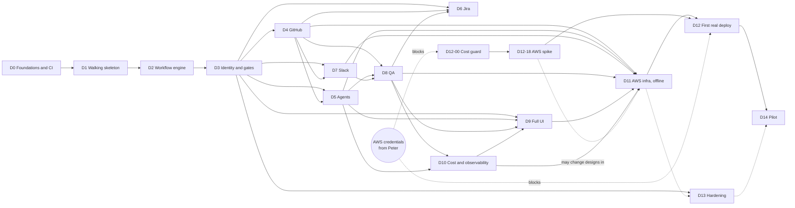

# Delivery stages

How the product in [PLAN.md](PLAN.md) gets built: a walking skeleton first, then vertical slices. Each
issue below is sized for one agent to finish in one PR.

**Stage names here (D0, D1 and so on) are delivery stages of this project.** They are not the workflow
stages a team configures.

## Overview

| Stage | Goal | Blocked on credentials? |
|---|---|---|
| D0 | CI lands first, then a repo where any later PR can be built, tested and reviewed | No |
| D1 | One ticket goes through both gates end to end, offline, with fakes | No |
| D2 | Any valid team workflow runs, and invalid ones are refused | No |
| D3 | Real identity, roles and complete gate rules | No |
| D4 | A real PR is opened, gated and merged on a live throwaway repo | No. Its live issues need a GitHub App step by Peter, and nothing offline waits on that |
| D5 | Real Strands agents do the work, driven by scripted models | No |
| D6 | Jira is fully built, and proved against a fake API | No |
| D7 | Slack is fully built, and proved against a fake API | No |
| D8 | QA runs and the QA gate shows real evidence | No |
| D9 | All UI pages from PLAN.md section 13 | No |
| D10 | Budgets, cancel, kill switch and telemetry complete | No |
| D11 | Everything synthesizes and passes template tests, ready to deploy | No |
| **D12** | **First real deploy and live Bedrock verification** | **Yes** |
| D13 | Hardening, extra adapters, docs | No |
| D14 | Pilot team and evals | **Yes, needs D12** |

**Offline-complete** means D0 to D11 and D13 are done, with CI green, which D11-19 checks. D11-19 is a goal, not a gate: the graph lets D12 start after D11-18, and the D12-18 spike can start as soon as credentials exist.

**Dependency rules, checked by script on every change to this file:**

- Every issue after D0-05 has D0-05 as an ancestor, so CI exists before it, and every issue outside D0 has D0-10, so the declared-files check does too.
- No offline issue depends on a human step (D4-24), and no issue before D12 depends on D12.
- D11-18, and so D12, does not depend on optional adapters in D13 or on a live run. Everything up to that point is reachable with no AWS
account.

## Delivery rules

These come from what went wrong in the PoCs.

1. **No stacked PRs.** Stacks conflict after squash merges. An issue starts from `main`, after its
   dependencies have merged.
2. **One issue, one PR.** If it grows beyond its size, split the issue rather than growing the PR.
3. **Tests first** for engine, gates, effects and budget code.
4. **Independent review on every PR,** in a fresh session that did not write the code. Reviewers found critical
   bugs that green CI missed.
5. **Review loops are capped at 3 rounds.** After that, a person decides, or the remaining items become issues.
6. **Gate suite is a required check from D0-05, filling up from D1-11.** Changing an invariant test requires an ADR.
7. **Hermetic by default:** no test tier except `live` needs credentials, and tests block sockets.
8. **Say what is unproven.** A PR touching AWS behaviour lists what stays unverified until D12. The README keeps
   "never deployed" until D12 closes.
9. **Nothing real is committed,** because this repo is public: no account IDs, tokens, internal URLs or real
   customer data in fixtures.
10. **Dependency lockfiles** are not counted as conflicts: re-lock on rebase.

### Standing acceptance criteria for every issue

Up to 8 agent workers build this at once, on one 7.4 GB laptop. So **every issue below implicitly includes these**, in
addition to its own criteria:

- **Locally, the worker runs only targeted tests for the code it touched** (`make test-changed`, or `make test T=<path>`).
  It does not run full suites, e2e, `cdk synth`, browsers or Docker.
- **Full suites, integration, e2e and synth run in GitHub Actions, and `ci-required` must be green before merge.** A claim
  in an acceptance criterion is met when CI shows it, not when it passed locally.
- **New unit, contract and gate tests are hermetic:** fake LLM, in-process fakes, no Docker, no network. Anything needing Docker
  or a browser carries the `integration` or `ui_browser` marker, and runs in CI only.
- **A heavy CI job is never moved to a laptop to save time.** If a test is too slow for its tier, fix it or move it to a CI-only tier.

**Sizes:** S is under about 300 changed lines, M about 300 to 800, L about 800 to 1,500. Nothing larger.

**Serial areas:** these files are shared, so an issue touching one must be `serial`, and only one such issue may be open per file: `.github/workflows/ci.yml`, `src/sto/engine/reducer.py`, `src/sto/engine/commands.py`, `src/sto/domain/` and `src/sto/gates/service.py`. Other code plugs in without editing them, through the reducer's handler registry (D1-02), gate hook points (D1-06) and the `AuditWriter` seam (D1-06). D0-10 checks this on each PR.

**Run mode:**

- `parallel`: safe alongside other open issues once dependencies have merged, because its files, including the places it integrates, are disjoint from
  any other issue it could overlap with.
- `serial`: touches something shared, so nothing else in that area should be open at the same time.

The wave tables below are generated from the dependencies. Issues in one wave can start together, except that
`serial` ones run one at a time.

---

## D0: Foundations

**Goal:** a repo where any later PR can be built, tested and reviewed.

**Scope:** toolchain, skeletons, GitHub Actions CI early, contribution rules and domain types. No product behaviour.

**Exit criteria:** every CI job runs on a PR, in parallel, with `ci-required` as the single required check, and a ruleset enforces it on `main`. `make doctor &&
make test-changed` works from a fresh clone, with no Docker. Socket-blocking is active. The web and infra skeletons build in CI.
Later issues can rely on all of this.

GitHub Free allows 20 concurrent jobs, so 8 PRs at 11 jobs will queue. Path filters reduce that, and it costs only time.

<!-- waves:D0 -->
| Wave | Parallel | Serial, one at a time |
|---|---|---|
| 1 | - | D0-01 |
| 2 | - | D0-05 |
| 3 | D0-02, D0-06 | D0-03, D0-04, D0-08 |
| 4 | - | D0-09, D0-10 |
| 5 | - | D0-07 |
| 6 | - | D0-08a, D0-09a |
| 7 | - | D0-02a |

#### D0-01: Python project skeleton
Create `src/sto`, `pyproject.toml`, uv lock, ruff, mypy strict and pytest with a socket-blocking fixture.
Host AWS config is hidden from tests, so a test can never reach a real account.
**AC:** `make test-fast` passes on an empty package with no Docker; a test that opens a socket fails; `AWS_PROFILE` is unset in tests.
**Deps:** none. **Size:** S. **Run:** serial. **Files:** `pyproject.toml`, `Makefile`, `src/sto/__init__.py`, `tests/conftest.py`.

#### D0-02: Local prerequisites and ports
`make doctor` checks Python, uv, Node 24 and free ports, with a fix for each, and reports Docker as optional. Dedicated ports
8710 and 5710 avoid collisions with other projects, and `make dev-lan` binds to the LAN with a warning.
**AC:** each missing prerequisite prints a fix; a missing Docker is not an error; ports are overridable; a taken port gives a clear message.
**Deps:** D0-05. **Size:** S. **Run:** parallel. **Files:** `scripts/doctor.py`, `.nvmrc`, `tests/scripts/test_doctor.py`.

#### D0-03: Web skeleton and UI job
Vite, React, TypeScript, ESLint and Vitest in `web/`, with a placeholder page, strict TypeScript and a CI job for all of it.
Pages are discovered from `web/src/pages/*`, so parallel page PRs do not edit one router file.
**AC:** CI's UI job passes and feeds `ci-required`; `vitest related` runs for changed files only; a page folder is routed with no central edit; there is no dependency on `crypto.subtle`.
**Deps:** D0-05. **Size:** S. **Run:** serial. **Files:** `web/`, `.github/workflows/ci.yml`.

#### D0-04: CDK skeleton and synth job
TypeScript CDK app in `infra/` with empty stacks, cdk-nag, Vitest template assertions and a CI synth job.
It uses stable `aws-cdk-lib` constructs and needs no account to synth.
**AC:** `cdk synth` runs in CI with no credentials and feeds `ci-required`; a nag failure fails the job; `deployment.yaml` schema is checked before synth.
**Deps:** D0-05. **Size:** S. **Run:** serial. **Files:** `infra/`, `.github/workflows/ci.yml`.

#### D0-05: First CI and ruleset
One workflow with lint, typecheck and unit jobs, a filter job, and an always-running `ci-required` aggregator as the only required check, enforced by a ruleset on `main`.
This lands straight after the skeleton, so everything later is covered. Other jobs join it in D0-03, D0-04, D0-08 and D0-09.
**AC:** workers use a separate bot account or GitHub App with no admin rights and no ruleset bypass, set up by Peter, and Peter's account keeps overrides; a failing job fails `ci-required`; a direct push to `main` is refused; a docs-only PR passes without running tests; a change to shared code, CI or lockfiles runs everything; pushes to `main` run everything; forks get no secrets.
**Deps:** D0-01. **Size:** M. **Run:** serial. **Files:** `.github/workflows/ci.yml`, `deploy/ruleset-main.json`.

#### D0-06: Contribution rules
Write `CONTRIBUTING.md`, `CLAUDE.md`, PR and issue templates, carrying the delivery rules above.
The PR template requires a "what stays unverified until D12" section and a link to an independent review.
**AC:** templates render on GitHub; rules match this document.
**Deps:** D0-05. **Size:** S. **Run:** parallel. **Files:** `CONTRIBUTING.md`, `CLAUDE.md`, `.github/PULL_REQUEST_TEMPLATE.md`, `.github/ISSUE_TEMPLATE/`.

#### D0-07: Domain types
Define IDs (ULID-based), base types for run, step, gate, decision and effect, and the error classes. **Event, command and `BLOCKED` reason types register from the modules that use them,** so later issues add types without editing `domain/`.
These are frozen typed models with no I/O, and everything later imports them.
**AC:** invalid transitions cannot be represented in types where practical; error classes are `transient`, `permanent` or `degraded`; a new event type in another module needs no edit here; mypy strict passes in CI.
**Deps:** D0-10. **Size:** M. **Run:** serial. **Files:** `src/sto/domain/`, `tests/domain/`.

#### D0-08: Test tiers, targeted runs and core jobs
Pytest markers for `unit`, `contract`, `gate`, `integration`, `ui_browser` and `live`, `make test-changed`, and CI jobs for contract, gate-integrity and coverage.
Tests that use Docker or a browser without the right marker fail, keeping the local tiers hermetic.
**AC:** `make test-changed` runs direct tests only, with a selection budget, so a change in `domain/` does not select the whole suite; a typical run stays under 60 seconds and about 500 MB, with the measurement in the PR; an unmarked Docker use fails; the new jobs feed `ci-required`; `make check` documents itself as the occasional full run.
**Deps:** D0-05. **Size:** M. **Run:** serial. **Files:** `scripts/test_changed.py`, `tests/test_tiers.py`, `.github/workflows/ci.yml`.

#### D0-09: CI integration, browser and e2e jobs
Add `integration`, `ui_browser` and `e2e` jobs, with DynamoDB Local, Docker and Playwright, all CI-only.
They start with smoke tests, so issues in later stages have somewhere to put heavy tests.
**AC:** each job runs when selected by the filter; each feeds `ci-required`; caching keeps a no-op run short; nothing here is needed locally.
**Deps:** D0-03, D0-08. **Size:** S. **Run:** serial. **Files:** `.github/workflows/ci.yml`, `tests/integration/test_smoke.py`, `docker-compose.yml`.

#### D0-10: Declared-files check
A CI job reads a PR's issue ID, and compares touched files with that issue's `Files` here, plus an allow-list of lockfiles, `pyproject.toml`, `Makefile`, `web/package.json` and docs. It feeds `ci-required`.
This is what keeps "parallel" honest, because file lists were the weak point of the first plan.
**AC:** an undeclared file fails with a message naming the issue; an override needs a label whose event actor is on a named list of humans, and a worker's own label is ignored; touching a serial area needs that issue to be marked serial.
**Deps:** D0-08. **Size:** S. **Run:** serial. **Files:** `scripts/check_scope.py`, `tests/scripts/test_check_scope.py`, `.github/workflows/ci.yml`.

#### D0-02a: make dev-lan
`make dev-lan` binds the dev servers to the LAN, printing a warning first; `make dev` stays on loopback. Split out of D0-02 because no server existed yet.
It reuses the ports and overrides from `scripts/doctor.py` (8710 API, 5710 web; `STO_API_PORT`, `STO_WEB_PORT`).
**AC:** `make dev-lan` binds to 0.0.0.0 and warns first; `make dev` stays on loopback; port overrides apply.
**Deps:** D1-08. **Size:** S. **Run:** serial. **Files:** `Makefile`, `scripts/dev.py`, `tests/scripts/test_dev.py`.

#### D0-08a: Tier guard, remaining Docker launch gaps
Close three gaps left after D0-08's review: a backtick or `$(docker ...)` inside a `shell=True` string, `Popen(..., executable="docker")`, and `xargs` as a wrapper.
**AC:** each form raises `TierViolationError`, with one test each; the harmless commands from D0-08's review (`grep -r docker`, `echo "fix firefox"` and so on) stay allowed.
**Deps:** D0-08. **Size:** S. **Run:** serial. **Files:** `tests/tier_guard.py`, `tests/test_tiers.py`.

#### D0-09a: e2e tier
Add an `e2e` marker and a `tests/e2e/` directory tier to the tier guard (CI only, deselected locally), and switch the e2e job from a path selection to `-m e2e`.
**AC:** an unmarked test under `tests/e2e/` is in the e2e tier; e2e tests are deselected locally; the CI e2e job selects by marker and still runs its smoke test.
**Deps:** D0-09, D0-08a. **Size:** S. **Run:** serial. **Files:** `tests/tier_guard.py`, `tests/test_tiers.py`, `.github/workflows/ci.yml`, `tests/e2e/test_stack_smoke.py`.

---

## D1: Walking skeleton

**Goal:** one ticket travels from intake through both human gates to a simulated merge, offline, using fakes,
through real API and UI. Thin everywhere, with the architecture's real seams in place.

**Scope:** one hard-coded workflow, memory and SQLite stores, the complete SPI, local driver, one real Strands agent on a scripted model.

**Exit criteria:** `make dev` runs with no Docker, and shows a demo ticket waiting at the review gate. Approving moves it to QA, and approving
there produces a simulated merge, labelled as simulated. Rejecting at either gate ends it with the writer never called.
Stopping the process and restarting keeps a waiting gate. The first gate tests are required in CI.

<!-- waves:D1 -->
| Wave | Parallel | Serial, one at a time |
|---|---|---|
| 1 | D1-01, D1-04, D1-05, D1-13 | D1-02 |
| 2 | D1-07, D1-12 | D1-06 |
| 3 | - | D1-03 |
| 4 | D1-11 | D1-08 |
| 5 | D1-09 | - |
| 6 | - | D1-10 |

#### D1-01: Store port and in-memory store
Repository port with conditional writes and multi-item transactions, implemented in memory. **Every repository function takes a `TeamScope` from day one**, so later auth work does not rewrite call sites.
This fixes the semantics that DynamoDB must match later, and a shared contract suite proves them.
**AC:** a failed condition aborts the whole transaction; a version counter detects conflicting writes; a query with no `TeamScope` cannot be written; the contract suite is reusable for other stores.
**Deps:** D0-07. **Size:** M. **Run:** parallel. **Files:** `src/sto/store/ports.py`, `src/sto/store/memory.py`, `tests/store/`.

#### D1-12: Local file store
SQLite implementation of the store port, passing the same contract suite, with no Docker.
`make dev` uses it, so a waiting gate really does survive a process restart.
**AC:** contract suite passes; a killed process keeps committed state; single-writer use is documented as local only.
**Deps:** D1-01. **Size:** S. **Run:** parallel. **Files:** `src/sto/store/sqlite.py`, `tests/store/test_sqlite.py`.

#### D1-02: Reducer v0
Pure `next(state, event, workflow)` over a hard-coded linear workflow with two gates, with **registries of handlers, events and commands**, so later issues add files rather than edit shared ones.
It has no I/O, clock or randomness, and emits commands rather than doing anything.
**AC:** same input always gives same output; an out-of-order event is rejected; a new handler, event or command needs no edit to `reducer.py`, `commands.py` or `domain/`; every outcome is covered by a test.
**Deps:** D0-07. **Size:** M. **Run:** serial. **Files:** `src/sto/engine/reducer.py`, `src/sto/engine/commands.py`, `src/sto/engine/handlers/core.py`, `tests/engine/test_reducer.py`.

#### D1-03: Local driver
Asyncio driver that applies commands and feeds back events, persisting state each step.
It recovers from a process restart using only stored state.
**AC:** killing the process at any commit and restarting finishes the run with no duplicated work; a waiting gate stays waiting.
**Deps:** D1-12, D1-02. **Size:** M. **Run:** serial. **Files:** `src/sto/engine/drivers/local.py`, `src/sto/engine/drivers/ports.py`, `tests/engine/test_local_driver.py`.

#### D1-04: Fake integrations and spy writer
All of `TicketSource`, `ScmProvider` and `Notifier` from PLAN.md section 10.1, with in-memory fakes. Later adapters implement these ports, so they are complete now.
A spy records every write, and the fake results are marked `simulated`.
**AC:** ports match the SPI, including commit intent, async merge, dequeue and `expected_head`; a spy exposes calls for assertions; fakes need no network.
**Deps:** D0-07. **Size:** M. **Run:** parallel. **Files:** `src/sto/adapters/ports.py`, `src/sto/adapters/fake/`, `tests/adapters/test_fake.py`.

#### D1-05: Strands agent on a scripted model
A minimal harness runs a real Strands `Agent` for a stage, using a scripted `Model` and returning a structured outcome.
The demo `FakeLLM` is keyword rules, and says plainly that it is not real analysis.
**AC:** drives the real Strands event loop with no framework mocks; an undeclared outcome fails the step; a refusal fails the step.
**Deps:** D0-07. **Size:** M. **Run:** parallel. **Files:** `src/sto/agents/harness.py`, `src/sto/agents/models/scripted.py`, `src/sto/agents/models/fake.py`, `tests/agents/test_harness_v0.py`.

#### D1-06: Gate service v0
Open a gate with a subject, decide through one function, close once by conditional write. Decision, audit and outbox commit in one transaction.
It defines an **`AuditWriter` seam and gate-open and decide hook points**, so later gate rules add files.
**AC:** approve, request changes and reject work; a second close gets `gate_closed`; a stale approval digest is refused and a negative one is not; hooks run inside the same transaction.
**Deps:** D1-01. **Size:** M. **Run:** serial. **Files:** `src/sto/gates/service.py`, `src/sto/gates/hooks.py`, `tests/gates/test_service.py`.

#### D1-07: Effects v0
Effect records with `scoped` and `gated` classes, a claim transaction with `ConditionCheck`s on run, gate and switches, and receipts.
A gated effect refuses to run without a live approval, and reports only what a receipt confirms.
**AC:** a gated effect with no approval never calls the writer; cancel voids a planned effect; a concurrent cancel and claim have exactly one winner; status comes only from a receipt.
**Deps:** D1-01, D1-04. **Size:** M. **Run:** parallel. **Files:** `src/sto/effects/core.py`, `src/sto/effects/ports.py`, `tests/effects/test_core.py`.

#### D1-08: API v0
FastAPI with runs, events by cursor, gates and decisions, using a dev token.
Everything is asynchronous, and no request holds work open.
**AC:** OpenAPI is generated; a decision returns `409` when closed; events resume from a cursor; dev auth refuses to start outside local mode.
**Deps:** D1-03, D1-06, D1-07. **Size:** M. **Run:** serial. **Files:** `src/sto/api/app.py`, `src/sto/api/routers/runs.py`, `src/sto/api/routers/gates.py`, `tests/api/test_v0.py`.

#### D1-09: UI v0
Run list, timeline and one gate page with Approve, Request changes and Reject.
It shows simulated writes as simulated, and renders all model and ticket text as plain text.
**AC:** a person can complete the demo in a browser; a required comment is enforced; a closed gate shows who closed it.
**Deps:** D1-08, D0-03. **Size:** M. **Run:** parallel. **Files:** `web/src/pages/runs/`, `web/src/pages/gate/`, `web/src/lib/`.

#### D1-10: Demo and end-to-end test
`make dev` starts the whole local stack with demo tickets and no Docker, and CI's e2e job drives it through both gates.
The README states the status plainly, including "never deployed".
**AC:** works from a fresh clone with no credentials or Docker; the e2e covers approve-approve and reject at each gate; README is accurate.
**Deps:** D1-05, D1-08, D1-09, D0-09. **Size:** M. **Run:** serial. **Files:** `README.md`, `tests/e2e/test_skeleton.py`, `scripts/dev.py`.

#### D1-11: Gate suite v1
Create `tests/gates/` integrity suite with G1, G4, G10 and the single-approver cases of G3 and G5, in the gate-integrity job that feeds `ci-required`. Quorum cases come with D3-06.
Each test name carries its invariant ID, so a failure explains itself.
**AC:** each invariant has a test that fails when the code is deliberately broken, shown in the PR; CI requires the suite.
**Deps:** D1-06, D1-07, D1-03. **Size:** M. **Run:** parallel. **Files:** `tests/gates/test_integrity.py`.

#### D1-13: Signer port
A single signer port with a local implementation, used by audit checkpoints, step tokens and GitHub App JWTs, with KMS implementations later.
It exists early so that two workers do not invent two ports.
**AC:** sign and verify round-trip; a key ID is part of the result, for rotation; no private key is logged.
**Deps:** D0-07. **Size:** S. **Run:** parallel. **Files:** `src/sto/signing/`, `tests/signing/`.

---

## D2: Workflow engine

**Goal:** any valid team workflow runs, and any invalid one is refused before it can run.

**Scope:** schema, overlays, team and org documents, validator, templates, full reducer through handlers, loops, re-entry, evidence, failure rules, timers, simulator, state compatibility.

**Exit criteria:** the `standard` template and three overlays from PLAN.md section 7 pass validation and run on fakes through every
outcome. Deleting a gate from a template fails validation. A permanent failure does not re-spend after a restart.
Property tests pass over all templates, with crash injection.

<!-- waves:D2 -->
| Wave | Parallel | Serial, one at a time |
|---|---|---|
| 1 | D2-01, D2-22 | - |
| 2 | D2-18, D2-24 | - |
| 3 | D2-02, D2-03, D2-04, D2-12 | - |
| 4 | D2-05 | D2-06 |
| 5 | D2-07, D2-08, D2-10, D2-11, D2-13, D2-16, D2-17, D2-21 | - |
| 6 | D2-09, D2-19, D2-23, D2-25 | - |
| 7 | D2-14, D2-15 | - |
| 8 | D2-20 | - |

#### D2-01: Workflow schema
Typed models for the whole schema in PLAN.md section 7.2, generating a JSON Schema for editors.
There is deliberately no `auto_approve` key, and unknown keys are refused.
**AC:** PLAN.md examples parse; an unknown or duplicate key fails with a line number; a bare `on` key is refused, with an explanation; the JSON Schema is generated and checked in.
**Deps:** D0-07. **Size:** M. **Run:** parallel. **Files:** `src/sto/config/schema.py`, `tests/config/test_schema.py`, `schemas/`.

#### D2-18: Agent profile manifest
Declare each agent profile's outcomes, tool allowlist and default tier as data, so the validator can check them before any agent exists.
D5 and D8 implement these profiles, and a test fails if code and manifest differ.
**AC:** V2 and V9 can read it; all profiles in PLAN.md section 8.3 are listed; the effect catalog gives each effect's class, outcomes, key scope, typed `with` and hold default, including a push effect and `pr.ensure_draft`.
**Deps:** D2-01. **Size:** S. **Run:** parallel. **Files:** `catalog/profiles.yaml`, `catalog/effects.yaml`, `src/sto/config/manifest.py`, `tests/config/test_manifest.py`.

#### D2-02: Overlays and flattening
Apply a `WorkflowOverlay` to its pinned template with JSON Merge Patch on the stage map, and flatten at publish, with provenance for each value.
Maps merge, lists replace and `null` removes. A value below a floor gets an error naming the floor.
**AC:** merge rules have a table of cases; all three PLAN.md overlays flatten; removing a mandatory gate fails; provenance shows which layer set a value.
**Deps:** D2-01, D2-24. **Size:** M. **Run:** parallel. **Files:** `src/sto/config/overlays.py`, `tests/config/test_overlays.py`.

#### D2-03: Structural validator
Implement V1, V2, V3, V7, V8, V9, V10, V13 and V15: references, reachability, outcomes, capped cycles, limits, surfaces, empty floors and typed `with`.
Errors name the stage and say how to fix them.
**AC:** a positive and a negative fixture per rule; an uncapped cycle is refused and the cycle is printed; `reviewers: []` and `required: []` are refused; an unknown `with` key is refused.
**Deps:** D2-18, D2-24. **Size:** M. **Run:** parallel. **Files:** `src/sto/config/validate_structure.py`, `tests/config/test_validate_structure.py`.

#### D2-04: Gate dominance proof
Implement V4, V5, V6, V11 and V14 by edge-removal reachability on the stage graph, deriving code-changing stages from the manifest, and V6's clause scoped to merges reachable with QA approvals removed.
This is the static generalisation of the LangGraph PoC's topology test, and it applies Q2's default.
**AC:** mutation tests: deleting or bypassing any gate edge in any template fails; a gated effect with empty `requires_gates` fails; `review_gate -> merge -> closed` fails; the standard and regulated orders pass; the failing path is printed; G2 is added to the gate suite.
**Deps:** D2-18, D1-11. **Size:** M. **Run:** parallel. **Files:** `src/sto/config/validate_gates.py`, `tests/config/test_validate_gates.py`, `tests/gates/test_static_dominance.py`.

#### D2-05: Bundled templates
Ship `standard` as the template, and Kanban and regulated as overlays on it, each with a README.
All later suites run against all of them.
**AC:** all validate; each has a README on when to use it, and which checks to require; PLAN.md examples match, or a test explains why not.
**Deps:** D2-02, D2-03, D2-04. **Size:** S. **Run:** parallel. **Files:** `templates/`, `tests/config/test_templates.py`.

#### D2-06: Reducer v1
Run any validated workflow for `agent`, `review_panel`, `gate`, `effect` and `terminal` stages through the handler registry, with named loops, step limits and the visited-gates rule.
It replaces the hard-coded path, with no behaviour change to the gate suite. `wait`, `checks` and `route` come in D2-13 and D2-23.
**AC:** each kind and outcome is covered; an exhausted loop goes to `BLOCKED(loop_exhausted)`; `max_steps_per_run` holds; a merged run without a QA approval ends `done_with_incident` and plans a revert.
**Deps:** D2-03, D1-02. **Size:** L. **Run:** serial. **Files:** `src/sto/engine/reducer.py`, `src/sto/engine/commands.py`, `src/sto/engine/handlers/stages.py`, `tests/engine/test_reducer_v1.py`.

#### D2-07: Publishing and pinning
Publishing stores a flattened, immutable version with a manifest digest over workflow, profiles, effects and prompts, and a run pins that digest at start.
Old manifests stay addressable by hash, so a changed profile cannot strand a run.
**AC:** publish during a run changes nothing for that run; changing a profile's outcomes does not affect a pinned run; `TeamConfig` and `OrgPolicy` changes do apply live.
**Deps:** D2-02, D2-06. **Size:** M. **Run:** parallel. **Files:** `src/sto/config/publish.py`, `tests/config/test_publish.py`.

#### D2-08: Subject and rounds
Compute subject digests, verbatim `patch_id`, attention digests, normalised `ticket_revision` and round numbers, and store the data for interdiffs.
A re-entered gate is a new instance linked to the last, and it cannot open if evidence is not valid for the subject.
**AC:** same diff on a new base gives the same `patch_id`; a whitespace-only change gives a different one; our own ticket comments do not change `ticket_revision`; interdiff data exists for round 2 onward.
**Deps:** D1-06, D2-06, D2-22. **Size:** M. **Run:** parallel. **Files:** `src/sto/gates/subject.py`, `tests/gates/test_subject.py`.

#### D2-09: Carry-over and invalidation
Any non-approved close invalidates earlier approvals, a patch change invalidates permanently, and `carry_over: patch_id` closes a re-entered gate only under the six conditions in PLAN.md section 4.6.
This is the most dangerous logic in the product, and it implements invariant G13. Approver re-checks go through a port that D3-05 fills.
**AC:** all G13 cases pass, including P1, P2, P1; approve, request changes, same patch; approve, superseded, same patch; partial votes; a base range touching the patch's files; only the most recent closed instance can be cited; carry-over never crosses a retest.
**Deps:** D2-08. **Size:** M. **Run:** parallel. **Files:** `src/sto/gates/carry_over.py`, `tests/gates/test_carry_over.py`.

#### D2-10: Failure classes and retry
Classify errors, apply one retry layer, send permanent failures to `BLOCKED`, and add an audited human retry that stops the earlier attempt.
This fixes the PoC's re-spending on restart. Retry only re-runs a step, and can never change an outcome.
**AC:** R1: spend stays flat across restarts for a permanent failure; R2: one retry layer counted at a stub; retry does not reset loop counters or step past `block_on`; it is audited.
**Deps:** D2-06. **Size:** M. **Run:** parallel. **Files:** `src/sto/engine/handlers/failures.py`, `tests/engine/test_failures.py`.

#### D2-11: Cancel v1
Add the `CANCELLING` state from any active state, with a timeout and alarm, voiding planned effects, closing gates and stopping dispatch of new steps. A run stopped after a merge ends `done_with_incident`, with the revert.
Stopping model calls mid-step and session stopping arrive in D10-06.
**AC:** C3 passes on fakes; Stop beats an approved but unexecuted effect (G10); closing a browser does nothing (C4); gate-eligible people can use Stop; a stuck stop raises the alarm; Stop after merge plans a revert and never ends plain `CANCELLED`.
**Deps:** D2-06, D1-06, D1-07. **Size:** M. **Run:** parallel. **Files:** `src/sto/engine/handlers/cancel.py`, `tests/engine/test_cancel.py`.

#### D2-12: Timers and business calendar
Timer port, a local implementation, and business-time maths from `TeamConfig` calendars.
Timers re-read the gate, so a late or repeated one is harmless.
**AC:** G12: any firing order never approves; holidays and time zones are tested with DST; reminders pause with a paused run; `max_run_age` counts wall-clock time and always holds.
**Deps:** D1-06, D2-24. **Size:** M. **Run:** parallel. **Files:** `src/sto/gates/timers.py`, `src/sto/gates/calendar.py`, `tests/gates/test_timers.py`.

#### D2-13: Wait and checks stages
`wait` stages for human answers, and `checks` stages that wait for external results with a timeout, as handlers.
No compute is held while waiting, and `team_default` resolving to no checks blocks with a reason.
**AC:** duplicates and late results change nothing (R4); a timeout follows its edge; a closed run ignores results; a pending check is a wait, not a failure.
**Deps:** D2-06. **Size:** M. **Run:** parallel. **Files:** `src/sto/engine/handlers/waits.py`, `tests/engine/test_waits.py`.

#### D2-14: Simulator and CLI
`sto validate` and `sto dry-run` walk a workflow with the fake LLM and print the path taken.
A team can try any outcome without touching anything real.
**AC:** a chosen outcome sequence is scriptable; no real writes occur (asserted by spy); output is usable in CI.
**Deps:** D2-06, D2-02, D2-13, D2-23. **Size:** M. **Run:** parallel. **Files:** `src/sto/cli/`, `tests/cli/`.

#### D2-15: Property and crash tests
Hypothesis generates valid workflows and event sequences, and a crash is injected at every commit.
Invariants: terminates or waits, never runs gated effects unapproved, never loses a decision.
**AC:** R3 and the store-level part of G6 pass; a seed is printed on failure; runs under a fixed time budget in CI.
**Deps:** D2-06, D2-05, D2-13, D2-23. **Size:** M. **Run:** parallel. **Files:** `tests/engine/test_properties.py`, `tests/gates/test_crash.py`.

#### D2-16: Definition of done checks
Machine-evaluated conditions from config, evaluated **before a gate opens** or before a stage exits, blocking with a clear reason.
Checks are a registry of named evaluators, with no free-form expressions.
**AC:** `ac_present`, `checks_green`, `coverage_at_least` and `no_findings_above` work; a failed check explains what is missing; a gate never opens with a failed check.
**Deps:** D2-06. **Size:** S. **Run:** parallel. **Files:** `src/sto/engine/handlers/dod.py`, `tests/engine/test_dod.py`.

#### D2-17: Intake, sprints, WIP and windows
Start runs from closed intake selectors, honour active-sprint filtering, WIP limits and freeze and change windows, and record the intake actor, ticket revision and frozen route inputs.
Duplicate active runs and tickets matching two workflows start nothing, and a non-member's edit pauses the run for a member to confirm.
**AC:** a ticket outside the active sprint does not start; WIP holds runs queued; a freeze holds merge in `WAITING_EXTERNAL`; overlapping selectors are refused at publish (V12); T11: public repos need opt-in, and an edit by a non-member or unknown editor pauses the run.
**Deps:** D2-06, D2-12. **Size:** M. **Run:** parallel. **Files:** `src/sto/engine/intake.py`, `tests/engine/test_intake.py`.

#### D2-19: Run migration
Admins can move a pinned run to a newer manifest, only if the target is valid at its current stage and meets `OrgPolicy.teams`, and it is audited.
An `apiVersion` change comes with a migration rule, tested here.
**AC:** migration to an invalid position is refused; migration onto a version lacking an org-required gate is refused; `POST /runs/{id}:migrate` is enforced by role; a stored older run migrates in a test.
**Deps:** D2-07, D1-08. **Size:** S. **Run:** parallel. **Files:** `src/sto/config/migrate.py`, `src/sto/api/routers/migrate.py`, `tests/config/test_migrate.py`.

#### D2-20: State compatibility
Replay stored fixtures of older run states through the current reducer, required on every engine change from here on.
In-flight runs must survive deployments, and this comes before D3 so nothing needs retrofitting.
**AC:** an incompatible change fails CI with a clear message; fixture capture is one command.
**Deps:** D2-15. **Size:** S. **Run:** parallel. **Files:** `tests/engine/test_compat.py`, `tests/engine/fixtures/`.

#### D2-21: Same-patch result reuse
A `review_panel` and an `agent` QA stage reuse results when `patch_id` is unchanged, with `same_patch` validity, and `checks` stages never do.
This keeps a base update cheap, and the reuse decision is recorded.
**AC:** a base update re-runs CI and QA suites, and reuses reviews; a changed patch reuses nothing; a new required reviewer is not reused away.
**Deps:** D2-22, D2-06. **Size:** S. **Run:** parallel. **Files:** `src/sto/engine/handlers/reuse.py`, `tests/engine/test_reuse.py`.

#### D2-22: Evidence records
Each piece of evidence stores `tested_sha`, `patch_id` and validity (`exact_sha`, `same_patch`, `contains_sha`), and a check says whether all of it holds for a subject.
This settles the rule that D2-08 and D2-21 both depend on.
**AC:** a table of cases per validity; a squash merge's frozen subject works with `contains_sha`; the gate page data says "evidence from an older base".
**Deps:** D0-07, D1-01. **Size:** S. **Run:** parallel. **Files:** `src/sto/gates/evidence.py`, `tests/gates/test_evidence.py`.

#### D2-23: Route stages
A `route` stage picks an edge from a closed vocabulary, with no expressions, and a required `default`. Ticket-field inputs are frozen at intake, with a ratchet: raises apply, and lowering needs a named role, whose audited actor becomes ineligible for that run's gates.
A gate reached by a ticket-field route stays required once visited, and the validator treats every edge as possible, so proofs still hold.
**AC:** G21: risk lowered before the route runs, and between rounds, does not skip the gate; on a route with `order`, a value outside it goes to `BLOCKED` with a reason and never takes `default`; route inputs are part of `ticket_revision`; `repo_ci_trust` is evaluated fresh each pass.
**Deps:** D2-06, D2-08, D2-17. **Size:** M. **Run:** parallel. **Files:** `src/sto/engine/handlers/route.py`, `tests/engine/test_route.py`.

#### D2-24: Team and org documents
Typed `TeamConfig` and `OrgPolicy`, stored live, with a typed read API used at decision and effect time, plus V17 for org-required gates at publish.
Each floor's enforcement lands in a later issue, so a tracking test lists every floor, and fills up as they arrive.
**AC:** a tightened floor changes the next read on a pinned run; only org admins can write `OrgPolicy`, at the role seam; V17 refuses a workflow missing a required gate, quorum or carry-over setting; the tracking test names the issue for each floor still open.
**Deps:** D2-01, D1-01. **Size:** M. **Run:** parallel. **Files:** `src/sto/config/team_config.py`, `src/sto/config/org_policy.py`, `tests/config/test_policy.py`.

#### D2-25: Loop grants and route-to-gate
A team admin can grant extra rounds to a run at a spent loop, and, under `route_to_gate_allowed`, send a run with a `review_panel` false positive to the next gate in the proved graph.
Both are engine actions, so they are limited to what the graph allows. A patch blocked by path policy or a secret scan is never routed past `branch.push`.
**AC:** route-to-gate puts the item on the attention list and makes the actor ineligible for that round; it is refused by default, from a non-review stage, and for a policy-blocked patch (G20); both are audited.
**Deps:** D2-10, D2-08. **Size:** S. **Run:** parallel. **Files:** `src/sto/engine/handlers/grants.py`, `tests/engine/test_grants.py`.

---

## D3: Identity and complete gates

**Goal:** real identities, roles and every gate rule in PLAN.md section 4.

**Scope:** OIDC validation, group mapping, resource bindings, RBAC, membership freshness, SoD, quorum, audit chain and checkpoints, DynamoDB store, outbox relay, attribution.

**Exit criteria:** sign-in through a fake OIDC issuer gives correct team roles. The tenancy suite passes, including team A naming team B's repo. G3 to G7, G11 and G19 pass. Store contract tests pass on DynamoDB Local. The chain verifier passes on an exported run.

<!-- waves:D3 -->
| Wave | Parallel | Serial, one at a time |
|---|---|---|
| 1 | D3-01, D3-08 | D3-09 |
| 2 | D3-02, D3-10 | - |
| 3 | D3-04, D3-05, D3-14, D3-18 | D3-03 |
| 4 | D3-15, D3-19 | D3-06 |
| 5 | D3-11, D3-12, D3-13, D3-16, D3-17 | - |
| 6 | D3-07, D3-20 | - |

#### D3-01: OIDC validation and fake issuer
Validate any issuer's JWTs by JWKS, with a fake issuer for tests and local use.
Records a test plan for what only a real IdP can prove: group list size, step-up and revocation.
**AC:** bad signature, audience, expiry and issuer are refused; the Cognito-specific part is config only; the D12 test plan is written.
**Deps:** D0-07, D1-08. **Size:** M. **Run:** parallel. **Files:** `src/sto/identity/oidc.py`, `src/sto/identity/fake_issuer.py`, `tests/identity/test_oidc.py`.

#### D3-02: Group mapping and roles
Store `(idp, group) -> (team, role)` as data, and resolve roles server-side on each request.
Custom gate roles are declared per team.
**AC:** a changed mapping applies on next request; an unmapped user has no access; a disabled user is refused immediately; custom roles work.
**Deps:** D3-01, D1-01. **Size:** S. **Run:** parallel. **Files:** `src/sto/identity/mapping.py`, `tests/identity/test_mapping.py`.

#### D3-03: Authorization middleware
Middleware turns a verified identity into a `TeamScope` and enforces the permission matrix from PLAN.md section 9.3. Repositories already require the scope from D1-01.
A shared suite tries every route as every role from another team.
**AC:** matrix tests are generated from one table; cross-team access is refused on every route; T9 covered; a new route with no declared permission fails a test.
**Deps:** D3-02, D1-08. **Size:** M. **Run:** serial. **Files:** `src/sto/api/auth.py`, `tests/api/test_tenancy.py`.

#### D3-04: Account linking
Linking proves control of a Slack, GitHub or **Jira** account through that vendor's OAuth flow, while signed in to SSO.
Email matching alone is refused, links expire, and an unlinked account can never decide.
**AC:** replayed and expired link tokens are refused; a Jira account ID resolves to an SSO identity; unlink works and is audited.
**Deps:** D3-02. **Size:** M. **Run:** parallel. **Files:** `src/sto/identity/linking.py`, `src/sto/api/routers/links.py`, `tests/identity/test_linking.py`.

#### D3-05: Separation of duties
Evaluate SoD at decision time from push receipts, with the floors from PLAN.md section 9.4, including two distinct humans, a frozen `author` union and an intake-derived `requester`. Unresolvable terms fail closed.
An admin who changed a mapping, attributed a commit or cleared an exclusion is ineligible for the affected round.
**AC:** G7's whole matrix; a forged bot author on a pushed commit blocks; platform commits do not block; service identities are never eligible; T8 covered.
**Deps:** D3-02, D1-06, D2-24. **Size:** M. **Run:** parallel. **Files:** `src/sto/gates/sod.py`, `tests/gates/test_sod.py`.

#### D3-06: Quorum and veto
Quorum per role, one vote per person, and veto by any negative decision, replacing the v0 decision path. All surfaces use it.
Negative decisions are exempt from the digest match, and a moved subject drops earlier votes.
**AC:** G3 by every commit order; a per-role quorum needs each role; votes drop on a ticket edit; required comments are enforced.
**Deps:** D3-05, D2-08. **Size:** M. **Run:** serial. **Files:** `src/sto/gates/service.py`, `tests/gates/test_decisions.py`.

#### D3-07: Eligibility display and escalation
Show who can decide, warn when nobody can, and run reminders and escalation through timers.
Escalation notifies, but grants nothing. The way out of a stuck gate is D3-20.
**AC:** a team with no eligible approver gets a warning immediately, naming D3-20's action; escalation does not change eligibility.
**Deps:** D3-16, D2-12. **Size:** S. **Run:** parallel. **Files:** `src/sto/gates/escalation.py`, `tests/gates/test_escalation.py`.

#### D3-08: Audit chain and checkpoints
Hash-chain audit events through a chain head item, on the `AuditWriter` seam, with signed checkpoints through the signer port, a verifier and an export.
Secrets are redacted before storing. Refused attempts go through a separate, best-effort path.
**AC:** every state change produces an audit event, asserted across a template run; editing, reordering or **removing a tail or a whole run** fails verification against a checkpoint; T14 covered; update and delete are unavailable in the port.
**Deps:** D1-06, D1-07, D1-13. **Size:** M. **Run:** parallel. **Files:** `src/sto/audit/`, `tests/audit/`.

#### D3-09: DynamoDB store
Implement the store and table design from PLAN.md section 11, passing the shared contract suite on moto locally and DynamoDB Local in CI.
Atomicity uses `TransactWriteItems` with conditions.
**AC:** contract suite passes on memory, SQLite and moto with no Docker, and on DynamoDB Local in CI's integration job; a test bounds items per transaction.
**Deps:** D1-01, D0-09. **Size:** L. **Run:** serial. **Files:** `src/sto/store/dynamodb.py`, `tests/store/test_dynamodb.py`.

#### D3-10: Indexed queries
"My approvals", run lists, ticket lookup and PR lookup, all through indexes with pagination.
This removes the PoC's read-everything list.
**AC:** a test asserts no scans on these paths; pagination is stable; duplicate active run for a ticket is refused atomically.
**Deps:** D3-09. **Size:** M. **Run:** parallel. **Files:** `src/sto/store/queries.py`, `tests/store/test_queries.py`.

#### D3-11: Outbox relay
Deliver committed signals to the driver, retrying until delivered, treating "already closed" as success after a reconcile.
This is the seam that G6 tests hardest, including a decision committing before the task token is stored.
**AC:** G6: a crash after each write recovers and applies once; a stuck entry raises an alarm metric; ordering per run holds.
**Deps:** D3-06, D1-03. **Size:** M. **Run:** parallel. **Files:** `src/sto/effects/relay.py`, `tests/gates/test_outbox_crash.py`.

#### D3-12: Cognito triggers
An Inbound federation trigger that rewrites groups on every sign-in, a Pre authentication fallback, a pre token trigger that normalises immutable group IDs, and a configuration guide for Entra ID, Okta and a generic SAML IdP.
Two traps need fixtures: `{}` is a no-op that keeps every attribute, so no groups needs a non-empty map with an explicit blank, and attributes left out of a non-empty map are dropped.
**AC:** fixtures for string, list, missing and removed groups, and refresh; the no-groups case returns an explicit blank; attributes to keep are all returned; the guide lists what stays unverified until D12-10.
**Deps:** D3-15. **Size:** M. **Run:** parallel. **Files:** `src/sto/identity/cognito_trigger.py`, `tests/identity/test_cognito_trigger.py`, `docs/SSO.md`.

#### D3-13: Moving ticket and PR
Handle the events in PLAN.md section 4.5 at any stage, not only at a gate: new commit, edited or closed ticket, closed PR, outside merge.
A ticket edit drops votes and needs an acknowledgement, and our own merge is recognised by its receipt.
**AC:** G11 passes; a closed ticket cannot be approved; an outside merge is flagged in audit; a commit during a QA stage returns to CI under the `external_commit` cap.
**Deps:** D3-06, D2-13. **Size:** M. **Run:** parallel. **Files:** `src/sto/gates/moving.py`, `tests/gates/test_moving.py`.

#### D3-14: Resource bindings
Org-admin-owned bindings from repo, Jira project and Slack channel to team, with V12 at publish, and a check the credential broker and tool layer call.
This is the tenancy boundary for outside systems, and T19 depends on it.
**AC:** team A's workflow naming team B's repo is refused at publish, and again at the broker; only org admins can write bindings; a test covers each resource kind.
**Deps:** D2-24, D3-02. **Size:** M. **Run:** parallel. **Files:** `src/sto/tenancy/bindings.py`, `src/sto/api/routers/resources.py`, `tests/tenancy/test_bindings.py`.

#### D3-15: Membership freshness
Store a membership snapshot with `as_of` per identity, **set to the time the IdP authenticated the person**, require it within `identity_max_age` for every decision on every surface, and expire links. A port allows a directory or SCIM refresh.
Without this, a Slack or GitHub decision has no meaningful identity.
**AC:** G19 on all surfaces that exist so far; a refreshed token or reused session does not move `as_of`; a stale identity gets a deep link to sign in; the port has a fake; `auth_time` and `prompt=login` flow is covered for the UI.
**Deps:** D3-04, D2-24. **Size:** M. **Run:** parallel. **Files:** `src/sto/identity/membership.py`, `tests/identity/test_membership.py`.

#### D3-16: Eligibility and surface checks
At decision time: a role in `eligible_roles` then and now, the surface permitted by the gate and `OrgPolicy`, and a fresh identity. A gate snapshots eligibility when it opens.
This plugs into the D1-06 hook points.
**AC:** a mapping change does not apply to an open gate; an approver who loses eligibility is refused, and their vote stops counting; a forbidden surface is refused live on a pinned run.
**Deps:** D3-06, D3-15. **Size:** S. **Run:** parallel. **Files:** `src/sto/gates/eligibility.py`, `tests/gates/test_eligibility.py`.

#### D3-17: Write conflicts and concurrency
A write conflict while a gate is open retries instead of returning a false `409`, on every store, with 50 concurrent decisions.
Runs on DynamoDB Local in CI, because the fast stores may not model `TransactionConflict`.
**AC:** G5 with 50 concurrent decisions; sub-quorum approvals all commit; only a truly closed gate returns `409`; G3, G5 and G6 also pass in the integration job.
**Deps:** D3-06, D3-09. **Size:** S. **Run:** parallel. **Files:** `src/sto/gates/retry.py`, `tests/integration/test_gate_concurrency.py`.

#### D3-18: First org admin
A deployment parameter names one bootstrap IdP group, because mappings are data and something must write the first one.
It works once, and is then disabled and audited.
**AC:** an empty system has one way in; the bootstrap cannot be reused after the first mapping exists.
**Deps:** D3-02. **Size:** S. **Run:** parallel. **Files:** `src/sto/identity/bootstrap.py`, `tests/identity/test_bootstrap.py`.

#### D3-19: Commit attribution and term resolution
`POST /runs/{id}/commits/{sha}:attribute` and `POST /runs/{id}/sod-terms:resolve` let a team admin attribute an unknown commit, clear a false exclusion, or resolve an unknown requester or author, which unblocks the gate.
Without them, one stray commit or a Jira automation adding a label would leave a run stuck forever.
**AC:** the gate reports the block and who can clear it; the actor becomes ineligible for that round; a person cannot clear their own exclusion; it is audited.
**Deps:** D3-05, D3-03. **Size:** S. **Run:** parallel. **Files:** `src/sto/api/routers/attribution.py`, `tests/api/test_attribution.py`.

#### D3-20: Eligibility extension
An org admin can extend eligibility on an open gate when its approvers have left or are away, through `POST /gates/{id}:extend-eligibility`. Otherwise "then and now" could deadlock a gate, with Stop the only exit.
The extender cannot vote in that round, and the added person must pass separation of duties.
**AC:** G7's extension cases pass; only org admins can do it; it is audited, and shown on the gate; ordinary mapping changes still do not reach open gates.
**Deps:** D3-16. **Size:** S. **Run:** parallel. **Files:** `src/sto/gates/extension.py`, `src/sto/api/routers/gate_extension.py`, `tests/gates/test_extension.py`.

---

## D4: GitHub, live

**Goal:** a real PR is opened, gated and merged by the orchestrator on a live throwaway repo.

**Scope:** credential broker, fake GitHub, webhooks, all SCM operations, CI trust, the pre-push gate, fork mode, check runs, PR review surface, merge guard, async merge, reconciler.

**Exit criteria:** the conformance suite passes on the fake and on live GitHub. On the throwaway repo, with scripted agents,
an issue becomes a merged PR, and each merge guard blocks when it should. No branch exists before the pre-push approval, and a hostile test cannot read a canary secret. Merging a run's exact SHA before approval is blocked by its pending check, and content landing outside the platform is detected.

**Needs:** Peter for D4-24 only. Everything else is offline.

<!-- waves:D4 -->
| Wave | Parallel | Serial, one at a time |
|---|---|---|
| 1 | D4-03, D4-27 | D4-01 |
| 2 | D4-16 | - |
| 3 | D4-02, D4-04, D4-19, D4-20 | - |
| 4 | D4-05, D4-06, D4-10 | D4-24 |
| 5 | D4-07, D4-09, D4-13, D4-17, D4-25 | - |
| 6 | D4-08 | D4-11 |
| 7 | - | D4-21 |
| 8 | D4-12, D4-14, D4-22 | - |
| 9 | D4-26, D4-28 | - |
| 10 | - | D4-15 |
| 11 | - | D4-23 |

#### D4-01: Conformance suite
Shared adapter conformance suite, run against whichever server a setting selects: in-process fake or real API.
It is written once, and every adapter in every later stage runs it.
**AC:** suite covers signature rejection, duplicates, out-of-order delivery, crash-after-write, rate limits and auth failure; it runs in process with no Docker; a trivial fake adapter passes it; T6 covered.
**Deps:** D1-04. **Size:** M. **Run:** serial. **Files:** `tests/contract/suite.py`.

#### D4-16: Fake GitHub: auth and webhooks
First part of an in-process fake: App auth, tokens, signatures, deliveries, pagination, rate limits and errors.
Each behaviour is documented with its source URL, and the live suite later proves it.
**AC:** the conformance suite's auth and webhook sections can target it; fixtures are synthetic.
**Deps:** D4-01. **Size:** M. **Run:** parallel. **Files:** `tests/fakes/github/auth/`, `tests/fakes/github/webhooks/`.

#### D4-02: Credential broker and GitHub auth port
`CredentialBroker` port on the signer port from D1-13. No human step and no real App, so no offline work waits on a person.
Tokens are narrowed per call, cached under an hour, never logged, and refused for a repo not bound to the team.
**AC:** a token request names repos and permissions; an unbound repo is refused; T15 covered at this layer.
**Deps:** D4-16, D3-14, D1-13. **Size:** M. **Run:** parallel. **Files:** `src/sto/adapters/credentials/`, `src/sto/adapters/github/auth.py`, `tests/adapters/github/test_auth.py`.

#### D4-03: Webhook ingest core
Generic ingest: verify on the raw body, dedupe, enqueue, respond inside the vendor's deadline.
Consumers treat the delivery as a nudge and re-read state.
**AC:** bad signatures get 401 with a metric; duplicates are dropped; queue failure returns an error so the vendor retries.
**Deps:** D3-09. **Size:** M. **Run:** parallel. **Files:** `src/sto/ingest/core.py`, `tests/ingest/test_core.py`.

#### D4-04: GitHub webhooks
`X-Hub-Signature-256` in constant time, dedupe by `X-GitHub-Delivery`, event parsing to `ExternalChange`.
Installation and permission events update connection state.
**AC:** conformance signature and duplicate tests pass; each subscribed event type has a fixture.
**Deps:** D4-03, D4-16. **Size:** S. **Run:** parallel. **Files:** `src/sto/ingest/github.py`, `tests/ingest/test_github.py`.

#### D4-05: GitHub issues as tickets
`TicketSource` on issues: intake by label, comments, labels and `/sto` commands from linked users only, recording the actor from the issue's events.
A closed state maps to `to_status_category: done`.
**AC:** a command from an unlinked user is refused with a reply; a planted marker from another user does not suppress our comment (G9); idempotent after a crash.
**Deps:** D4-02, D4-04, D3-04. **Size:** M. **Run:** parallel. **Files:** `src/sto/adapters/github/tickets.py`, `tests/adapters/github/test_tickets.py`.

#### D4-06: SCM reads
Tarball snapshot at a pinned SHA for private repos, tree, file, search, log, blame, diff, checks and the `ci_trust` report.
All reads are by SHA, so results do not drift.
**AC:** a private repo works with a narrowed token; the 5 minute link expiry is handled; pagination and rate limits are covered.
**Deps:** D4-02, D4-19. **Size:** M. **Run:** parallel. **Files:** `src/sto/adapters/github/scm_read.py`, `tests/adapters/github/test_scm_read.py`.

#### D4-07: SCM writes
Create a commit object and record its SHA as intent, then move the ref without force, on `sto/<run>`, `sto/<run>/<n>`, `sto-approved/<run>` or `sto-revert/*`. Ensure, close or mark ready a draft PR, all idempotently.
Only those branches can be written, and these receipts are what SoD relies on.
**AC:** a crash after each step gives one commit and one PR; a concurrent human push makes the move fail cleanly; other branch names are refused in code; a second round does not open a second PR; each receipt is read back.
**Deps:** D4-06, D1-07. **Size:** M. **Run:** parallel. **Files:** `src/sto/adapters/github/scm_write.py`, `tests/adapters/github/test_scm_write.py`.

#### D4-08: Gate check runs
Publish `sto/review-gate` and `sto/qa-gate` as gates change. Post neutral only for a SHA no run has ever produced, using a tombstone, and never replace a pending gate check.
Docs state plainly what this stops and what it does not, and which to require per template.
**AC:** a new SHA starts pending; only a valid approval, direct or carried over, sets success; the same SHA on another branch stays pending until approved; a rejected run's SHA never goes neutral after the run ends; a human PR is not blocked; a failed publish does not change gate state.
**Deps:** D4-07, D4-20, D3-06. **Size:** S. **Run:** parallel. **Files:** `src/sto/adapters/github/checks.py`, `tests/adapters/github/test_checks.py`.

#### D4-09: CI checks stage
Wire `checks` stages to real check results for an exact SHA, by webhook and reconcile.
Handles required sets, skipped checks and flakes.
**AC:** a check on another SHA is ignored; missing required checks time out rather than pass; results survive restart.
**Deps:** D4-06, D2-13. **Size:** S. **Run:** parallel. **Files:** `src/sto/engine/checks_stage.py`, `tests/engine/test_checks_stage.py`.

#### D4-10: PR review as a decision surface
Map PR review events to decisions, with the same function, identity and SoD rules. Off by default in templates.
Accepted only if submitted after the gate opened, at `head_sha`, not already consumed, and still valid when re-read.
**AC:** same decision function as the UI; review-type gates only; a review before the gate opened, from an earlier round, dismissed or of the wrong SHA is refused; an approval needing acknowledgement deep-links to the UI; a stale identity is refused (G19).
**Deps:** D4-04, D3-16, D4-20. **Size:** M. **Run:** parallel. **Files:** `src/sto/adapters/github/review_surface.py`, `tests/adapters/github/test_review_surface.py`.

#### D4-11: Merge guards
Implement guards 1 to 6 from PLAN.md section 6.4 in the claim transaction and immediately before it, including holds, `require_up_to_date`, and the latest-instance rule.
A switches port is read here, and D10-07 controls it.
**AC:** G13 and G15: each guard failing alone blocks; a head behind base does not merge; pending checks wait without using a loop.
**Deps:** D4-07, D4-09, D2-09, D3-05, D2-17. **Size:** M. **Run:** serial. **Files:** `src/sto/effects/merge.py`, `tests/gates/test_merge_guard.py`.

#### D4-12: Base update
The `pr.update_branch` path from a `stale` merge through `POST /merges`, which returns the SHA. It cannot carry an expected head, so we check the head before, and read back that the first parent equals it.
A commit from a lost response is recognised only by parents and an unchanged `patch_id`, and carry-over decides on re-approval.
**AC:** a clean update with `carry_over: patch_id` proceeds with no person asked; with `none` it asks again; conflict goes to the `merge_conflict` loop; a human push between check and merge is detected by the first parent; a crash never classifies our commit as human (G9); a hand-made merge that alters code is not treated as ours.
**Deps:** D4-21. **Size:** M. **Run:** parallel. **Files:** `src/sto/effects/base_update.py`, `tests/effects/test_base_update.py`.

#### D4-13: Reconciler
Sweep open runs on a schedule, compare external state, and emit `ExternalChange` for differences, including a run's content landing outside the platform.
A missed webhook adds only delay.
**AC:** dropping every webhook still finishes a run; rate-limit friendly; idempotent; a large webhook rejected at the edge is caught, with a metric; drift appears as a metric.
**Deps:** D4-06, D3-13. **Size:** M. **Run:** parallel. **Files:** `src/sto/engine/reconcile.py`, `tests/engine/test_reconcile.py`.

#### D4-14: Post-merge and revert
Run post-merge checks at the merge SHA, and on failure open a revert PR on `sto-revert/*`, outside the gate check, without merging it. The engine rule for an unqualified merge uses the same path, keyed by `(run, merge_sha)`.
The revert goes through normal review, and the run ends `done_with_incident`.
**AC:** a red post-merge opens one revert PR idempotently; a declared revert and the implicit one open one PR; the revert is not held pending by a gate check; notification sent; the revert is not merged automatically.
**Deps:** D4-21. **Size:** S. **Run:** parallel. **Files:** `src/sto/effects/revert.py`, `tests/effects/test_revert.py`.

#### D4-15: Live GitHub conformance
Run the conformance suite against the real App on a throwaway repo, including a **hostile test that must not read a canary secret** before a human approves it.
It is tagged, and its secrets are in a GitHub Environment with Peter as required reviewer, because a same-repo branch could otherwise edit the workflow. The worker identity is not on that reviewer list.
**AC:** conformance passes live; no branch exists before the pre-push approval; the canary stays unread; App permissions are confirmed; differences from the fake are fixed in the fake; test repo cleans up after itself.
**Deps:** D4-24, D4-05, D4-08, D4-26, D4-27. **Size:** M. **Run:** serial. **Files:** `tests/live/github/test_conformance.py`, `.github/workflows/live-github.yml`.

#### D4-17: CI trust report
Report a repo's `ci_trust`, which can only be `attested` or `unknown`, re-checked per round and expiring after 90 days. It reads secrets, Environment rules and `default_workflow_permissions`, scans workflow files for `pull_request_target` and `workflow_run`, and records a named human's statements on CI systems and OIDC trust.
Anything it cannot prove stays `unknown`, because attestation fails closed. Fork mode is never `attested` here until D4-28 and D4-23 pass.
**AC:** each condition in PLAN.md section 12's table flips `attested` to `unknown` in a test; a repo with a repo-level secret, a read-write default token, a `pull_request_target` workflow, a workflow on `sto/*` declaring write `permissions` or `id-token: write`, or no ruleset on `sto-approved/*` and `sto-revert/*` is `unknown`; the human statements are audited, with name and date.
**Deps:** D4-06, D2-24. **Size:** M. **Run:** parallel. **Files:** `src/sto/adapters/github/ci_trust.py`, `tests/adapters/github/test_ci_trust.py`.

#### D4-19: Fake GitHub: PRs and merges
Fake pull requests, draft state, async merge with polling and `sha`, base updates through `POST /merges`, commit and ref APIs, and merge queue responses.
It models the async API as the main path, with the behaviours marked unverified until D4-23.
**AC:** async merge, a moved head, `enqueued` and conflict are all simulated; the conformance suite's SCM section can target it.
**Deps:** D4-16. **Size:** L. **Run:** parallel. **Files:** `tests/fakes/github/pulls/`.

#### D4-20: Fake GitHub: checks, rulesets and dispatch
Fake check runs, required checks with `neutral` counting as passing, rulesets, reviews and workflow dispatch with run IDs.
Protection failures give messages the merge guard can explain.
**AC:** a required check pending blocks; neutral passes; dispatch returns a run ID only in the response, so a crash can lose it.
**Deps:** D4-16. **Size:** M. **Run:** parallel. **Files:** `tests/fakes/github/checks/`.

#### D4-21: Merge request and results
Request merges through the async API with the approved SHA, poll, read back, and map each result: merged, moved head, conflict, cannot merge, `enqueued`, and protection failure.
The sync endpoint is not used, because it cannot do merge queues and GitHub no longer recommends it.
**AC:** each result maps to its defined next step; `gate_invalid` returns to the gate; already merged at that SHA counts as success; an effect stays `ACCEPTED` until read-back.
**Deps:** D4-11, D4-19. **Size:** M. **Run:** serial. **Files:** `src/sto/effects/merge_results.py`, `tests/effects/test_merge_results.py`.

#### D4-22: Merge queue
Enqueue through the async API, wait for the outcome, read back, and dequeue on Stop, with the group's result counting as the tested tree.
Queues need an organization-owned repo, so the live part waits for one. D13-07 models the benefit.
**AC:** a queue failure returns to CI; Stop dequeues with the expected head; `enqueued` never reads as merged; live test is tagged and skipped on the personal account.
**Deps:** D4-21. **Size:** M. **Run:** parallel. **Files:** `src/sto/effects/merge_queue.py`, `tests/effects/test_merge_queue.py`.

#### D4-23: Live merge behaviour
With scripted agents on the throwaway repo: issue to merged PR, request changes and reject, every guard, async merge errors, a base update that brings in a workflow change, draft PR reviews, and fork mode, whose result decides if D4-28 is switched on.
This settles the items marked unverified in the GitHub sections of RESEARCH.md.
**AC:** issue to merged PR works live; no gated event appears before approval in the repo's event log (FF-05); each guard blocks live; each unverified item has an answer, and the fake and docs are updated.
**Deps:** D4-15, D4-10, D4-12, D4-13, D4-14, D4-28. **Size:** M. **Run:** serial. **Files:** `tests/live/github/test_merge.py`.

#### D4-24: GitHub App setup by Peter
**A human step, off the critical path.** Peter confirms the App manifest, arranges a throwaway repo and a second GitHub user, and checks what the plan allows on private repos.
Only live suites depend on this. A doc lists each permission and why.
**AC:** the App exists with the documented permissions; the Environment and required reviewer are set; the plan's limits are recorded.
**Deps:** D4-02. **Size:** S. **Run:** serial. **Files:** `deploy/github-app-manifest.json`, `docs/GITHUB_APP.md`.

#### D4-25: Path owners
A gate with `path_owners: codeowners` also requires an owner of each changed path, read from `CODEOWNERS` at the base SHA. CODEOWNERS teams need org `members` read.
Unknown owners or no owner for a path fail closed.
**AC:** a change touching two owners' paths needs both; a change to `CODEOWNERS` itself uses the base's version; a team owner resolves through members read; a linked identity is required.
**Deps:** D3-16, D4-06. **Size:** S. **Run:** parallel. **Files:** `src/sto/gates/path_owners.py`, `tests/gates/test_path_owners.py`.

#### D4-26: Pre-push gate
The `exposing` class for `branch.push`, V16, and a `pre_push` gate holding the patch in S3, with no branch or PR until a person approves, on every round. It is not a review, and its rules are in PLAN.md section 12.
`branch.push`'s claim checks for a human approval at this `patch_id` or a current attestation, so V16's proof holds at run time too.
**AC:** G20: spy shows no push before approval, on the first round and after `qa_fix`, `merge_conflict` and `changes_requested`; G23: an unattested run goes from this gate through a base update to a confirmed merge on fakes; approval does not count as the review gate, and the requester cannot give it; mutation: bypassing the gate fails V16; a waiver is org-only and audited.
**Deps:** D4-17, D4-07, D2-23, D2-04, D4-12. **Size:** M. **Run:** parallel. **Files:** `src/sto/engine/handlers/pre_push.py`, `src/sto/config/validate_exposure.py`, `tests/engine/test_pre_push.py`.

#### D4-27: Path deny list
Default path policy refusing `.github/**`, CI config files, `CODEOWNERS` and the GitOps workflow path, configurable upward.
It is a second layer only, because CI also runs files a change must touch, and the docs say so.
**AC:** each default path is refused, and so is a rename into one; a refused patch can only be corrected or waived by org, and is never routed past the push.
**Deps:** D5-06. **Size:** S. **Run:** parallel. **Files:** `src/sto/workspace/path_policy.py`, `tests/workspace/test_path_policy.py`.

#### D4-28: Fork mode
The fork design from PLAN.md section 12: App on a bot-owned fork, commits and refs targeting it, `merge-upstream` before base updates, the reconciler reading the PR's head repo, and the `promote` stage pushing the approved SHA upstream.
It stays unsupported, and is not accepted as `attested`, until D4-23 passes, so the gate remains the default.
**AC:** the flow works on the fake; a config flag holds it off until D4-23's result is recorded; what re-promotes after a fix round is tested.
**Deps:** D4-17, D4-07, D4-12. **Size:** M. **Run:** parallel. **Files:** `src/sto/adapters/github/fork.py`, `tests/adapters/github/test_fork.py`.

---

## D5: Agents

**Goal:** real Strands agents do each stage's work, driven by scripted models offline, with every safety control in place.

**Scope:** harness, workers, prompts, safety, tools, workspace, profiles, review panel, Bedrock wiring, AgentCore entrypoint.

**Exit criteria:** on the local stack, scripted agents do real file edits in a real local sandbox, tests run, and a real patch
reaches a PR. The hostile corpus passes. The AgentCore container contract passes locally. Bedrock wire tests pass against a
stub. **Agent quality is explicitly not proved here.**

<!-- waves:D5 -->
| Wave | Parallel | Serial, one at a time |
|---|---|---|
| 1 | D5-03, D5-04, D5-06, D5-15, D5-19 | D5-01 |
| 2 | D5-02, D5-05, D5-12, D5-13, D5-14 | - |
| 3 | D5-07, D5-08, D5-10, D5-11, D5-17 | - |
| 4 | D5-09, D5-18, D5-20 | - |
| 5 | D5-16 | - |

#### D5-01: Harness v1
Build an agent from a profile: tools, model tier, limits, session and structured outcome.
Handles refusal, truncation and undeclared outcomes as failures.
**AC:** A1, A2, A3 and A6 pass with the real event loop; turn and token limits are shared across workers.
**Deps:** D1-05, D2-10. **Size:** M. **Run:** serial. **Files:** `src/sto/agents/harness.py`, `tests/agents/test_harness.py`.

#### D5-02: Workers and event translation
Workers as tools with `ConcurrentToolExecutor`, and one module translating Strands events to typed run events.
Pins the SDK behaviours we rely on, with tests against the real package.
**AC:** a barrier test proves concurrency; a worker's finish is read from its own stream; upgrading Strands fails loudly if pinned behaviour changes.
**Deps:** D5-01. **Size:** M. **Run:** parallel. **Files:** `src/sto/agents/workers.py`, `src/sto/agents/translator.py`, `tests/agents/test_workers.py`.

#### D5-03: Prompt rendering
One-pass rendering of versioned prompts, with untrusted text framed and closing tags neutralised.
No framework substitution is ever used.
**AC:** T2: a ticket containing `{feedback}` stays literal; hostile text cannot close its frame; prompts are versioned and hashed into run records.
**Deps:** D0-07. **Size:** S. **Run:** parallel. **Files:** `src/sto/agents/prompts/render.py`, `tests/agents/test_render.py`.

#### D5-04: Secret scanning and redaction
Scan all tool output and everything rendered into a prompt before the model sees it, scan patches before push, and redact errors at one boundary.
Scanning covers known formats and entropy, including inside source files.
**AC:** T4: canaries with unusual names and inside source are caught, including in ticket text; T5: errors lose URLs, paths and tokens; a finding in a patch blocks the step.
**Deps:** D0-07. **Size:** M. **Run:** parallel. **Files:** `src/sto/agents/safety/`, `tests/agents/test_safety.py`.

#### D5-05: Tool broker and read tools
Registry that enforces a stage's allowlist, plus `ticket.*`, `repo.*`, `pr.diff`, `checks.read` and record tools. **Repo and SHA come from the signed step context, never from model arguments.** `ticket.read` serves a confirmed snapshot and member comments, with others withheld.
All output passes through the scanner, and is framed as untrusted.
**AC:** A1: a tool outside the allowlist cannot be built or called; no write tool exists; a model-supplied repo argument is ignored or refused; G11: a non-member's comment or a later edit never reaches an agent, through `ticket.read` or `ticket.search_similar`; every result is scanned; SHA-pinned reads.
**Deps:** D5-01, D5-04, D4-06, D5-19, D3-14. **Size:** M. **Run:** parallel. **Files:** `src/sto/agents/tools/registry.py`, `src/sto/agents/tools/read.py`, `tests/agents/test_tools.py`.

#### D5-06: Workspace port and local Docker
`WorkspaceProvider` port, and a local provider with no network and no credentials.
It matches the AgentCore command model, so tests stay meaningful.
**AC:** code in the container cannot reach the network or host credentials, in CI's integration job; a fake provider gives local tests the same port with no Docker; command timeout and output caps hold; a lost session recovers from the branch.
**Deps:** D0-07. **Size:** M. **Run:** parallel. **Files:** `src/sto/workspace/ports.py`, `src/sto/workspace/local_docker.py`, `tests/workspace/test_local_docker.py`.

#### D5-07: Patch flow
Workspace tools for agents, snapshot delivery, patch capture, scan, path and size policy, then hand-off to `branch.push` by effect, held in S3 until allowed. The harness checkpoints a patch at each worker turn, and caps commands per step.
The sandbox never sees an SCM token.
**AC:** full loop from snapshot to commit on the fake; a denied path or size blocks; the sandbox environment holds no SCM credentials, by assertion; a lost session recovers from the last checkpoint.
**Deps:** D5-06, D5-05, D4-07, D4-27. **Size:** M. **Run:** parallel. **Files:** `src/sto/workspace/patch.py`, `src/sto/agents/tools/workspace.py`, `tests/workspace/test_patch.py`.

#### D5-08: Triage, refine and plan profiles
Profiles and prompts for the three early stages, with workers, each with declared outcomes.
The plan is a tool call, because text between tool calls may be hidden on Opus.
**AC:** each outcome is reachable with scripted models; a plan arrives through `record_plan`; missing acceptance criteria route correctly.
**Deps:** D5-02, D5-03, D5-05. **Size:** M. **Run:** parallel. **Files:** `src/sto/agents/profiles/triage.py`, `src/sto/agents/profiles/refiner.py`, `src/sto/agents/profiles/planner.py`, `src/sto/agents/prompts/early/`, `tests/agents/test_early_profiles.py`.

#### D5-09: Implementer profile
Implementer with coder, test writer and fixer workers, driven by plan, findings and human comments as framed text.
No-progress detection blocks a round that changes nothing.
**AC:** A4: unchanged patch or findings block; change requests reach the prompt; scripted run produces a real patch in the local sandbox.
**Deps:** D5-07, D5-08. **Size:** M. **Run:** parallel. **Files:** `src/sto/agents/profiles/implementer.py`, `src/sto/agents/prompts/implement/`, `tests/agents/test_implementer.py`.

#### D5-10: Review panel
Independent reviewers in fresh sessions, findings merged by code, disagreements kept, `degraded` computed by code.
Reviewers never see the implementer's reasoning.
**AC:** A5 and G18 pass; `block_on` and `fail_closed` work; a reviewer's prompt excludes implementer reasoning, by assertion.
**Deps:** D5-02, D5-03, D5-05. **Size:** M. **Run:** parallel. **Files:** `src/sto/agents/review/`, `tests/agents/test_review.py`.

#### D5-11: Telemetry
OTel for agents, models and tools from Strands, plus engine, gate and effect spans, with attributes per PLAN.md section 14.5.
It asserts on real SDK output, because the docs page could not be retrieved at research time.
**AC:** O1 passes with an in-memory exporter; ticket and code text is absent by default; worker spans nest in the stage trace.
**Deps:** D5-02. **Size:** M. **Run:** parallel. **Files:** `src/sto/observability/telemetry.py`, `tests/observability/test_telemetry.py`.

#### D5-12: Bedrock model and catalog
Model catalog from [RESEARCH.md](RESEARCH.md) section 3 per tier and geography, a `BedrockModel` wrapper, the abort fix from the Strands PoC, and a per-team client rate limiter.
Tested on real botocore against a local stub.
**AC:** a tier with no profile in the geography fails validation; request shape, signing Region and structured output retry are asserted through botocore's `before-send` hook, with sockets still blocked; C2: a stream closes at the next chunk after cancel; inner retries are off.
**Deps:** D5-01. **Size:** M. **Run:** parallel. **Files:** `src/sto/agents/models/bedrock.py`, `src/sto/agents/models/catalog.py`, `catalog/models.yaml`, `tests/agents/test_bedrock_wire.py`.

#### D5-13: AgentCore entrypoint
Container with `/invocations` and `/ping`, async tasks, session IDs of the right length, and results through a queue port. Built for arm64. **Provisional until the AWS spike (D12-18).**
AWS clients are built inside the handler, because clients made at module scope lack the session context keys.
**AC:** an in-process test runs locally, and the arm64 container contract runs in CI: long work keeps `HealthyBusy`; ping is never blocked; a test fails if a client is created at import; H2: no progress relies on the invoke stream.
**Deps:** D5-01, D5-15. **Size:** M. **Run:** parallel. **Files:** `src/sto/agents/runtime.py`, `images/agent/`, `tests/agents/test_runtime_contract.py`.

#### D5-14: In-stage interrupts
`ask_human` and high-risk tool approval, through Strands hooks and a session manager on S3, trying `SnapshotSessionManager` first. The dispatcher copies the snapshot into the new session's prefix.
The engine's `wait` stage holds the human wait, with no session alive.
**AC:** the choice of manager is recorded with a reason; an answer resumes a new session correctly; sessions load only from our prefix, and a repo path is refused; only the orchestrator has a manager; a worker's interrupt with `preserve_context=False` resumes, pinned by test.
**Deps:** D5-01, D2-13. **Size:** M. **Run:** parallel. **Files:** `src/sto/agents/interrupts.py`, `tests/agents/test_interrupts.py`.

#### D5-15: Dispatch and result handling
Dispatcher stores the token and fence, delivers a per-attempt secret, and invokes a runtime port. The result handler checks the signature and fence. Retry stops the previous attempt first.
The task token never enters the session. Commands travel in a versioned envelope.
**AC:** G17: a stale attempt is discarded; a result without the attempt's signature is refused; a malformed result fails the step; a heartbeat gap stops attempt 1 before starting attempt 2; the local runtime port runs in-process.
**Deps:** D2-10, D1-03. **Size:** M. **Run:** parallel. **Files:** `src/sto/engine/dispatch.py`, `src/sto/engine/results.py`, `tests/engine/test_dispatch.py`.

#### D5-16: Hostile corpus
A set of hostile tickets, code comments, CI logs and web pages, run through scripted models and real tool layers.
It proves the controls hold when the model obeys the attacker.
**AC:** G14 and T1: a scripted obedient model still cannot approve, merge or skip; T3 and T12 covered; corpus is easy to extend.
**Deps:** D5-09, D5-10, D5-14. **Size:** M. **Run:** parallel. **Files:** `tests/security/`.

#### D5-17: Memory port
Optional team knowledge through a port, with local and AgentCore implementations.
Written only from gate-approved content, and read as framed, untrusted text.
**AC:** T12: content from an unapproved run is not stored; off by default; failure does not fail a step.
**Deps:** D5-05. **Size:** S. **Run:** parallel. **Files:** `src/sto/agents/memory.py`, `tests/agents/test_memory.py`.

#### D5-18: Eval harness
Labelled ticket format, scorers and a report, runnable on scripted models for plumbing.
Real scores come only with D14, and the report says which it used.
**AC:** runs offline; a report compares two prompt versions; a real-model mode exists but needs an explicit flag and a budget.
**Deps:** D5-08, D5-10. **Size:** M. **Run:** parallel. **Files:** `evals/`, `tests/evals/`.

#### D5-19: Signed step context
The dispatcher mints a short-lived signed token per step, with team, run, stage, tools, repo and SHA, on the signer port. Agent-side ledger and flag calls go through a broker keyed by it, and refreshes go through that broker using the per-attempt secret.
Cedar and the tool layer both read it. The AWS issuer comes in D11-23.
**AC:** expired, wrong-stage and tampered tokens are refused; a long step can refresh, and a dead step cannot; a session's token cannot read another team's ledger; verifying uses a JWKS-style public key.
**Deps:** D1-13, D1-01. **Size:** M. **Run:** parallel. **Files:** `src/sto/agents/step_token.py`, `src/sto/budget/broker.py`, `tests/agents/test_step_token.py`.

#### D5-20: Custom profiles
A team declares its own reviewer or agent in `TeamConfig`: a built-in base, a prompt addendum, and a subset of tools. Outcomes come from the base. A run pins them in its manifest at start, so edits affect only new runs.
This delivers "config, not forks" for team-specific review.
**AC:** a custom reviewer runs in a panel with no platform PR; a tool outside the base's set is refused; the addendum is rendered as trusted team config but is size-limited; editing a profile does not change a run in flight.
**Deps:** D5-10, D2-24. **Size:** S. **Run:** parallel. **Files:** `src/sto/agents/profiles/custom.py`, `tests/agents/test_custom_profiles.py`.

---

## D6: Jira

**Goal:** Jira is first-class and fully built, proved against a fake API, and ready to run the same suite live.

**Scope:** auth, reads, writes, webhooks, sprints.

**Exit criteria:** the conformance suite passes. The Scrum template runs end to end on fake Jira. The live-tagged suite is ready
and needs only credentials.

<!-- waves:D6 -->
| Wave | Parallel | Serial, one at a time |
|---|---|---|
| 1 | D6-01 | - |
| 2 | D6-02, D6-09 | - |
| 3 | D6-03, D6-04, D6-05 | - |
| 4 | D6-06 | - |
| 5 | D6-07 | - |
| 6 | D6-08 | - |

#### D6-01: Fake Jira: issues
Fake server for issues, JQL search, comments, ADF bodies, rate limits and errors, from Atlassian's docs.
Every Jira test uses it.
**AC:** documented with source URLs; fixtures are synthetic; pagination is simulated.
**Deps:** D4-01. **Size:** M. **Run:** parallel. **Files:** `tests/fakes/jira/issues/`.

#### D6-02: Jira auth
Service account with API token as the default, through the credential broker, with OAuth 2.0 3LO as the alternative, including token refresh.
Auth failures are `permanent` with a clear reason.
**AC:** expired 3LO tokens refresh once; a revoked app or lapsed refresh token blocks with a useful message; no token is logged; our bot identity for marker trust is defined for both modes.
**Deps:** D6-01, D4-02. **Size:** S. **Run:** parallel. **Files:** `src/sto/adapters/jira/auth.py`, `tests/adapters/jira/test_auth.py`.

#### D6-03: Jira reads
`TicketSource.get` and JQL search with cursors, converting ADF to framed plain text, and acceptance-criteria field mapping.
Nothing from ADF is ever rendered as active content.
**AC:** pagination and rate limits covered; unknown ADF nodes degrade to text; a malformed issue is skipped with a warning.
**Deps:** D6-02. **Size:** M. **Run:** parallel. **Files:** `src/sto/adapters/jira/read.py`, `src/sto/adapters/jira/adf.py`, `tests/adapters/jira/test_read.py`.

#### D6-04: Jira writes
Comments and transitions by target status category, resolved per issue through Get Transitions, and idempotent. Requires a project bound to the team.
A required screen field gives a clear `BLOCKED` reason.
**AC:** already in target status counts as success; crash-after-write produces one comment; read-back confirms; G8 passes.
**Deps:** D6-02, D6-09. **Size:** M. **Run:** parallel. **Files:** `src/sto/adapters/jira/write.py`, `tests/adapters/jira/test_write.py`.

#### D6-05: Jira webhooks
Verify HMAC and bearer forms, dedupe on the webhook identifier, register and refresh well inside 30 days, with one shared registration per Jira site, because of the limit per app and user.
Webhook JQL supports only a few clauses, so filtering happens after the re-read. Expiry raises an alert, and the reconciler covers the gap.
**AC:** refresh job is tested with a fake clock; many teams on one site stay within the limit, routed by project binding; an expired webhook alerts; out-of-order events change nothing.
**Deps:** D4-03, D6-09. **Size:** M. **Run:** parallel. **Files:** `src/sto/ingest/jira.py`, `src/sto/adapters/jira/webhooks.py`, `tests/ingest/test_jira.py`.

#### D6-06: Jira sprints
Board and sprint lookups for `active_only` and freeze windows, cached with a short expiry.
Team-managed and company-managed differences are handled by capability.
**AC:** sprint change moves eligibility; no active sprint is handled clearly; cache expires.
**Deps:** D6-03, D2-17, D6-09. **Size:** S. **Run:** parallel. **Files:** `src/sto/adapters/jira/sprints.py`, `tests/adapters/jira/test_sprints.py`.

#### D6-07: Jira end to end
Run the conformance suite, and the Scrum overlay from intake to Done on fake Jira and GitHub, including the pre-push gate, preview environment and QA agent.
Includes a stale ticket during a gate.
**AC:** all conformance tests pass; the ticket reaches Done only through gates; G11 works on Jira events.
**Deps:** D6-03, D6-04, D6-05, D6-06, D4-21, D4-26, D8-05, D8-13. **Size:** M. **Run:** parallel. **Files:** `tests/contract/test_jira.py`, `tests/e2e/test_jira_scrum.py`.

#### D6-08: Jira live suite, ready to run
Tag the same tests for a real site, with a setup guide and a cleanup step.
It stays skipped until D12-11 supplies a site.
**AC:** one setting points tests at a real site; skipped cleanly otherwise; guide lists required scopes.
**Deps:** D6-07. **Size:** S. **Run:** parallel. **Files:** `tests/live/jira/`, `docs/JIRA.md`.

#### D6-09: Fake Jira: workflow features
Fake transitions and screens with IDs differing per workflow, sprints, boards, and webhooks with signatures, retries and no ordering.
Built from Atlassian's docs, and proved in D12-11.
**AC:** transition IDs differ across two fake workflows; a required screen field fails as documented; retries reuse the webhook identifier.
**Deps:** D6-01. **Size:** M. **Run:** parallel. **Files:** `tests/fakes/jira/workflow/`.

---

## D7: Slack

**Goal:** Slack is first-class and fully built, with decisions and notifications, proved against a fake API.

**Scope:** signing, interactivity, Block Kit, modals, linking, notifications and install.

**Exit criteria:** a gate can be decided from Slack on the fake, with results matching the UI, which D8-14 proves across all surfaces. The 3 second path is tested with a
timing assertion on the handler. The live-tagged suite is ready.

<!-- waves:D7 -->
| Wave | Parallel | Serial, one at a time |
|---|---|---|
| 1 | D7-01 | - |
| 2 | D7-02, D7-03, D7-07 | - |
| 3 | D7-04, D7-05, D7-06 | - |
| 4 | D7-08 | - |

#### D7-01: Fake Slack
Fake Web API, signed requests, interactive payloads and timing rules for `trigger_id` and `response_url`.
Built from Slack's docs, and used by every Slack test.
**AC:** expired triggers fail as documented; `response_url` limits are enforced; docs and sources are linked.
**Deps:** D4-01. **Size:** M. **Run:** parallel. **Files:** `tests/fakes/slack/`.

#### D7-02: Slack verification and ack path
Verify `v0` signatures on the raw body with a 5 minute window, then ack fast and hand off.
A separate small function handles interactivity.
**AC:** old timestamps are refused; handler has no heavy imports and a measured budget under 1 second in tests; retries are deduped.
**Deps:** D7-01, D4-03. **Size:** S. **Run:** parallel. **Files:** `src/sto/ingest/slack.py`, `tests/ingest/test_slack.py`.

#### D7-03: Gate messages
Block Kit message with summary, attention list and deep link, updated in place when a gate closes, on any surface.
Buttons carry only IDs, and text is escaped.
**AC:** blocks validate against a stored schema; hostile ticket text cannot inject mentions or links; `ts` is stored for updates.
**Deps:** D7-01, D3-06. **Size:** M. **Run:** parallel. **Files:** `src/sto/adapters/slack/messages.py`, `tests/adapters/slack/test_messages.py`.

#### D7-04: Decisions from Slack
Buttons open modals synchronously for comment and confirmation, showing the SHA, then call the one decision function.
Ineligible or stale users get an ephemeral refusal, and anything Slack cannot express deep-links to the UI.
**AC:** a closed gate says who closed it; a stale approval is refused; G19 holds; retest, waive and approvals needing acknowledgement deep-link to the UI.
**Deps:** D7-02, D7-03, D3-16. **Size:** M. **Run:** parallel. **Files:** `src/sto/adapters/slack/actions.py`, `tests/adapters/slack/test_actions.py`.

#### D7-05: Slack linking
Unlinked users get a private message with a signed link, finished in a signed-in session.
A linked user can unlink.
**AC:** an unlinked approval is refused and prompts linking; link replay is refused; no email matching.
**Deps:** D3-04, D7-02. **Size:** S. **Run:** parallel. **Files:** `src/sto/adapters/slack/linking.py`, `tests/adapters/slack/test_linking.py`.

#### D7-06: Notifications
Route per team: gate opened, reminder, escalation, blocked, budget, finished, with grouped digests to reduce fatigue.
A notifier failure never fails a run.
**AC:** routes come from config; ten events in a minute for one channel produce one digest message; failure retries through the outbox and alerts.
**Deps:** D7-03, D3-07. **Size:** M. **Run:** parallel. **Files:** `src/sto/adapters/slack/notify.py`, `src/sto/notifications/`, `tests/adapters/slack/test_notify.py`.

#### D7-07: Slack app install
App manifest, one org-level install per workspace, channels bound to teams through resource bindings, and the bot token stored through the credential broker.
Scopes are minimal, and documented with a reason each.
**AC:** an org connects a workspace; a team can only use channels bound to it; a revoked token blocks clearly; the manifest validates.
**Deps:** D4-02, D7-01. **Size:** S. **Run:** parallel. **Files:** `deploy/slack-app-manifest.yaml`, `src/sto/adapters/slack/install.py`, `tests/adapters/slack/test_install.py`.

#### D7-08: Slack end to end and live suite
Conformance on the fake, an end-to-end decision on the local stack, and a live-tagged suite for later.
It stays skipped until D12-12 supplies a workspace.
**AC:** conformance passes; one setting targets a real workspace; a setup guide exists; a stale linked identity is refused end to end.
**Deps:** D7-04, D7-05, D7-06, D7-07. **Size:** M. **Run:** parallel. **Files:** `tests/contract/test_slack.py`, `tests/e2e/test_slack_gate.py`, `tests/live/slack/`, `docs/SLACK.md`.

---

## D8: QA stage

**Goal:** automated and agentic QA run, and the QA gate shows real evidence, including what was **not** verified.

**Scope:** QA suite, environments, previews, Browser and Code Interpreter ports, QA agent, evidence, matrix, decisions, release, and the merge-before-QA order.

**Exit criteria:** in CI, a scripted QA agent drives a real Playwright browser against a demo app, and evidence
appears in the gate. An unverified criterion needs acknowledgement. Retest and request changes loop correctly.

<!-- waves:D8 -->
| Wave | Parallel | Serial, one at a time |
|---|---|---|
| 1 | D8-01, D8-02, D8-03, D8-04, D8-08, D8-11 | - |
| 2 | D8-05, D8-13 | - |
| 3 | D8-06 | - |
| 4 | - | D8-07 |
| 5 | D8-14 | D8-09 |
| 6 | - | D8-10 |
| 7 | - | D8-12 |

#### D8-01: QA suite results
Trigger the team's QA suite through a workflow dispatch or watched checks, and parse JUnit into a normal form.
Flaky retries are detected and reported.
**AC:** results are tied to the SHA; flakes are flagged, not hidden; a missing report is a failure, not a pass.
**Deps:** D4-09. **Size:** M. **Run:** parallel. **Files:** `src/sto/qa/results.py`, `src/sto/adapters/github/qa_dispatch.py`, `tests/qa/test_results.py`.

#### D8-02: Environment port
Find the test URL from config or GitHub Deployments, and wait for readiness at a deployment containing the required SHA, recording `tested_sha`.
An environment that never becomes ready ends in a defined timeout.
**AC:** a deployment missing the SHA is refused, and one containing it is accepted, for trunk-based staging; timeout follows its edge; a host outside the team's `test_domains` is refused.
**Deps:** D4-06, D2-13, D2-24. **Size:** S. **Run:** parallel. **Files:** `src/sto/qa/environment.py`, `tests/qa/test_environment.py`.

#### D8-03: Browser port
Port with a local Playwright provider and an AgentCore provider using **one custom browser per team**, with managed `URLBlocklist: ["*"]` and `URLAllowlist` for that team's `test_domains`, screenshots and recordings. Managed policies are fixed at `CreateBrowser`, so per-PR browsers or a shared one would not work.
The AgentCore side is tested by stubs until D12-09. A tool-level check alone does not stop page-driven redirects, so tests include them.
**AC:** navigation and redirects outside the allowlist are refused; a team's browser cannot reach another team's domain; artifacts land in the session prefix and are scanned, including screenshots flagged for review; page content is framed; real browser tests run only in CI, with a fake provider locally.
**Deps:** D5-05. **Size:** M. **Run:** parallel. **Files:** `src/sto/qa/browser/`, `src/sto/agents/tools/browser.py`, `tests/qa/test_browser.py`.

#### D8-04: Code Interpreter port
Port for QA scripts, with a local container provider and an AgentCore provider, floored at VPC mode with DNS filtering for QA, since the agent reads both untrusted pages and `pr.diff`.
Documents the language limits, and is never presented as a build environment.
**AC:** a fake provider gives local tests the same port with no Docker; the container provider runs in CI; timeouts and output caps hold; no credentials reach it; Public mode is refused for QA.
**Deps:** D5-06. **Size:** S. **Run:** parallel. **Files:** `src/sto/qa/code_interpreter.py`, `src/sto/agents/tools/code_interpreter.py`, `tests/qa/test_code_interpreter.py`.

#### D8-05: QA agent and evidence
QA agent with test planner, explorer and verifier workers, recording evidence through a tool, with a declared outcome.
An observation is labelled as observed, never as a test pass.
**AC:** scripted run produces screenshots and notes; `inconclusive` works; failed sessions go to the gate visibly.
**Deps:** D8-03, D8-04, D8-02, D5-08. **Size:** M. **Run:** parallel. **Files:** `src/sto/agents/profiles/qa_agent.py`, `src/sto/agents/prompts/qa/`, `src/sto/qa/evidence.py`, `tests/qa/test_qa_agent.py`.

#### D8-06: Test matrix
Build the matrix of acceptance criteria against evidence, in code, with three states: `verified by automation`, `observed by agent`, `not verified`.
The model cannot upgrade a row.
**AC:** a model claim alone never gives `verified`; every criterion has a row; matrix is hashed into the subject.
**Deps:** D8-01, D8-05. **Size:** S. **Run:** parallel. **Files:** `src/sto/qa/matrix.py`, `tests/qa/test_matrix.py`.

#### D8-07: QA decisions
Add retest, waive and acknowledgement of unverified rows to the decision service.
Waive needs its own permission and a reason per criterion, and org policy can forbid it.
**AC:** approving with unacknowledged `not verified` rows is refused; retest keeps the SHA and uses its loop; forbidden waive is refused; G3 still holds.
**Deps:** D8-06, D3-06. **Size:** M. **Run:** serial. **Files:** `src/sto/gates/qa_decisions.py`, `tests/gates/test_qa_decisions.py`.

#### D8-08: Demo target app
A small web app with deliberate defects and a test suite, as the target for QA and full demos.
It is synthetic and stays in `examples/`.
**AC:** runs on a dedicated port; defects are documented; used by the D8-09 test in CI.
**Deps:** D0-02, D0-07. **Size:** S. **Run:** parallel. **Files:** `examples/demo-target/`.

#### D8-09: QA end to end
Full flow on the local stack, through the review gate, QA suite, agentic QA and QA gate, in all decisions.
Code change after QA failure goes back through review.
**AC:** request changes re-enters review; retest does not; approve leads to merge on the fake.
**Deps:** D8-07, D8-08, D4-21, D8-13, D4-26, D2-23. **Size:** M. **Run:** serial. **Files:** `tests/e2e/test_qa_flow.py`.

#### D8-10: Merge-before-QA end to end
Run the Kanban order: merge, QA on staging, fix forward on a new branch, reject with a revert PR, and reject a follow-up at review, with **two runs sharing staging**.
Our own merge must not supersede the QA gate.
**AC:** G22 passes with run B pending, rejected and cancelled after merge; G23: Kanban's second merge succeeds after a QA `changes_requested`; a follow-up PR holds only the new change; a rejection at QA or on a follow-up opens a revert PR and alerts; a run closing unapproved ends `done_with_incident`.
**Deps:** D8-09, D8-11, D3-13, D4-14. **Size:** M. **Run:** serial. **Files:** `tests/e2e/test_kanban_order.py`.

#### D8-11: Release effect
`release.trigger` dispatches the team's deploy workflow with the release SHA and the effect key as required inputs, shows the key in `run-name`, and reads back the run. The range check requires a QA approval for each run-merged commit since the last release, read from the deploy workflow's run history.
A crash can lose the run ID, so retry looks up by key, and ambiguity means `BLOCKED`, never a second deploy.
**AC:** G9: a crash after dispatch does not deploy twice; G22: a rejected, pending or cancelled run blocks, acknowledgement cannot override a rejection, and each commit is listed on the QA gate; a tested SHA that is an ancestor of the last release finishes as "already released"; a blocked good run takes `stale` back to QA; an alarm fires on hold age; human-merged commits need a named acknowledgement; an unknown last release blocks; requires a QA approval and honours the hold; supported in the fake.
**Deps:** D4-11, D4-20. **Size:** M. **Run:** parallel. **Files:** `src/sto/effects/release.py`, `tests/effects/test_release.py`.

#### D8-12: Live GitHub re-run
Re-run the live suite with the whole flow, including QA stages with scripted agents, on the throwaway repo.
This closes the [GH] parts of FF-01, FF-03, FF-04, FF-05 and FF-09, which D4-23 could not reach.
**AC:** each [GH] clause maps to a passing test; a real workflow dispatch triggers the release effect; results are recorded.
**Deps:** D4-23, D8-10. **Size:** S. **Run:** serial. **Files:** `tests/live/github/test_full_flow.py`.

#### D8-13: Preview environments
`env.deploy_preview`, a gated effect that triggers the team's preview deployment after the review gate, on the team's `test_domains`, so agentic QA has somewhere to run on unmerged code.
It uses the same keyed dispatch as release.
**AC:** it needs a review approval; it waits for readiness at the SHA; a crash does not deploy twice; a preview URL outside the team's `test_domains` is refused.
**Deps:** D8-02, D8-11, D4-17. **Size:** S. **Run:** parallel. **Files:** `src/sto/effects/preview.py`, `tests/effects/test_preview.py`.

#### D8-14: Surface parity
Run the whole G16 decision matrix through UI, Slack and GitHub, asserting the same outcome or the documented refusal.
It comes here so all three surfaces exist, and QA decisions are included.
**AC:** G16 passes; a new surface must join the matrix to count as supported; the CLI joins in D13-12.
**Deps:** D7-04, D4-10, D8-07. **Size:** S. **Run:** parallel. **Files:** `tests/gates/test_surface_parity.py`.

---

## D9: Full UI

**Goal:** every page in PLAN.md section 13.

**Scope:** shell, generated client, live updates, all pages, admin APIs, accessibility and browser security.

**Exit criteria:** Playwright runs every persona's main journey against the local stack, with an automated a11y audit clean to WCAG 2.2
AA. Keyboard-only gate decisions work. XSS fixtures do nothing.

<!-- waves:D9 -->
| Wave | Parallel | Serial, one at a time |
|---|---|---|
| 1 | D9-02, D9-03, D9-19, D9-20 | D9-01 |
| 2 | D9-04, D9-09, D9-10, D9-12, D9-13, D9-14, D9-15, D9-16, D9-21 | - |
| 3 | D9-05, D9-06, D9-07, D9-08, D9-11, D9-23 | - |
| 4 | D9-18, D9-22 | - |
| 5 | - | D9-17 |

#### D9-01: App shell and sign-in
Layout, navigation, tokens for light and dark themes, sign-in by PKCE, and a dev-token mode for local use.
PKCE runs only on HTTPS, so LAN mode over HTTP still works with the dev token.
**AC:** routes are guarded by role; session expiry prompts sign-in, with no silent failure; LAN mode works without `crypto.subtle` (H4).
**Deps:** D1-09, D3-01. **Size:** M. **Run:** serial. **Files:** `web/src/shell/`, `web/src/auth/`.

#### D9-02: Generated API client
Generate a TypeScript client from OpenAPI, with a test that fails on drift.
Everything in `web/` uses it, and no page writes its own fetch.
**AC:** a changed API without regeneration fails CI; idempotency keys are sent on POST; errors are typed.
**Deps:** D1-09. **Size:** S. **Run:** parallel. **Files:** `web/src/api/`, `scripts/gen_client.py`, `tests/api/test_client_drift.py`.

#### D9-03: Team APIs
Routers for teams, members, mappings, connections and notification routes.
Each is enforced by the D3-03 matrix, and secrets are write-only.
**AC:** tenancy tests pass on new routes; inputs are validated; every change is audited.
**Deps:** D3-03. **Size:** M. **Run:** parallel. **Files:** `src/sto/api/routers/teams.py`, `tests/api/test_teams.py`.

#### D9-19: Workflow and spend APIs
Routers for workflows, validation, publishing, team config, spend and insights reads.
Validation here returns the same errors as the CLI.
**AC:** tenancy tests pass; publish is audited; spend figures are labelled estimated unless reconciled.
**Deps:** D3-03, D2-07, D10-02. **Size:** M. **Run:** parallel. **Files:** `src/sto/api/routers/workflows.py`, `src/sto/api/routers/spend.py`, `tests/api/test_workflows.py`.

#### D9-20: Audit, org and resource APIs
Routers for audit search and export, org policy, resource bindings, sandbox images, model catalog and kill switch.
Only auditors and org admins can reach them, by role.
**AC:** auditors can change nothing; kill switch calls are audited, and confirm the blast radius; export matches the verifier.
**Deps:** D3-03, D3-08, D10-07. **Size:** M. **Run:** parallel. **Files:** `src/sto/api/routers/audit.py`, `src/sto/api/routers/org.py`, `tests/api/test_audit_org.py`.

#### D9-04: Live updates hook
Cursor-based event reading with backoff, and an optional nudge channel port.
If the socket fails, polling continues with no user-visible error.
**AC:** a drop resumes without gaps or duplicates; a page on a throttled connection keeps responding to input; two open tabs both show the same events, in order.
**Deps:** D9-02. **Size:** S. **Run:** parallel. **Files:** `web/src/live/`.

#### D9-05: My work page
Open gates I can decide, my runs and blocked items, with counts.
This is where people land.
**AC:** only eligible gates appear; ineligible reason is available; empty state explains itself.
**Deps:** D9-01, D9-04. **Size:** S. **Run:** parallel. **Files:** `web/src/pages/my-work/`.

#### D9-06: Board page
Runs by stage, WIP limits, sprint filter and search.
It uses the indexed list APIs and paginates.
**AC:** 1,000 fixture runs render in under 2 seconds in CI's browser job, with a virtualised list; WIP breach is visible; sprint filter works.
**Deps:** D9-01, D9-04, D3-10. **Size:** M. **Run:** parallel. **Files:** `web/src/pages/board/`.

#### D9-07: Run detail page
Timeline, stage graph, step details, artifacts, costs, and Cancel and Retry, with confirmations.
Effect status shows only receipts, and simulated writes are labelled.
**AC:** G8 is visible: an unconfirmed write is never shown as written; cancel shows what was already written; a trace link appears when configured.
**Deps:** D9-01, D9-04. **Size:** L. **Run:** parallel. **Files:** `web/src/pages/run/`.

#### D9-08: Review gate page
Full layout from PLAN.md section 4.1: attention list first, matrix, findings, CI and rationale, using the diff component.
Text is inert, and a blocked gate says why and who can clear it.
**AC:** decision carries the digest seen; a stale subject explains itself; keyboard decisions work; ticket-edit acknowledgement is enforced; "evidence from an older base" is shown.
**Deps:** D9-01, D2-08, D5-10, D9-21. **Size:** M. **Run:** parallel. **Files:** `web/src/pages/review-gate/`.

#### D9-09: QA gate page and evidence viewer
Layout from PLAN.md section 4.2: matrix with three states, results, screenshots, recordings and notes.
`not verified` is unmissable and needs acknowledgement.
**AC:** retest and waive appear only when permitted; recordings play; missing evidence is shown as missing; in merge-before-QA, every commit in the release range is listed with its run's QA status.
**Deps:** D9-01, D8-07, D8-11. **Size:** L. **Run:** parallel. **Files:** `web/src/pages/qa-gate/`, `web/src/components/evidence/`.

#### D9-10: Workflow editor
YAML editor with schema help, live validation from the server, and a generated stage graph.
Errors link to a stage, and dominance failures show the offending path.
**AC:** the three templates render; invalid YAML cannot be published; floors are explained in the error.
**Deps:** D9-01, D9-19, D2-04. **Size:** L. **Run:** parallel. **Files:** `web/src/pages/workflows/`.

#### D9-11: Dry-run and version diff
Simulate a draft from the UI, choosing outcomes, and compare versions, including routing changes on past runs.
No real write is possible from here.
**AC:** spy asserts no writes; diff shows gates added or removed prominently; publishing shows the diff first.
**Deps:** D9-10, D2-14. **Size:** M. **Run:** parallel. **Files:** `web/src/pages/workflow-dry-run/`, `src/sto/api/routers/dry_run.py`, `tests/api/test_dry_run.py`.

#### D9-12: Team settings
Members, group mappings, connections, budgets, notification routes and account linking.
Secrets are write-only.
**AC:** a connection test button works on fakes and reports CI trust; a mapping change is audited, and warns that it makes the actor ineligible for gates it affects; a team admin cannot grant themselves org rights.
**Deps:** D9-01, D9-03. **Size:** M. **Run:** parallel. **Files:** `web/src/pages/team/`.

#### D9-13: Spend page
Team and run costs, budget burn and estimate against billed, always labelled as estimated.
Charts follow one consistent design and work in both themes.
**AC:** estimates are labelled; billed figures appear only when reconciled; drill down to a run.
**Deps:** D9-01, D9-19. **Size:** M. **Run:** parallel. **Files:** `web/src/pages/spend/`.

#### D9-14: Insights page
Cycle time, gate wait, approve and change rates, loop counts and finding agreement.
It helps spot rubber-stamping, without ranking individuals.
**AC:** time to decide and approval rate per team appear; sprint reports are included; no per-person league tables; small samples are flagged.
**Deps:** D9-01, D9-19, D10-10. **Size:** M. **Run:** parallel. **Files:** `web/src/pages/insights/`.

#### D9-15: Audit page
Filter events, verify the chain, and export, with the auditor's read-only view.
Verification shows clearly when a chain fails.
**AC:** an auditor can change nothing; a tampered fixture fails visibly; export matches the CLI verifier.
**Deps:** D9-01, D9-20. **Size:** M. **Run:** parallel. **Files:** `web/src/pages/audit/`.

#### D9-16: Org page
Floors, model catalog, fleet health and the kill switch with strong confirmation.
Every action is audited, and available only to org admins.
**AC:** kill switch levels work on the local stack; confirmation names the blast radius; catalog warnings appear.
**Deps:** D9-01, D9-20. **Size:** M. **Run:** parallel. **Files:** `web/src/pages/org/`.

#### D9-17: Journey and a11y suite
Playwright journeys for each persona, plus an automated accessibility audit on all pages.
It runs in CI's `ui_browser` job for `web/` changes, never on the laptop.
**AC:** every persona journey passes; no serious a11y violations; focus order on gate pages is tested.
**Deps:** D9-05, D9-06, D9-07, D9-08, D9-09, D9-10, D9-11, D9-12, D9-13, D9-14, D9-15, D9-16, D9-18. **Size:** M. **Run:** serial. **Files:** `web/e2e/`.

#### D9-18: Browser security
Strict CSP, escaped rendering everywhere, link allowlist and hostile display fixtures.
Model text can never produce active content.
**AC:** T13: XSS fixtures do nothing on every page that shows ticket, model or PR text; CSP has no `unsafe-inline` for scripts.
**Deps:** D9-07, D9-08, D9-09. **Size:** S. **Run:** parallel. **Files:** `web/e2e/security/`, `web/src/lib/safe-text/`.

#### D9-21: Diff component
Diff and interdiff viewer with inert text, large-file handling and line comments, shared by the gate pages.
It is split out because a review diff is its own hard problem.
**AC:** a 10,000 line diff stays usable in CI's browser job; an interdiff for round 2 shows only changes since round 1; hostile content is escaped.
**Deps:** D9-01. **Size:** M. **Run:** parallel. **Files:** `web/src/components/diff/`.

#### D9-22: Blocked-run actions
UI for commit attribution, route-to-gate, a loop grant, and run migration, on the Run and gate pages.
Each shows who it makes ineligible, because these are the actions admins could misuse.
**AC:** an unknown commit's block can be cleared from the gate page; the warning names the affected round; all actions need the right role and are audited.
**Deps:** D9-07, D3-19, D2-19, D2-25. **Size:** M. **Run:** parallel. **Files:** `web/src/pages/run-actions/`.

#### D9-23: Pre-push gate page
The page for `pre_push` gates: the diff from S3, since no PR exists yet, and a plain statement that the person is confirming the patch is safe to run in CI with its secrets, not that it is correct.
It reuses the diff component, and shows the repo's CI trust status and why.
**AC:** the diff renders with no branch or PR; decisions work with a keyboard; the page never reads as a review; the unknown attestation conditions are listed.
**Deps:** D9-21, D4-26. **Size:** S. **Run:** parallel. **Files:** `web/src/pages/pre-push-gate/`.

---

## D10: Cost and observability

**Goal:** budgets, cancel and kill switch are complete, with telemetry to prove it.

**Scope:** ledger, reservation policy, hooks, compute budgets, concurrency, full cancel, kill switch, metrics, reconciliation.

**Exit criteria:** B1 to B3, C1 to C6 and O1 pass. A run stops cleanly at its budget and resumes when raised. Cancel stops further model
calls, as counted at the stub. A local trace shows a whole run.

<!-- waves:D10 -->
| Wave | Parallel | Serial, one at a time |
|---|---|---|
| 1 | D10-01, D10-05, D10-08, D10-09, D10-10, D10-12 | - |
| 2 | D10-02, D10-13 | - |
| 3 | D10-03, D10-11, D10-14 | - |
| 4 | D10-04, D10-06 | - |
| 5 | D10-07 | - |

#### D10-01: Prices in the catalog
Prices with source and effective date, including long-context tiers, and a function from usage to estimated cost.
Prices are data, and a stale date warns.
**AC:** cached, thinking and long-context usage are calculated by a table of cases; unknown model fails closed.
**Deps:** D5-12. **Size:** S. **Run:** parallel. **Files:** `src/sto/budget/prices.py`, `catalog/prices.yaml`, `tests/budget/test_prices.py`.

#### D10-02: Budget ledger
Atomic reservations and settlement at step, stage, run, team and org, on both stores.
A failed reservation is an expected result, not an error.
**AC:** B1: concurrent reservations cannot overspend beyond one reservation; settlement is idempotent; crash-orphaned reservations expire.
**Deps:** D10-01, D3-09. **Size:** M. **Run:** parallel. **Files:** `src/sto/budget/ledger.py`, `tests/budget/test_ledger.py`.

#### D10-03: Budget hook
Strands hook reserves before each model call by the D10-13 policy, and settles after, including worker calls, through the budget broker.
If the ledger is unreachable, the call does not happen.
**AC:** B2: outage stops calls; a call over budget never reaches the model, counted at the stub; usage from real SDK events is accurate.
**Deps:** D10-02, D5-02, D10-13, D5-19. **Size:** M. **Run:** parallel. **Files:** `src/sto/agents/hooks/budget.py`, `tests/agents/test_budget_hook.py`.

#### D10-04: Budget behaviour
Notify at 80%, end the step cleanly at 100%, go to `BLOCKED(budget)` keeping work, and resume when raised.
Monthly team and org limits queue new runs.
**AC:** work survives; raise-and-resume continues from state; a monthly limit queues rather than fails; audited.
**Deps:** D10-03, D2-10. **Size:** S. **Run:** parallel. **Files:** `src/sto/budget/policy.py`, `tests/budget/test_policy.py`.

#### D10-05: Concurrency leases
DynamoDB lease semaphore per team and org, with expiry, used at dispatch.
Lambda reserved concurrency is not used for this.
**AC:** a limit holds under concurrency; a crashed holder's lease expires; a queued run starts when a slot frees.
**Deps:** D3-09. **Size:** S. **Run:** parallel. **Files:** `src/sto/budget/concurrency.py`, `tests/budget/test_concurrency.py`.

#### D10-06: Full cancel
Add the ordered steps from PLAN.md section 14.3: a flag polled inside the stream loop, a tool layer that refuses calls for a dead step, then session stop through ports, dequeue, and a report of what was written.
Latency is measured and exposed as a metric.
**AC:** C1, C2, C3 and C6 with all ports; no session leaks after cancel in any state; a late sandbox call is refused rather than recreating a session; the UI lists writes already made.
**Deps:** D2-11, D5-13, D5-06, D8-03, D8-04, D10-03, D4-22. **Size:** M. **Run:** parallel. **Files:** `src/sto/engine/cancel_sessions.py`, `tests/engine/test_cancel_sessions.py`.

#### D10-07: Kill switch
Pause, stop and merge-off at team, org and model level, read before dispatch and before each model call, and through the switches port at merge.
Stop keeps gates open and holds effects, and a timeout checks the kill flag before charging an attempt. The break-glass runbook is written, and tested in D12-13.
**AC:** C5 per level; decisions during Stop are recorded; on release, interrupted steps retry and held effects re-run their guards; every use is audited; flag read failure pauses (fails closed).
**Deps:** D10-03, D10-06. **Size:** M. **Run:** parallel. **Files:** `src/sto/budget/kill_switch.py`, `tests/budget/test_kill_switch.py`, `docs/runbooks/kill-switch.md`.

#### D10-08: Prompt caching
Cache checkpoints on system prompts and tools, up to the model's limit, with a metric for hit rate.
Cached usage is costed correctly.
**AC:** request shape is asserted at the stub; a limit of 4 checkpoints holds; off by a flag.
**Deps:** D5-12. **Size:** S. **Run:** parallel. **Files:** `src/sto/agents/models/caching.py`, `tests/agents/test_caching.py`.

#### D10-09: Metrics
Emit the metrics in PLAN.md section 14.5, and define alarms as data used later by the observability stack.
Dimensions are bounded, so cost cannot run away.
**AC:** each named metric has a test; no unbounded dimension values; alarm definitions validate.
**Deps:** D5-11. **Size:** S. **Run:** parallel. **Files:** `src/sto/observability/metrics.py`, `src/sto/observability/alarms.py`, `tests/observability/test_metrics.py`.

#### D10-10: Insights aggregates
Stream events into per-team aggregates for the Insights and Board views, including sprint reports, with no scans.
Replays are idempotent.
**AC:** replaying the stream gives the same result; a late event is handled; approve and change rates match a fixture.
**Deps:** D3-09, D3-08. **Size:** M. **Run:** parallel. **Files:** `src/sto/observability/insights.py`, `tests/observability/test_insights.py`.

#### D10-11: Cost reconciliation
Compare estimates to CUR-format data by inference profile tags, and report drift.
Tested on synthetic CUR fixtures until D12 has real ones.
**AC:** drift over a threshold alerts; a missing tag is reported; the UI's "billed" comes only from this.
**Deps:** D10-02. **Size:** M. **Run:** parallel. **Files:** `src/sto/budget/reconcile.py`, `tests/budget/test_reconcile.py`.

#### D10-12: Local trace viewer
`make dev-obs` starts a local trace viewer, wired through OTLP.
A developer can see one run end to end.
**AC:** this one uses Docker, is optional, and has a CI smoke test; a demo run shows one connected trace per stage; default off; ports do not collide.
**Deps:** D5-11. **Size:** S. **Run:** parallel. **Files:** `docker-compose.obs.yml`, `docs/OBSERVABILITY.md`.

#### D10-13: Reservation policy
Set `max_tokens` per tier and a concurrency-aware reservation rule, in writing, with a test, before the hook is built.
Naive reservations by parallel workers can exhaust a stage budget with nothing spent, and a low `max_tokens` risks truncation.
**AC:** a stage with an orchestrator and parallel workers makes progress within its budget in a simulation; truncation risk is stated per tier; D12-05 has a calibration task to revise it.
**Deps:** D10-01. **Size:** S. **Run:** parallel. **Files:** `src/sto/budget/reservation.py`, `tests/budget/test_reservation.py`.

#### D10-14: Compute budgets
Session-seconds per run and per stage, `max_commands_per_step`, and Browser and Code Interpreter time, reported with token cost.
A looping `workspace.exec` costs no tokens, so token budgets alone do not bound it.
**AC:** B3 passes; exhaustion goes to `BLOCKED(budget)`; team CI minutes are reported but not limited.
**Deps:** D10-02, D5-07. **Size:** S. **Run:** parallel. **Files:** `src/sto/budget/compute.py`, `tests/budget/test_compute.py`.

---

## D11: AWS infrastructure, offline

**Goal:** the whole product synthesizes, with every AWS seam implemented and tested as far as possible with no account.

**Scope:** all stacks, interpreter, Step Functions driver, Lambda entrypoints, AgentCore providers, image registry, step token issuer, Gateway, Policy. Issues marked provisional can change after D12-18.

**Exit criteria:** `cdk synth` passes for all stacks in CI, with template tests on IAM, routing and encryption. The ASL behaves under the
offline harness. AWS implementations of every port pass their stub-based tests. The deploy guide is written. **Nothing has been
deployed, and the README still says so.**

<!-- waves:D11 -->
| Wave | Parallel | Serial, one at a time |
|---|---|---|
| 1 | D11-01, D11-12, D11-20 | D11-02, D11-04 |
| 2 | D11-03, D11-06, D11-07, D11-23 | D11-22 |
| 3 | D11-08, D11-09, D11-11 | D11-05 |
| 4 | D11-10, D11-13, D11-15, D11-16, D11-17, D11-21 | - |
| 5 | D11-14 | D11-18 |
| 6 | - | D11-19 |

#### D11-01: Foundation stack
KMS, S3 buckets with lifecycle rules, DynamoDB tables and indexes, log groups and a VPC for the egress proxy.
Audit data survives stack deletion.
**AC:** template tests for encryption, PITR, retention and bucket policies; cdk-nag is clean or justified.
**Deps:** D0-04, D3-09. **Size:** M. **Run:** parallel. **Files:** `infra/lib/foundation-stack.ts`, `infra/test/foundation.test.ts`.

#### D11-02: Interpreter state machine
ASL for the single interpreter, with versioned command envelopes, carrying IDs only, plus lint and a computed bound on history events.
Old ASL must keep working with new handlers, because an execution can live for 300 days.
**AC:** no payload in state input; a test computes the history bound at `max_steps_per_run`, well under 25,000; R5: an old envelope works with new handlers, and the reverse.
**Deps:** D3-11, D5-15, D0-04. **Size:** M. **Run:** serial. **Files:** `infra/asl/`, `tests/asl/test_definition.py`.

#### D11-03: ASL offline harness
Spike Step Functions Local and moto for callback and heartbeat behaviour, then build the best available harness, in CI's integration job.
Record what stays unproven for `TestState` in D12-07.
**AC:** a written finding on each tool; every Choice and error path exercised where possible; gaps are listed in D12-07.
**Deps:** D11-02. **Size:** M. **Run:** parallel. **Files:** `tests/asl/test_offline.py`, `docs/findings/asl-offline.md`.

#### D11-04: Lambda entrypoints
Thin handlers for API, ingest, Slack ack, advance, dispatch, results, effects, relay, timers, reconcile and the **agent broker** for ledger, flags and token refresh, with packaging.
The Slack function stays small, and each role's imports are bounded.
**AC:** each handler has a local invocation test; package size is checked; no handler holds business logic; the broker checks the step token on every call.
**Deps:** D5-15, D4-13, D7-02, D5-19. **Size:** M. **Run:** serial. **Files:** `src/sto/lambdas/`, `tests/lambdas/`.

#### D11-05: Control plane stack
API Gateway, Lambdas including the agent broker, SQS with DLQs, the state machine and least-privilege roles.
Only named roles can use `states:SendTask*` or read tokens.
**AC:** H3 template test; agent roles cannot reach task tokens or decision routes; the broker has a route the agent role can call; alarms attach to DLQs; provisioned concurrency only on the Slack function.
**Deps:** D11-01, D11-22, D11-04. **Size:** L. **Run:** serial. **Files:** `infra/lib/control-plane-stack.ts`, `infra/test/control-plane.test.ts`.

#### D11-06: Identity stack
Cognito user pool with OIDC and SAML from parameters, triggers, app client and short token lifetimes, with local users disabled, admin-create-only, and no `aws.cognito.signin.user.admin` scope.
No IdP details are in the repo.
**AC:** template tests for lifetimes, PKCE, disabled self-registration, dropped scope and mapped attribute write settings; JWT authorizer points at the issuer; the guide matches parameters.
**Deps:** D11-01, D3-12. **Size:** M. **Run:** parallel. **Files:** `infra/lib/identity-stack.ts`, `infra/test/identity.test.ts`.

#### D11-07: Agent plane stack
AgentCore Runtime with arm64 image, lifecycle settings, session-scoped IAM, and team inference profiles.
IAM allows the profile and its routed foundation models only, and **the agent role has no DynamoDB access**: it reaches ledger and flags through the broker.
**AC:** template asserts model scope, session context key conditions and no DynamoDB actions on the agent role; idle and max lifetime set; image digest pinned.
**Deps:** D11-01, D5-13. **Size:** M. **Run:** parallel. **Files:** `infra/lib/agent-plane-stack.ts`, `infra/lib/inference-profiles.ts`, `infra/test/agent-plane.test.ts`.

#### D11-08: Sandbox stack
Runtime template for a registered image with a minimal role, in a VPC with default-deny egress through an allowlist proxy, and **Route 53 Resolver DNS Firewall**, because security groups do not filter Amazon DNS.
It has no route to control plane APIs. **Provisional until the AWS spike (D12-18).**
**AC:** template asserts the role has no data access and no Bedrock; security groups allow only the proxy; DNS Firewall rules deny by default; log groups are restricted (T17); synth runs in CI.
**Deps:** D11-07. **Size:** M. **Run:** parallel. **Files:** `infra/lib/sandbox-stack.ts`, `infra/test/sandbox.test.ts`.

#### D11-20: Sandbox images and egress proxy
Base images for Python, Node, Java and Go, and an allowlist proxy image, each under the 2 GB limit.
All builds and container tests run in CI only.
**AC:** each image builds and runs a sample test suite in CI's integration job; size is checked; the proxy refuses a non-allowlisted host and any method but GET and HEAD, in that job.
**Deps:** D5-06, D0-09. **Size:** M. **Run:** parallel. **Files:** `images/sandbox/`, `images/egress-proxy/`, `tests/integration/test_images.py`.

#### D11-09: Gateway tools
Gateway with Lambda targets for read tools, per-team rate limits and JWT inbound auth, in place of the local registry. **Provisional until the AWS spike (D12-18).**
Tool behaviour is the same code as local.
**AC:** contract test: registry and Gateway adapters expose identical tools; no write target exists, by template assertion; targets read repo and SHA from the step token.
**Deps:** D11-07, D11-04, D5-05, D11-23. **Size:** M. **Run:** parallel. **Files:** `infra/lib/gateway.ts`, `src/sto/agents/tools/gateway.py`, `src/sto/lambdas/tools/`, `tests/agents/test_gateway_tools.py`.

#### D11-10: Cedar policies
Generate Cedar from each stage allowlist, default deny, keyed on the step token's claims on the OAuth principal, and deploy through L1 constructs since the L2 is alpha.
Policies get unit tests in a local Cedar evaluator. Whether real claims arrive as expected is proved in D12-18.
**AC:** every stage's allowed and forbidden tool pair is tested with realistic claims; a tool missing from the policy is denied; G14's Cedar part passes.
**Deps:** D11-09. **Size:** M. **Run:** parallel. **Files:** `src/sto/agents/tools/cedar.py`, `infra/lib/policy.ts`, `tests/agents/test_cedar.py`.

#### D11-11: AgentCore Identity adapter
`CredentialBroker` implementation for Jira and Slack, through the token vault, tested by stub.
GitHub stays on the KMS broker, as ADR-0010 explains.
**AC:** no token reaches an agent; a missing grant blocks clearly; a KMS signer implementation passes signer tests.
**Deps:** D4-02, D11-07. **Size:** M. **Run:** parallel. **Files:** `src/sto/adapters/credentials/agentcore.py`, `src/sto/adapters/credentials/kms_signer.py`, `tests/adapters/test_agentcore_identity.py`.

#### D11-12: AgentCore providers
`agentcore_sandbox`, `code_interpreter` and Browser implementations, and session stop, tested with Stubber.
Each lists what it cannot prove offline.
**AC:** request shapes validate against botocore's model; command limits are enforced client-side; a change to a team's `test_domains` recreates its custom browser; unknowns are listed for D12.
**Deps:** D5-06, D8-03, D8-04, D10-06. **Size:** M. **Run:** parallel. **Files:** `src/sto/workspace/agentcore_sandbox.py`, `src/sto/qa/browser/agentcore.py`, `src/sto/qa/code_interpreter_agentcore.py`, `tests/workspace/test_agentcore_providers.py`.

#### D11-13: Web stack
CloudFront, S3 site, WAF, and routing to API and hooks, forwarding `Authorization` with no caching on API paths and no `Host`. No function URLs.
Decide how direct `execute-api` access is handled, since it skips CloudFront and WAF.
**AC:** H1 and H4 template tests pass; the API returns a clear 401 on GET when the header is absent; `/hooks/*` allows raw bodies; response security headers are set; the direct-access decision is written down.
**Deps:** D11-05, D9-01. **Size:** M. **Run:** parallel. **Files:** `infra/lib/web-stack.ts`, `infra/test/web.test.ts`.

#### D11-14: Live nudge
AppSync Events channel per run, published from the event writer, subscribed in the web app.
Authorization limits channels to the team. The cursor remains the source of truth.
**AC:** a failed publish does not fail a run; a client outside the team cannot subscribe, in a template or authorizer test; fallback is tested in the browser.
**Deps:** D11-13, D9-04. **Size:** M. **Run:** parallel. **Files:** `infra/lib/events.ts`, `src/sto/observability/nudge.py`, `web/src/live/nudge.ts`, `tests/observability/test_nudge.py`.

#### D11-15: Observability stack
Dashboards, alarms from D10-09 definitions, AWS Budgets, ADOT config and Transaction Search instructions.
Invocation logging is off, or goes to a restricted bucket.
**AC:** every alarm definition is deployed in the template; T17 is asserted; Budgets exist before first use.
**Deps:** D10-09, D11-05, D11-07. **Size:** M. **Run:** parallel. **Files:** `infra/lib/observability-stack.ts`, `infra/test/observability.test.ts`.

#### D11-16: Scheduler timers
EventBridge Scheduler implementation of the timer port, with one-shot schedules that delete after completion.
A late or repeated firing is safe.
**AC:** Stubber validates the calls; schedule names are bounded; closing a gate deletes its timers, tolerating missing ones.
**Deps:** D2-12, D11-05. **Size:** S. **Run:** parallel. **Files:** `src/sto/gates/timers_scheduler.py`, `tests/gates/test_timers_scheduler.py`.

#### D11-17: Audit stream and checkpoints
DynamoDB stream to S3 Object Lock, verifying the chain as it copies, a scheduled KMS-signed checkpoint, and iterator age alarms well under 24 hours.
IAM denies mutation by app roles, and Object Lock defaults to compliance mode for regulated deployments.
**AC:** template asserts Object Lock mode, deny policies and the alarm; replay is idempotent; a broken chain or removed tail alarms.
**Deps:** D3-08, D11-05. **Size:** M. **Run:** parallel. **Files:** `src/sto/lambdas/audit_stream.py`, `infra/lib/audit.ts`, `tests/lambdas/test_audit_stream.py`.

#### D11-18: Deploy config and guide
Typed `deployment.yaml`, `make synth` and `make deploy`, and a step-by-step guide marked untested.
`make deploy` refuses to run without confirming the account and a budget alarm.
**AC:** invalid config fails before synth; no account ID is committed; guide marks every step "unverified until D12".
**Deps:** D11-05, D11-06, D11-07, D11-13, D11-15. **Size:** M. **Run:** serial. **Files:** `deploy/deployment.example.yaml`, `docs/DEPLOY.md`, `scripts/deploy_guard.py`.

#### D11-19: Offline-complete rehearsal
Run the three example teams together on the local stack in CI, and check every [O] and [GH] item in PLAN.md section 17 against evidence.
This is the point where the product waits for credentials, and it does not gate D12, which can start sooner.
**AC:** each [O] and [GH] item links to a passing CI job, test or walkthrough; gaps become issues; the README lists what stays unproven.
**Deps:** D0-06, D2-16, D2-20, D2-21, D3-17, D3-18, D3-20, D4-25, D5-17, D5-20, D8-12, D8-14, D9-17, D9-22, D9-23, D10-04, D10-05, D10-08, D10-12, D10-14, D11-11, D11-14, D11-16, D11-17, D13-04, D13-06, D13-07, D13-08, D13-09, D13-11, D13-12, D13-14, D13-15, D13-16. **Size:** M. **Run:** serial. **Files:** `docs/findings/offline-complete.md`.

#### D11-21: Sandbox image registry
Register a team image: scan it, check it is ARM64 and meets the service contract, provision its Runtime, and record it. We ship an entrypoint shim for `/ping`.
A workflow only names a registered image, so publishing still touches no AWS API.
**AC:** an unregistered image fails validation; an x86 image is refused; registration is audited and org-approved; the 1,000 Runtime quota is tracked; a Stubber test covers provisioning.
**Deps:** D11-08, D11-20. **Size:** M. **Run:** parallel. **Files:** `src/sto/workspace/image_registry.py`, `images/shim/`, `tests/workspace/test_image_registry.py`.

#### D11-22: Step Functions driver
A `StepFunctionsDriver` with token handling and heartbeats, passing the same driver contract tests as `LocalDriver`, with Stubber.
The step that stores a task token reads gate status and signals at once if already closed.
**AC:** token stored only by the right role; `TaskTimedOut` handled as closed; G6's token race passes; a timeout checks the kill flag before charging an attempt.
**Deps:** D11-02. **Size:** M. **Run:** serial. **Files:** `src/sto/engine/drivers/stepfunctions.py`, `tests/engine/test_sfn_driver.py`.

#### D11-23: Step token issuer on AWS
KMS-signed step tokens, with a JWKS endpoint the Gateway can trust, on the signer port from D5-19. **Provisional until the AWS spike (D12-18),** which proves Gateway accepts it.
If it does not, the alternative is a Gateway interceptor or a per-stage role, decided then.
**AC:** template asserts only the dispatcher can sign; tokens verify against the published JWKS in a local test; rotation is documented.
**Deps:** D5-19, D11-01, D4-02. **Size:** S. **Run:** parallel. **Files:** `src/sto/adapters/credentials/kms_step_signer.py`, `infra/lib/step-token.ts`, `tests/adapters/test_kms_step_signer.py`.

---

## D12: First real deploy and live Bedrock verification

**Status: BLOCKED on AWS credentials from Peter.** Nothing else depends on D12 except D14. **When credentials arrive, start with D12-00, then D12-18,** whatever else is in progress. Its result may change D5, D8 and D11 designs. D12-01 and every deploy wait for the spike.

**Goal:** turn "should work" into "does work", in a controlled order, stopping cost surprises first.

**Scope:** first deploy, every hypothesis offline tests could not prove, and fixing what breaks.

**Exit criteria:** every [A] item from FF-01 to FF-23, except FF-07, holds in AWS. The README's "never deployed" warning is replaced by what was proved, on what date,
in which Region. Findings are written up in `docs/findings/first-deploy.md`.

**Hypotheses to confirm or correct:**

| # | Hypothesis | Issue |
|---|---|---|
| L1 | Model and profile IDs from the cards work from our Region, and IAM covers the routed destinations | D12-02 |
| L2 | The deployed role cannot subscribe through Marketplace, and a separate identity must do this first | D12-01 |
| L3 | Stacks deploy from clean, with no manual steps beyond the guide | D12-03 |
| L4 | Async invoke, `HealthyBusy`, heartbeat, session stop and arm64 image behave as stubbed | D12-04 |
| L5 | Real usage matches budget estimates, including thinking tokens, with no count tokens API | D12-05 |
| L6 | Real prompts produce usable work in each stage. **Likely needs tuning** | D12-06 |
| L7 | Interpreter ASL, callbacks and token errors behave as in the offline harness | D12-07 |
| L8 | Session context keys, Gateway auth and Cedar enforce what templates claim | D12-07 |
| L9 | `InvokeAgentRuntimeCommand`, VPC egress control and team images work for real builds | D12-08 |
| L10 | Browser, recordings and Code Interpreter network modes meet the QA design | D12-09 |
| L11 | Cognito with real IdPs: groups, list size, step-up and revocation | D12-10 |
| L12 | Fake Jira and Slack match the real APIs | D12-11, D12-12 |
| L13 | Cancel and kill switch stop real spending in time, including break-glass | D12-13 |
| L14 | A gate survives a real multi-day wait, a redeploy and a restart | D12-14 |
| L15 | CloudFront, API Gateway, AppSync and auth work together through real edges | D12-15 |
| L16 | Estimates reconcile with real billing, within an agreed margin | D12-16 |
| L17 | Gateway accepts a per-step JWT, and its claims reach Cedar | D12-18 |
| L18 | Identity can hold a bot token and serve control-plane Lambdas | D12-18 |
| L19 | Session keys hold across a resume through a copied snapshot | D12-18 |

<!-- waves:D12 -->
| Wave | Parallel | Serial, one at a time |
|---|---|---|
| 1 | - | D12-00 |
| 2 | - | D12-18 |
| 3 | - | D12-01 |
| 4 | - | D12-02, D12-03 |
| 5 | D12-10, D12-15 | D12-04 |
| 6 | D12-07, D12-08 | D12-05 |
| 7 | - | D12-06 |
| 8 | D12-09, D12-11, D12-12, D12-13, D12-14, D12-16 | - |
| 9 | - | D12-17 |

#### D12-01: Account readiness for the stacks
Turn on Transaction Search, confirm the spike's results are reflected in D5, D8 and D11, and record any design changes made.
Deploying waits for this, so a failed spike cannot be skipped.
**AC:** the checklist links the spike's result for each design; Transaction Search is on; no account details are committed.
**Deps:** D11-18, D12-18. **Size:** S. **Run:** serial. **Files:** `docs/findings/first-deploy.md`.

#### D12-02: Model verification
`sto doctor --aws` calls `GetInferenceProfile` for each catalog entry from the source Region, one small `Converse` per model, and reports Bedrock quotas.
It corrects the catalog and IAM wherever the docs and reality differ.
**AC:** L1 confirmed or fixed; the tool exits non-zero on any mismatch; quotas are compared with expected use; costs recorded.
**Deps:** D12-01, D2-14, D5-12. **Size:** S. **Run:** serial. **Files:** `src/sto/cli/doctor_aws.py`, `catalog/models.yaml`, `tests/cli/test_doctor_aws.py`.

#### D12-03: Deploy control plane on fake LLM
Deploy Foundation, Identity, ControlPlane, and Web with the fake LLM, and run the demo with no Bedrock cost.
Small fixes land here, and anything larger becomes its own issue, so this stays one PR. Update the guide.
**AC:** L3 confirmed or its failures filed; demo run reaches a gate; alarms are live; a clean-account retry follows only the guide.
**Deps:** D12-01, D12-18. **Size:** M. **Run:** serial. **Files:** `infra/lib/control-plane-stack.ts`, `docs/DEPLOY.md`.

#### D12-04: Deploy agent plane with scripted model
Deploy Runtime and sandbox, with a scripted model baked in, to prove hosting without tokens.
Test heartbeats, session stop and a killed session.
**AC:** L4 confirmed or fixed; a killed session retries per policy; ping behaviour observed under load.
**Deps:** D12-03. **Size:** M. **Run:** serial. **Files:** `infra/lib/agent-plane-stack.ts`, `src/sto/agents/runtime.py`.

#### D12-05: First live Bedrock call
One triage step on real Haiku, with a low budget, then one each for Sonnet and Opus. Compare real usage to estimates, including thinking against output.
Calibrate the reservation estimator and D10-13 policy.
**AC:** L5 confirmed; estimator updated; `max_tokens` per tier revised with data; trace shows usage; no call escaped the budget hook.
**Deps:** D12-02, D12-04, D10-13. **Size:** S. **Run:** serial. **Files:** `src/sto/budget/reservation.py`, `docs/findings/first-deploy.md`.

#### D12-06: First full live run
A real ticket on the throwaway repo, on real models, with fake Jira and Slack, through both gates to a real merge.
Record quality problems as issues for D14.
**AC:** FF-01 holds with real models; cost and trace recorded; every gate invariant smoke-tested live.
**Deps:** D12-05, D8-09, D5-16, D4-24. **Size:** M. **Run:** serial. **Files:** `docs/findings/first-run.md`, `src/sto/agents/prompts/`.

#### D12-07: Verify engine and enforcement
Run `TestState` and real callbacks on the interpreter. Try forbidden actions for real with session keys, Gateway auth and Cedar, including reaching another session's prefix and another team's data.
The cross-team tests also try a real Slack and Jira resource binding once those are connected.
**AC:** L7 and L8 confirmed or fixed; G14 live; D11-03 gaps closed.
**Deps:** D12-04, D11-03, D11-10. **Size:** M. **Run:** parallel. **Files:** `tests/live/aws/test_enforcement.py`, `docs/findings/enforcement.md`.

#### D12-08: Verify sandbox
Run real team images with `InvokeAgentRuntimeCommand`, test timeouts and output caps, test egress blocking from inside, and try **canary exfiltration by DNS and by allowed hosts**.
Measure startup and build times.
**AC:** L9 confirmed or fixed; a denied host and a DNS exfiltration attempt are refused; no credentials found from inside except the minimal role; measured limits are documented.
**Deps:** D12-04, D11-21. **Size:** M. **Run:** parallel. **Files:** `tests/live/aws/test_sandbox.py`, `docs/findings/sandbox.md`.

#### D12-09: Verify QA tools
Real Browser against a test site, with recording and live view, proving the block-all rule and the team's `test_domains`, redirects outside the allowlist, and real Code Interpreter in VPC mode, with a canary exfiltration test.
Confirm artifacts arrive, and allowlists hold.
**AC:** L10 confirmed or fixed; `URLBlocklist` plus `URLAllowlist` behaviour is answered; a QA gate shows real evidence; Sandbox mode's DNS behaviour is answered; costs recorded.
**Deps:** D12-06, D11-12. **Size:** M. **Run:** parallel. **Files:** `tests/live/aws/test_qa_tools.py`, `docs/findings/qa-tools.md`.

#### D12-10: Verify SSO
Real OIDC and SAML sign-in, with group mapping, a large group list, `prompt=login`, removal of a group, a reused session cookie, a blank attribute from the trigger, and an attempt by a federated user to overwrite a mapped attribute.
Update ADR-0008 with what is proved.
**AC:** L11 answered; FF-13 holds; a removed group really is cleared; `as_of` and `auth_time` behave as designed on a reused session; a self-write attempt fails; unverified items in the ADR closed or given a fallback.
**Deps:** D12-03. **Size:** M. **Run:** parallel. **Files:** `docs/SSO.md`, `docs/adr/0008-sso-cognito-as-federation-broker.md`, `docs/findings/sso.md`.

#### D12-11: Jira live
Run the contract suite against a real Jira site, and fix differences in the fake and the adapter, including who authors comments under 3LO.
Then run the Scrum overlay end to end.
**AC:** L12 for Jira; FF-10 holds; fake updated wherever reality differed.
**Deps:** D12-06, D6-08. **Size:** M. **Run:** parallel. **Files:** `tests/fakes/jira/`, `src/sto/adapters/jira/`.

#### D12-12: Slack live
Run the contract suite in a real workspace, including 3 second timing from a cold start.
Fix differences, and tune provisioned concurrency if needed.
**AC:** L12 for Slack; FF-11 holds; real gate decision from Slack; p99 ack under 3 seconds measured.
**Deps:** D12-06, D7-08. **Size:** M. **Run:** parallel. **Files:** `tests/fakes/slack/`, `src/sto/adapters/slack/`.

#### D12-13: Cancel and kill switch live
Cancel mid-generation and measure Bedrock usage afterwards, including **whether Bedrock keeps billing after a disconnect or session stop**. Exercise each kill level, including break-glass IAM.
Practise the runbook.
**AC:** L13 confirmed; FF-15 and FF-16 hold; runbook corrected; time to stop measured.
**Deps:** D12-06, D10-07. **Size:** S. **Run:** parallel. **Files:** `docs/runbooks/kill-switch.md`, `docs/findings/cancel.md`.

#### D12-14: Durable wait soak
Leave gates open across at least 14 days, a redeploy and forced restarts, then decide them.
Other work continues in parallel.
**AC:** L14 confirmed; FF-02 holds; costs while waiting recorded.
**Deps:** D12-06. **Size:** S. **Run:** parallel. **Files:** `docs/findings/soak.md`.

#### D12-15: Edge verification
Use the UI through real CloudFront on HTTPS: sign-in, GET with auth, POST, nudge channel, webhooks through the edge.
Check WAF rules do not block webhooks.
**AC:** L15 confirmed or fixed; H1 proved live; GitHub, Jira and Slack deliveries arrive through the edge.
**Deps:** D12-03. **Size:** S. **Run:** parallel. **Files:** `infra/lib/web-stack.ts`, `docs/findings/edge.md`.

#### D12-16: Cost reconciliation
Compare a period's estimates against real billing by inference profile tag, and set the accepted margin.
Update placeholder budgets in the docs and templates using real data.
**AC:** L16 answered; FF-23 holds; template budgets updated with evidence.
**Deps:** D12-06, D10-11, D2-05. **Size:** S. **Run:** parallel. **Files:** `src/sto/budget/reconcile.py`, `templates/`, `docs/findings/cost.md`.

#### D12-17: Close out
Destroy and redeploy from clean. Confirm audit data is retained. Update the README and all "unverified" notes.
Write the first-deploy report, with what surprised us.
**AC:** FF-21 and FF-22 hold; the README says what was proved and when; every L row has an answer.
**Deps:** D12-07, D12-08, D12-09, D12-10, D12-11, D12-12, D12-13, D12-14, D12-15, D12-16, D1-10. **Size:** S. **Run:** serial. **Files:** `README.md`, `docs/findings/first-deploy.md`, `docs/DEPLOY.md`.

#### D12-18: AWS spike
**The first work on a guarded account, with no dependency on D11.** One day of throwaway code on the five designs no fake can prove: a sandbox on a second Runtime, Gateway accepting a per-step JWT with claims reaching Cedar, session keys across resume, VPC egress with DNS Firewall, and Identity holding a bot token.
A failure changes D5, D8 and D11 before they harden, so this is deliberately early, and D5-13, D11-08, D11-09 and D11-23 stay provisional until it runs.
**AC:** each design has a written yes or no, with the alternative named on a no; affected issues are updated; spike code is not kept.
**Deps:** D12-00. **Size:** M. **Run:** serial. **Files:** `docs/findings/aws-spike.md`.

#### D12-00: Cost guard and bootstrap
Before anything else on a new account: AWS Budgets alarms, CDK bootstrap, the Anthropic first-time-use form, and a one-time subscribing invocation from a separate identity. Confirm the Region and residency choice (Q4).
This has no dependency on D11, so the spike never runs unguarded.
**AC:** a budget alarm fires on a test threshold; deployed roles have no Marketplace permissions; a checklist is committed with no account details.
**Deps:** D0-05. **Size:** S. **Run:** serial. **Files:** `docs/findings/bootstrap.md`.

---

## D13: Hardening and reach

**Goal:** prove reuse with more adapters, and close operational gaps. Runs alongside other stages, needing no credentials.

**Scope:** Linear, Azure DevOps, evidence pack, chaos, scale, supply chain, rotation, restore, retention, docs, GitOps.

**Exit criteria:** new adapters pass conformance with no engine changes. Chaos and scale tests pass. An independent threat model pass leaves no high-severity item unfixed or unaccepted. A fresh agent session can write and dry-run a team's overlay from the docs.

<!-- waves:D13 -->
| Wave | Parallel | Serial, one at a time |
|---|---|---|
| 1 | D13-01, D13-02, D13-03, D13-04, D13-06, D13-07, D13-08, D13-09, D13-10, D13-11, D13-12, D13-13, D13-14, D13-15, D13-16 | - |

#### D13-01: Linear adapter
`TicketSource` for Linear, with a fake server, passing conformance with no engine change.
Uses signature, timestamp window and delivery dedupe per Linear's docs.
**AC:** conformance passes; any needed engine change is reported as an SPI bug; live suite tagged.
**Deps:** D4-01, D3-13. **Size:** M. **Run:** parallel. **Files:** `src/sto/adapters/linear/`, `src/sto/ingest/linear.py`, `tests/fakes/linear/`, `tests/contract/test_linear.py`.

#### D13-02: Azure DevOps tickets
`TicketSource` for work items, on service hooks with a secret header, with a fake server.
Treats hook bodies as nudges, since we saw no HMAC in the docs.
**AC:** conformance passes; a wrong secret is refused; minimal resource details are enough.
**Deps:** D4-01, D3-13. **Size:** M. **Run:** parallel. **Files:** `src/sto/adapters/azure_devops/tickets.py`, `src/sto/ingest/azure_devops.py`, `tests/fakes/azure_devops/tickets/`, `tests/contract/test_ado_tickets.py`.

#### D13-03: Azure DevOps SCM
`ScmProvider` for Azure Repos and PR statuses, in place of check runs, declared through capabilities.
A workflow needing an unsupported capability is refused by the validator.
**AC:** conformance passes; merge uses the PR's expected source commit; capability rejection tested.
**Deps:** D4-01, D4-21. **Size:** L. **Run:** parallel. **Files:** `src/sto/adapters/azure_devops/scm.py`, `tests/fakes/azure_devops/scm/`, `tests/contract/test_ado_scm.py`.

#### D13-04: Evidence pack
Signed archive per run: ticket, plan, diffs, reviews, checks, QA evidence, decisions, chain and config version.
Offline verifier included.
**AC:** tampering fails verification; secrets are absent; size limits handled by reference plus hash.
**Deps:** D3-08, D8-06. **Size:** M. **Run:** parallel. **Files:** `src/sto/audit/evidence_pack.py`, `tests/audit/test_evidence_pack.py`.

#### D13-06: Chaos suite
Fail each port in turn: store, queue, adapters, model, sandbox, ledger, on every stage, at random and at each boundary.
The rule is: fail safe, explain, recover.
**AC:** no gated effect runs after any failure; every run ends visibly; no silent stuck runs, as the alarm metric shows.
**Deps:** D5-15, D3-11, D10-03. **Size:** M. **Run:** parallel. **Files:** `tests/chaos/`.

#### D13-07: Scale test
Offline load: thousands of runs, many open gates, webhook floods, using DynamoDB Local and fakes.
Find hot paths and missing indexes.
**AC:** "my approvals" and board stay within a stated latency at a stated scale; hot partition risks are documented; no scans; a busy trunk's merge rate against `merge_stale` is modelled, with and without a queue, and the template guidance reflects it.
**Deps:** D3-10, D4-13, D4-22. **Size:** M. **Run:** parallel. **Files:** `tests/scale/`, `docs/findings/scale.md`.

#### D13-08: Supply chain
Pin and hash dependencies, generate an SBOM, scan images and code, and raise weekly dependency PRs.
Agent and sandbox images pin digests.
**AC:** CI fails on known critical issues; a Strands upgrade PR runs the pinned-behaviour tests; T10 proved.
**Deps:** D0-05, D0-10. **Size:** S. **Run:** parallel. **Files:** `.github/workflows/supply-chain.yml`, `.github/dependabot.yml`.

#### D13-09: Independent threat review
A fresh reviewer tests PLAN.md section 12 against the code, trying to get past a gate, read across teams, or leak a canary.
Every finding becomes an issue, with a regression test.
**AC:** written report; high-severity findings are fixed, or accepted in writing by Peter; new hostile cases added to the corpus.
**Deps:** D5-16, D3-03. **Size:** M. **Run:** parallel. **Files:** `docs/findings/threat-review.md`, `tests/security/regressions/`.

#### D13-10: Docs
Onboarding guide per persona, workflow reference generated from the schema, admin guide, runbooks and adapter guide.
Examples are tested, so they cannot rot. A human trial comes at the pilot, because there is nobody else to try it sooner.
**AC:** a fresh agent session writes a new team's overlay and dry-runs it using only the docs (FF-07 [O]); doc code samples run in CI.
**Deps:** D2-05, D3-12. **Size:** M. **Run:** parallel. **Files:** `docs/guides/`, `docs/reference/`, `tests/docs/`.

#### D13-11: GitOps for workflows
Sync workflow YAML from a repo path, so a PR changes a workflow, with validation as a check run.
Publishing still pins versions, and audits who merged.
**AC:** an invalid workflow fails the PR's check; floors cannot be weakened this way; the merge author appears in audit.
**Deps:** D2-07, D4-08. **Size:** M. **Run:** parallel. **Files:** `src/sto/config/gitops.py`, `tests/config/test_gitops.py`.

#### D13-12: Complete CLI
`sto run`, `sto decide`, `sto cancel`, `sto export` and `sto verify`, using the same API and auth as the UI.
Decide uses the same rules and needs a human SSO session.
**AC:** a service identity cannot decide; output has JSON mode; G16 includes the CLI.
**Deps:** D2-14, D3-06. **Size:** M. **Run:** parallel. **Files:** `src/sto/cli/commands/`, `tests/cli/test_commands.py`.

#### D13-13: Team tools
Teams register MCP tools as Gateway targets, read-only by default. Write access needs an org admin and an in-stage approval.
Output is scanned and framed like everything else.
**AC:** an unapproved write call never runs; Cedar and registry both enforce; rate limits apply per team.
**Deps:** D5-14, D11-10. **Size:** M. **Run:** parallel. **Files:** `src/sto/agents/tools/team_tools.py`, `tests/agents/test_team_tools.py`.

#### D13-14: Key and secret rotation
Rotate the GitHub App key, webhook secrets, Slack and Jira credentials and the step token signer, with a runbook and a test where possible.
A rotation should not break runs in flight.
**AC:** old and new secrets overlap for webhooks during rotation; tokens from the old signer verify until expiry; the runbook is tested on the fakes.
**Deps:** D4-02, D5-19. **Size:** S. **Run:** parallel. **Files:** `src/sto/adapters/credentials/rotation.py`, `docs/runbooks/rotation.md`, `tests/adapters/test_rotation.py`.

#### D13-15: Restore runbook
A DR and restore runbook for DynamoDB PITR and S3, including reconciling Step Functions executions with restored state.
The rehearsal itself is in D12, once there is an account.
**AC:** restored state plus the reconciler gives correct run states, in an offline simulation; the runbook lists a rehearsal for after D12.
**Deps:** D4-13, D3-09. **Size:** S. **Run:** parallel. **Files:** `docs/runbooks/restore.md`, `tests/engine/test_restore_sim.py`.

#### D13-16: Retention and erasure
Data retention per class, and how an erasure request works when audit is WORM, including comment text and screenshots that may show secrets.
Artifacts get a review and redaction path.
**AC:** lifecycle rules match stated retention; audit stores person references so identity data can be erased from the mapping while the chain still verifies; a flagged screenshot can be withheld from display.
**Deps:** D3-08. **Size:** M. **Run:** parallel. **Files:** `src/sto/audit/retention.py`, `docs/runbooks/retention.md`, `tests/audit/test_retention.py`.

---

## D14: Pilot and release

**Status: BLOCKED on D12.**

**Goal:** a real team uses it, and agent quality is measured rather than assumed.

**Scope:** labelled evals, prompt tuning, first team, release checklist.

**Exit criteria:** FF-24 holds. A pilot team has completed real tickets, with measured approve, change and reject rates, and cycle time.
Every FF item in PLAN.md section 17 is true.

<!-- waves:D14 -->
| Wave | Parallel | Serial, one at a time |
|---|---|---|
| 1 | - | D14-01 |
| 2 | - | D14-02 |
| 3 | - | D14-03 |
| 4 | - | D14-04 |

#### D14-01: Eval set
Build a labelled ticket set with the pilot's stack (Q3), covering triage, planning, implementation, review and QA, with agreed thresholds.
Includes bugs seeded for reviewers to find.
**AC:** thresholds agreed with Peter; baseline recorded; cost per eval run known.
**Deps:** D12-06, D5-18. **Size:** M. **Run:** serial. **Files:** `evals/sets/`, `docs/findings/evals-baseline.md`.

#### D14-02: First prompt tuning pass
Make the single change with the largest expected effect on evals, with before and after numbers. Further passes are new issues, one each.
Security corpus must still pass.
**AC:** eval scores improve, and the remaining gap to FF-24 is listed as issues; prompt versions are recorded; no injection regressions.
**Deps:** D14-01, D5-12, D10-01. **Size:** M. **Run:** serial. **Files:** `src/sto/agents/prompts/`, `catalog/`.

#### D14-03: Pilot team onboarding
Onboard the first team using only the docs and UI, with nobody who built it helping, starting with low-risk tickets. Fix what blocks them.
Watch rubber-stamping and fatigue metrics.
**AC:** FF-07 holds with a real team, in under an hour; feedback captured as issues; approve-unchanged rate reported.
**Deps:** D14-02, D13-10. **Size:** M. **Run:** serial. **Files:** `docs/findings/pilot.md`.

#### D14-04: Release checklist
Confirm all FF items, tag a version, publish a changelog and upgrade notes, and write the honest list of known limitations.
This is the "fully functional" call.
**AC:** every FF item links to its evidence; Peter signs off.
**Deps:** D14-03. **Size:** S. **Run:** serial. **Files:** `CHANGELOG.md`, `docs/RELEASE.md`.

---

## Traceability

Which issue proves each item, so nothing relies on the final rehearsal to be noticed.

| Fully functional item | Proved by |
|---|---|
| FF-01 | D1-10, D8-09, D8-12, D12-06 |
| FF-02 | R3 in D2-15, D12-14 |
| FF-03 | D3-06, D8-09, D4-23 |
| FF-04 | D4-11, D4-21, D4-23 |
| FF-05 | D1-11, D2-04, D4-26, D4-23 |
| FF-06 | D2-05, D11-19 |
| FF-07 | D13-10, D14-03 |
| FF-08 | D3-03, D3-14 |
| FF-09 | D4-15, D4-23, D8-12 |
| FF-10 | D6-07, D12-11 |
| FF-11 | D7-08, D12-12 |
| FF-12 | D13-01, D13-02, D13-03 |
| FF-13 | D3-01, D3-12, D12-10 |
| FF-14 | D1-11, D3-17, D8-14, D11-19 |
| FF-15 | D10-06, D12-13 |
| FF-16 | D10-04, D10-07, D12-13 |
| FF-17 | D3-08, D11-17 |
| FF-18 | D5-16, D13-09 |
| FF-19 | D1-10 |
| FF-20 | D11-18 |
| FF-21 | D12-03, D12-17 |
| FF-22 | D12-02, D12-07, D12-18 |
| FF-23 | D5-11, D12-16 |
| FF-24 | D14-01, D14-02 |

| Threat | Control built by | Tested by |
|---|---|---|
| T1 | D5-05, D5-15 | D5-16 |
| T2 | D5-03 | D5-03 |
| T3 | D5-06, D8-03, D8-04, D8-13, D11-08 | D5-16, D12-08, D12-09 |
| T4 | D5-04, D5-07 | D5-04 |
| T5 | D5-04 | D5-04 |
| T6 | D4-03, D4-04, D6-05, D7-02 | D4-01 |
| T7 | D3-01, D3-16, D7-04 | D1-11, D3-17 |
| T8 | D3-05, D3-19 | D3-05 |
| T9 | D1-01, D3-03, D3-14 | D3-03, D12-07 |
| T10 | D13-08 | D13-08 |
| T11 | D2-17, D4-05, D5-05 | D2-17, D5-05 |
| T12 | D5-14, D5-17 | D5-16 |
| T13 | D9-18 | D9-18 |
| T14 | D3-08, D11-17 | D3-08 |
| T15 | D4-02, D11-05, D11-07, D11-08 | D11-05, D11-07, D12-07 |
| T16 | D9-08, D9-09, D9-14 | D14-03 |
| T17 | D11-08, D11-15 | D11-15 |
| T18 | D4-17, D4-26, D4-27 | D4-26, D4-15 |
| T19 | D3-14, D4-02, D5-05 | D3-14 |
| T20 | D3-04, D3-12, D3-15, D11-06 | D3-15, D12-10 |
